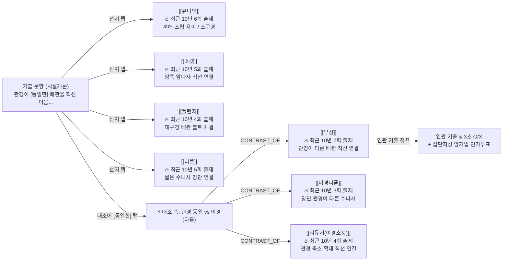

# Power J × 평생 전문가 Second Brain: 「기출 한정 지식 그래프 & 집단지성 암기 위키」 철학 정본

> **문서 성격**: PosMul 전문직 버티컬(1호: Housing-Pro, 향후 공인중개사·세무사·기사·수능 확장)의 궁극적 제품 철학 정본 및 기술·사업 타당성 보고서  
> **작성 기준일**: 2026-11-20  
> **근거 코드베이스**: `apps/housing-pro` (현행 기출 1,400제 · 5,880선지 · 69단원 · 30개 이론 `.md` · Power J PDCA 5탭)

---

## Part 1. 궁극의 서비스 철학 선언 (Ultimate Product Philosophy)

### 1.1 우리의 궁극적 목적
> **"극강의 계획·회독·통계를 사랑하는 `Power J` 수험생이 시험을 가장 과학적으로 정복하고, 합격 이후에는 자신이 깎아놓은 지식 그래프와 법령·실무 도구를 평생의 전문가 `Second Brain`으로 이어 쓰는 하이브리드 O2O 플랫폼."**

주택관리사는 이 거대한 엔진을 검증하는 **첫 번째 버티컬 팩(Vertical Pack #1)**일 뿐이며, 핵심 엔진은 어떤 자격증·전공·시험의 지식 볼트(Obsidian Vault)를 꽂아도 그대로 작동하도록 설계합니다.

---

### 1.2 종이책의 태생적 한계 vs 「꼬리에 꼬리를 무는 기출 지식 그래프」

종이책은 **1차원 선형 매체(p.1 → p.500)**입니다. 문제를 풀다 모르는 용어나 반대 개념이 나와도, 책장을 앞뒤로 20번 넘기며 찾아야 하므로 수험생의 학습 흐름이 끊깁니다.

우리는 **Obsidian Vault의 양방향 내부 링크(`[[개념]]`) + 대조 관계(`CONTRAST_OF`) + 역대 기출 출제 통계**를 결합해, 문제 지문과 선지 그 자체를 **살아있는 지식 그래프 입구**로 바꿉니다.

#### 📌 대표 시나리오: 배관 이음 부속품 꼬리물기 탐색
> **기출 문항**: *"관경이 **`동일한`** 배관을 직선으로 이음하는 데 사용하는 배관 부속품이 아닌 것은?"*  
> ① **`유니언`** · ② **`소켓`** · ③ **`플랜지`** · ④ **`니플`** · ⑤ **`부싱`**

- **선지 개념 탭 (`유니언`, `소켓`, `플랜지`, `니플`)**: 각 부속품의 3줄 핵심 특징·비교표·출제 함정 + **역대 출제 회차 통계** + **해당 키워드가 등장한 기출·O/X 목록** 즉시 노출.
- **대조어 탭 (`동일한`)**: 반의/대조 개념 클러스터(**`관경이 다른(이경)`**)가 열리며 **`부싱` · `이경니플` · `리듀서`**로 자연스럽게 꼬리를 물고 확장.
- **내부 링크 연쇄 탐색 (`부싱` 클릭)**: 부싱의 특징 → 부싱이 정답/오답으로 나온 역대 기출 → 내 `O/★/X` 숙련도까지 1탭 연결.

---

### 1.3 절대 철칙: 「기출 경계 한정 원칙 (Exam-Bounded Knowledge Graph)」

1. **경계 원칙 (Bounded Scope)**: 지식 그래프에 등재되는 모든 노드와 링크는 **오직 기출문제(및 현행 개정 법령)에 실제 출제되었거나, 기출 정답/오답을 가르는 직접 대조 개념**으로만 엄격히 한정합니다.
2. **통계 시각화 (Data-Driven Power J)**: 모든 개념 노드마다 **① 총 출제 횟수 (`N회 출제`)**, **② 출제 회차 이력 (`'19, '22, '24, '26`)**, **③ 최근 3년 추세**, **④ 내 숙련도 (`O/★/X`)**를 숫자로 보여줍니다.
3. **집단지성 암기법 위키 & 인기투표 (Community Mnemonics)**:
   - 개념 노드마다 수험생들이 직접 만든 **두문자·스토리·이미지 암기법**(예: *"**유소플니**는 동경 직선, **부이리**는 이경!"*)을 자유롭게 공유하고 **인기투표(`👍 추천`)**를 할 수 있습니다.
   - 가장 많은 추천을 받은 암기법이 최상단 **베스트 암기법**으로 고정 노출되어, 수험생이 모일수록 지식 그래프의 암기 효율이 기하급수적으로 강해지는 **네트워크 효과 해자**를 구축합니다.
   - *(PosMul 경제 연계 가능: 추후 월간 베스트 암기법 채택 시 코어 SDK 일일 캡 내에서 소액 PMP 참여 보상 확장 가능 — PMC 직접 지급 금지 원칙 준수)*
4. **O2O 하이브리드 & 평생 승계**:
   - 실물 종이책으로 넓게 읽고(QR · AI 스캔 · 키워드 검색 연동), 앱에서는 꼬리물기 지식 그래프 + 암기법 + 3초 O/X + Power J 회독 매트릭스로 빈틈을 0%로 만듭니다.
   - 합격 후 현직 전문가(`소장Pro`)가 되어서도 같은 지식 그래프를 **현장 설비·법령 실무 백과사전(Second Brain)**으로 평생 이어 씁니다.

---

## Part 2. 현행 Housing-Pro vs 궁극의 비전 비교 (As-Is vs To-Be)

| 비교 항목 | 현재 상태 (As-Is) | 궁극의 비전 (To-Be) | 격차 |
| :--- | :--- | :--- | :---: |
| **학습 최소 단위** | 단원(69) → 문항(1,400) → 선지(5,880 `O/★/X`) | 단원 → 문항 → 선지 → **개념 노드(`ConceptNode`) + 대조 엣지(`Edge`)** | 🟡 중 |
| **이론 문서 구조** | `content/theory/` 30개 단원 `.md` (2차 위주) | **Obsidian Vault** 개념별 원자 `.md` (`[[링크]]`, `contrast::`, 전 과목) | 🔴 높음 |
| **문항 ↔ 이론 연결** | 단원 이론 1회 점프 (`TheoryBottomSheet`) | **문장/선지 단어 클릭 → 꼬리물기 스택 드로어 (`ConceptTrailDrawer`)** | 🔴 높음 |
| **대조어 탐색** | 없음 | `CONTRAST_OF` 엣지 + 문장 내 `CONTRAST_TRIGGER` 하이라이트 | 🔴 높음 |
| **집단지성 암기법** | 없음 | **개념 노드별 사용자 암기법 등록 · 실시간 인기투표 (`👍` 정렬)** | 🔴 높음 |
| **출제 통계** | 단원 출제 횟수 & 선지 `repeat_count` | **개념(키워드) 단위 출제 회차 · 트렌드 · 내 취약 개념 맵** | 🟡 중 |
| **Power J 플래너** | PDCA 5탭, 4단계 Depth, 페이지·목표 회독 완료 | 취약 개념 → 1탭 복습/플래너 편입 + 순공 시간 자동 합산 | 🟢 낮음 |

---

## Part 3. 기술적 실행가능성 (Feasibility: 85~90%)

- **핵심 전략**: 런타임 AI 호출(느림·비용·환각)이 아니라 **「Obsidian Vault 정적 저작(Git) + 오프라인 AI 배치 스팬 태깅 + Supabase 그래프/암기법 DB」** 하이브리드 구조로 응답속도 50ms 이내 · 런타임 AI 비용 0원 · 정확도 95%+ 달성.
- **DB 스키마 (`vertical_housing` 확장)**:
  1. `concept_nodes` / `concept_edges` / `question_concept_spans`: 개념·대조관계·문항 오프셋
  2. `concept_mnemonics` / `concept_mnemonic_votes`: 이용자 암기법(두문자·해설) & 중복 방지 인기투표 (`UNIQUE(mnemonic_id, voter_key)`) + RLS 보호.

---

## Part 4. 6대 핵심 리스크 및 가드레일 해법

1. **문맥 오매칭 (`"동일한"` 다의성)** → 과목·단원 컨텍스트 기반 오프라인 배치 스팬 태깅 + 대조 축 명시.
2. **콘텐츠 제작 공수 폭발** → 파레토 법칙(기출 2회 이상 빈출 TOP 300~400 개념 + 대조 쌍 150쌍 우선 구축).
3. **꼬리물기 블랙홀(집중 이탈)** → 기출 0회 노드 금지 + 브레드크럼 깊이 표시 + `[원래 문제로 복귀]` 고정 버튼.
4. **모바일 시각 난잡함** → 풀이 중 밑줄 0개(클린 시험지) → 채점/해설 모드 또는 `[지식링크]` ON 시에만 핵심 5~7개 점선 밑줄.
5. **법령 개정 연쇄 오염** → `law_article_ref` + `verified_year` 메타로 개정 시 연결 노드·선지 일괄 경고 전파.
6. **암기법 스팸/부적절 게시물** → 길이 제한·중복 투표 DB 제약(`UNIQUE`)·신고/숨김 및 인증 유저 작성 가드.

---

## Part 5. 단계별 실행 로드맵

- **Stage 0 (즉시 착수 · PoC)**: `content/vault/housing/` Obsidian Vault 신설 + 시설개론 배관 부속품 지식 그래프(`유니언·소켓·플랜지·니플 ↔ [동일한/이경] ↔ 부싱·이경니플·리듀서` + 방향전환/끝막음 대조) + 모바일 `ConceptTrailDrawer` + **사용자 암기법 등록 & 인기투표(Supabase DB 실연동)** → `/study/solve`, `/study/ox`, `/study/books` 전면 탑재!
- **Stage 1 (2~3주)**: 주택관리사 5과목 기출 2회 이상 빈출 TOP 400 개념 자동 Vault화 + 키워드 출제 빈도 히트맵.
- **Stage 2 (4~6주)**: `/scan` AI 스캔 결과 → 지식 그래프 직결 + `/pro` 현직 소장 현장 Second Brain 검색 오픈.
- **Stage 3 (멀티 버티컬)**: `@posmul/vault-schema` 표준화 → 공인중개사·기사·과학·영어 등 무한 확장.
