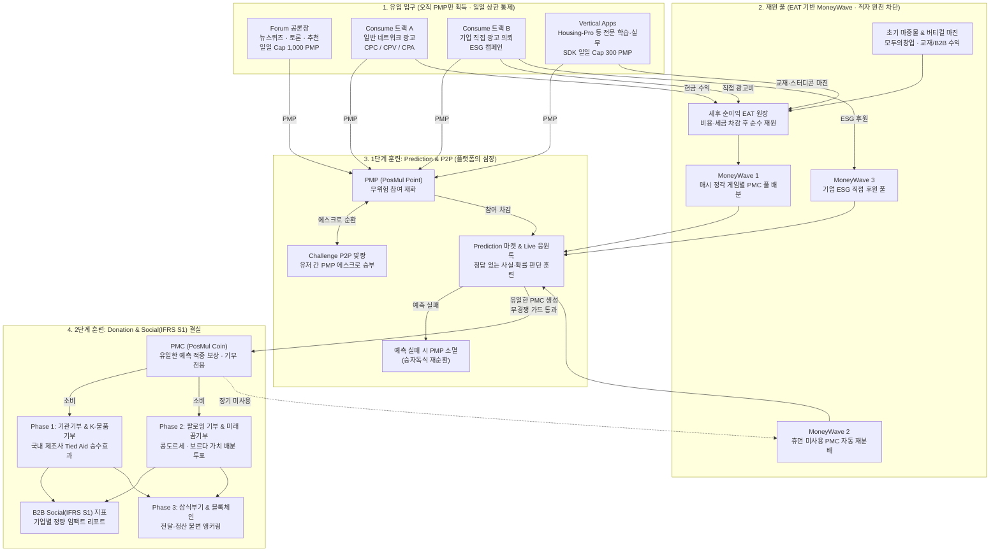

# PosMul 경제 시스템 아키텍처 (2027 Edition)

> **기준일**: 2026-11-17 (2027년 정식 운용 아키텍처)  
> **원본 비교**: [init/economic_system_architecture.md](file:///c:/G/posmul/docs/archive/2026-11-pre-v3/init/economic_system_architecture.md) (v1.0, 2025-11-28)  
> **정본 및 실코드 근거**: [POSMUL_WHITEPAPER.md](file:///c:/G/posmul/docs/POSMUL_WHITEPAPER.md), [DOMAIN_FLOW_AND_DECISIONS.md](file:///c:/G/posmul/docs/DOMAIN_FLOW_AND_DECISIONS.md), [20261113_fix_prediction_settlement_v3_moneywave_pure.sql](file:///c:/G/posmul/supabase/migrations/20261113_fix_prediction_settlement_v3_moneywave_pure.sql), [money-wave-calculator.service.ts](file:///c:/G/posmul/apps/posmul-web/src/shared/economy-kernel/services/money-wave-calculator.service.ts)

---

## 1. 2025 초기 설계 vs 2026 현재 vs 2027 아키텍처 핵심 변경 비교

| 설계 축 | 2025 초기 (`init/` v1.0) | 2026 현재 실구현 (v3.0) | 2027년 완성 목표 |
| :--- | :--- | :--- | :--- |
| **통화 획득 경로** | 돈 투입(`MoneyConsume`/`CloudConsume`/`Other`) 시 **`PMC` 직접 지급** | **입구 단일화**: `Forum` · `Consume(Major)` · `Vertical(Housing-Pro)` 모두 **오직 `PMP`만 지급**. `PMC` 직접 지급은 전면 차단 (`WELCOME_BONUS_PMC = 0`, `Minor`/`Cloud` `403 PHASE_3_LOCKED`) | **입구 단일화 영구 고수** (다중 버티컬/게임 허브 포함 `PMP`만 발행) |
| **`PMC` 발행 통로** | `Expect` + `MoneyConsume` + `CloudConsume` + `Other` (다원화) | **오직 `Prediction` 예측 적중 시에만 유일하게 발행**. 참여자 2인 미만 또는 반대편 풀 0건 시 미발행(`calculate_reward_amount`) | **유일 생성 통로 유지** + `Live` 연계 마켓 포함, 게임당 상한 및 동적 풀 배분 자동화 |
| **`MoneyWave` 재원** | **`EBIT`**(이자·세금 차감 전) 기준 시간별 풀 | **`EAT`(세후 순이익)** 기준 (`POSMUL_ANNUAL_EAT_POOL` / `annual_ebitda` 스냅샷). 마중물(`모두의창업`) + 광고·교재 마진 | **실시간 광고(`CPC/CPV/CPA`) · 버티컬 B2B 정산 → DB `EAT` 자동 연동** + `MoneyWave2/3` 가동 |
| **유저 P2P 순환** | 미정의 | **`Challenge` 맞짱 내기**: `PMP` 에스크로 차감(`deduct_challenge_pmp`), 합의 정산, 오픈 내기 3% 호스트 수수료 | `PMP` 기반 소셜 P2P 챌린지 활성화 (외부 유출 없이 `PMP` 순환 속도 제고) |
| **버티컬 생태계** | 미정의 | **`Housing-Pro`**: 앱 내 학습(O/X·20제·타이머) 및 종이책 AI 비전 스캔(`recordAiScanAndRewardPmp`) → 코어 `economy.pmp_pmc_accounts` 실시간 `PMP` 적립 | 복수 전문직 버티컬(`auth-economy-sdk` 통합 일일 상한 300 PMP 통제) + 교재/스터디콘 B2B 마진 → 중앙 `EAT` 환류 |
| **기부 & 가치 환원** | 직접/기관/오피니언 리더 병렬 나열 | Phase 1: `K-물품 직접기부` + `기관기부` (`pmc_balance` 실제 차감·원장 기록). `팔로잉` 잠금 | Phase 2: `오피니언 리더 팔로잉 기부` + `미래꿈기부(콩도르세·보르다 투표)` + 기업 **`Social(IFRS S1)` 리포트** |

---

## 2. 2027 경제 시스템 전체 순환 구조



---

## 3. 2027년 3대 절대 경제 원칙

### 원칙 1: 입구 단일화 (No Direct PMC on Entry)
- **규칙**: `Forum`, `Consume`, `Vertical Apps`, 회원가입 보너스(`WELCOME_BONUS_PMC = 0`), 개발 보너스 등 **어떤 유입 경로에서도 `PMC`를 직접 지급하지 않습니다.**
- **이유**: 사용자가 돈이나 시간으로 곧바로 기부 코인을 받으면 예측 시장을 통한 **사회적 학습(1단계 의사결정 훈련)** 동기가 약화되고 플랫폼 재원 건전성이 무너집니다.
- **통제**: 모든 외부/버티컬 앱은 `@posmul/auth-economy-sdk`를 통해서만 중앙 `economy.pmp_pmc_accounts`에 `PMP`를 적립하며, 채널별 일일 상한(Cap)이 강제됩니다.
  - `Forum`: `FORUM_DAILY_MAX_PMP = 1000` ([forum-pmp-policy.ts](file:///c:/G/posmul/apps/posmul-web/src/app/forum/forum-pmp-policy.ts))
  - `Vertical Apps`: 일일 최대 `300 PMP` 상한 및 동일 페이지 AI 스캔 1일 1회 중복 방어 (`uq_user_daily_page_scan`)

### 원칙 2: `PMC` 단일 생성 및 승자독식 순수 `MoneyWave` (`EAT` 기준)
- **규칙**: `PMC`는 오직 **`Prediction` 예측 성공 보상으로만 유일하게 생성**됩니다.
- **정산 로직 (`calculate_reward_amount`)**:
  1. 예측 참여 시 트리거(`process_prediction_payment`)로 `PMP`를 즉시 차감·락업하며, 예측 실패 시 건 `PMP`는 전액 소멸(승자독식)됩니다.
  2. **무경쟁/어뷰징 가드**: 참여자 2명 미만(`v_participant_cnt < 2`)이거나 반대편 베팅 풀(`v_losing_pool <= 0`)이 없으면 `PMC`를 발행하지 않습니다(`RETURN 0`).
  3. **순수 `MoneyWave` 풀 배분**: 과거 임의 배수(PMP→PMC 고정 전환, 기본 시드 보너스 등)를 폐기하고, 오직 해당 게임에 시간대별로 누적된 순수 `MoneyWave` 풀(`SUM(pool_pmc)`, 게임당 최대 `20,000 PMC` 상한)을 승자 지분 비율 `(bet_amount / winning_pool)`대로 분배합니다.
- **재원 건전성 (`EBIT` → `EAT`)**:
  - 매출이나 영업이익(`EBIT`) 기준으로 발행할 경우 세금·운영비 부담으로 플랫폼이 적자에 빠집니다.
  - 2027년 버전은 **세후 순이익(`EAT`)** 총량 안에서만 일일·시간별 `MoneyWave1` 상금 풀을 생성합니다.

### 원칙 3: `PMC`의 기부 전용성 & 2단계 가치 배분 훈련
- **규칙**: 획득한 `PMC`는 현금 환전이 불가능하며 오직 **`Donation` 실행**에만 사용됩니다.
- **실행 트랙**:
  - **Phase 1 (가동 중)**: `K-물품 직접기부`(국내 제조사 실물 직배송으로 Tied Aid 승수효과 창출) 및 `마일스톤 검증 NGO 기관기부`(3단계 분할 승인).
  - **Phase 2 (2027 주력 오픈)**: `오피니언 리더 팔로잉 기부`(위임형) 및 `미래꿈기부`(정답 없는 다자 가치 배분에 `analyzeSocialChoiceAggregation` 기반 **콩도르세·보르다 투표** 적용).
  - **Phase 3 (신뢰 인프라 & 로컬)**: `Minor League`(소상공인 지역 연계) 조건부 개방 및 **삼식부기(Triple-Entry Accounting) + 블록체인 앵커링**.

---

## 4. 2027 통화 속성 비교표 (PMP vs PMC)

| 속성 | `PMP` (PosMul Point) | `PMC` (PosMul Coin) |
| :--- | :--- | :--- |
| **경제학적 성격** | 무위험 참여 시드 (Risk-Free Seed, $R_f$ Proxy) | `EAT` 연동 성과·공익 가치 자산 (Risky Asset) |
| **획득 경로** | ① `Forum` 글·댓글·추천·개념글·뉴스퀴즈<br>② `Consume` 광고 시청·설문<br>③ `Vertical` 학습(O/X·20제·타이머·AI스캔) | **오직 `Prediction` 예측 성공 (유일)** |
| **내부 순환** | `Challenge` (P2P 맞짱 내기 에스크로/수수료) | 미사용 장기간 경과 시 **`MoneyWave2` 자동 재분배** |
| **사용처 / 소멸** | `Prediction` 참여 (실패 시 소멸 = 승자독식) | `Donation` 전용 (`pmc_balance` 차감 + 원장 기록) |
| **발행 한도** | 도메인별 일일 획득 상한(Cap) 엄격 통제 | 플랫폼 세후 순이익(`EAT`) + 게임당 `20,000 PMC` 상한 |

---

## 5. 2027 MoneyWave 3단 엔진 상세

### 5.1 MoneyWave 1 — `EAT` 기반 시간별 정각 배분
```text
연간 순이익 풀(EAT) = (광고 순수익 + 버티컬 B2B 마진 + 초기 시드) - 운영비 - 법인세
일일 기본 풀 = 연간 EAT / 365
시간별 풀 = (일일 기본 풀 / 24) × 시간대 활성도 가중치
```
- **2027 고도화 과제**: `POSMUL_ANNUAL_EAT_POOL` 환경변수 및 수동 `annual_ebitda` 스냅샷 단계에서 나아가, 실제 `CPC/CPV/CPA` 광고 정산 수익과 `Housing-Pro` 교재/스터디콘 순마진이 `economy.money_wave_daily_snapshots`로 자동 집계·반영되도록 연결합니다.

### 5.2 MoneyWave 2 — 손실회피(Loss Aversion) 기반 미사용 `PMC` 환류
- 일정 기간(예: 90일) 이상 `Donation`에 사용되지 않고 잠자고 있는 `PMC`는 보유자에게 사전 알림 후 일정 비율을 회수하여 활성 `Prediction` 상금 풀로 재투입합니다.
- 행동경제학의 **손실회피 성향**을 활용해 `PMC`가 지갑에 고이지 않고 실제 기부 임팩트로 빠르게 회전하도록 유도합니다.

### 5.3 MoneyWave 3 — 기업 직접 광고 & `Social(IFRS S1)` B2B 엔진
- **트랙 A (일반 네트워크 광고)**: 트래픽 기반 순수 현금 `EAT` 공급용.
- **트랙 B (기업 직접 의뢰)**: 기업이 캠페인/예측 주제를 후원하면, PosMul은 시민 참여 지표(의사결정 훈련 시간, 참여자 수)와 해당 재원에서 파생된 실제 `K-물품` 기부 결과를 결합해 **기업별 `IFRS S1` 공시 대응 정량 `Social` 리포트**를 발급합니다.

---

## 6. DB 스키마 및 핵심 원장 구조 (실코드 기준)

| 스키마 | 주요 역할 | 핵심 테이블 / RPC |
| :--- | :--- | :--- |
| **`economy.*`** | 중앙 단일 진실 공급원(SSOT) 원장 | `pmp_pmc_accounts`, `pmp_pmc_transactions`, `money_wave_daily_snapshots`, `money_wave_hourly_game_pools` |
| **`prediction.*`** | 1단계 훈련 및 P2P 맞짱 에스크로 | `prediction_games`, `predictions`, `prediction_settlements`, `user_challenges`, `user_challenge_bets` / RPC `calculate_reward_amount`, `settle_prediction_game`, `deduct_challenge_pmp` |
| **`forum.*`** | 공론장, 아고라, 뉴스룸 보상 | `forum_posts`, `forum_comments`, `forum_prediction_links` |
| **`donation.*`** | 2단계 훈련 및 실물/기관 기부 | `funding_wishlist_requests`, `donation_transactions`, `institutes` |
| **`vertical_housing.*`** | 최초 버티컬 앱 학습·실무 원장 | `exam_questions`, `exam_options`, `option_mastery`, `ai_scan_logs`, `book_serials`, `legal_obligations`, `study_cones` |
| **`feed.*`** | 트랙 B 공공기관 RSS/AI 뉴스 파이프라인 | 공공 보도자료 수집 및 예측/뉴스 생성 원천 데이터 |

---

*2025 v1.0 (`init/economic_system_architecture.md`) 대비 2027 정식 개편 완료.*
