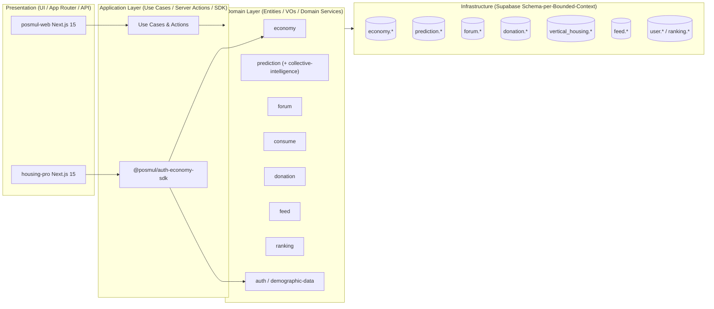

# PosMul 플랫폼 전체 아키텍처 다이어그램 (2027 Edition)

> **기준일**: 2026-11-17 (2027년 멀티 앱 · 버티컬 확장 아키텍처)  
> **원본 비교**: [init/project_diagram.md](file:///c:/G/posmul/docs/archive/2026-11-pre-v3/init/project_diagram.md) (2025-11-28)  
> **실코드 기준**: `apps/posmul-web` · `apps/housing-pro` · `packages/auth-economy-sdk` · [POSMUL_FRIENDS_WORLDVIEW.md](file:///c:/G/posmul/docs/POSMUL_FRIENDS_WORLDVIEW.md)

---

## 1. 2025 초기 다이어그램 vs 2027 다이어그램 주요 변화

| 영역 | 2025 `init/project_diagram.md` | 2027 다이어그램 (`2027/`) |
| :--- | :--- | :--- |
| **플랫폼 구조** | 단일 웹 플랫폼 개념 (`Consume`, `Expect`, `Donate`, `Forum`, `Others`, `Ranking`) | **멀티 앱 모노레포**: 코어 `posmul-web` + 버티컬 `housing-pro`(수험/소장Pro) + 향후 버티컬 앱들이 **`auth-economy-sdk` & 통합 SSO**로 연결 |
| **통화 화살표** | `MoneyConsume` / `CloudConsume` / `Others` → **`PMC` 직결** | 모든 유입(`Forum`, `Consume`, `Vertical`) → **오직 `PMP`만 연결** / `Prediction` → **유일한 `PMC` 생성 화살표** |
| **재원 & 정산** | `예상 EBIT` → `Money Wave` → `Expect` | **`EAT`(세후 순이익)** → `MoneyWave 1/2/3` → `Prediction`(무경쟁 가드 & 20,000 PMC 상한) |
| **신규 도메인** | 미포함 | **`Live`(실시간 응원톡 매치룸)**, **`Challenge`(P2P 맞짱 내기)**, **`Healing Room`(창작 아틀리에)**, **`PosMul Friends 7인`**, **`Feed`(트랙 B 공공 RSS)** |
| **기부 세분화** | `Direct`, `Organization`, `Opinion Leaders` | Phase 1(`K-물품 직배송` · `마일스톤 NGO`) + Phase 2(`팔로잉 기부` · `미래꿈기부 콩도르세/보르다`) |

---

## 2. 2027 전체 시스템 플로우 & 도메인 연결도

```mermaid
graph TB
    %% === 멀티 앱 및 사용자 인터페이스 ===
    subgraph APPS["📱 PosMul 멀티 앱 생태계 & 통합 SSO"]
        direction LR
        WEB["🌐 posmul-web\n코어 시민 플랫폼"]
        HPRO["🏢 housing-pro (posmul-pro)\n주택관리사 수험 O2O · 소장 Pro"]
        SDK["🔐 @posmul/auth-economy-sdk\n통합 SSO · 중앙 원장 · Cap 통제"]
        UI_EX["🎨 UI · MyPage · Wallet\nGate · Healing Room · Friends 7인"]
    end
    style WEB fill:#e3f2fd,stroke:#64b5f6,stroke-width:2px,color:#000
    style HPRO fill:#e8f5e9,stroke:#66bb6a,stroke-width:2px,color:#000
    style SDK fill:#eceff1,stroke:#78909c,stroke-width:2px,color:#000
    style UI_EX fill:#ede7f6,stroke:#9575cd,stroke-width:2px,color:#000

    %% === 유입 도메인 (오직 PMP 획득) ===
    subgraph INFLOW["⚡ 유입 엔진 (시간·참여 투입 → 오직 PMP만 획득)"]
        direction TB
        subgraph FOR_SUB["💬 Forum (일일 Cap 1,000 PMP)"]
            NEWS["📰 AI 뉴스룸 & 퀴즈\n(트랙 B 공공 RSS)"]
            BUDGET["⚖️ 국가·지역 Budget"]
            AGORA["🗣️ Agora\n토론·브레인스토밍·제안"]
        end
        subgraph CON_SUB["🛒 Consume (광고 2트랙)"]
            MAJ["🎬 Major League\n네트워크·직접 광고 시청"]
            MIN["🏪 Minor League\nPhase 3 예정"]
            CLD["💡 Cloud Funding\nPhase 3 예정"]
        end
        subgraph VERT_SUB["📚 Vertical (일일 Cap 300 PMP)"]
            STUDY["📝 스와이프 O/X · 20제 · 타이머"]
            SCAN["📸 종이책 AI 비전 스캔"]
            PRO_V["🛠️ 소장 Pro 법정 점검"]
        end
    end
    style MAJ fill:#fff3e0,stroke:#ffb74d,stroke-width:1px,color:#000
    style MIN fill:#f5f5f5,stroke:#bdbdbd,stroke-dasharray: 5 5,color:#666
    style CLD fill:#f5f5f5,stroke:#bdbdbd,stroke-dasharray: 5 5,color:#666
    style NEWS fill:#fff3e0,stroke:#ffb74d,stroke-width:1px,color:#000
    style BUDGET fill:#fff3e0,stroke:#ffb74d,stroke-width:1px,color:#000
    style AGORA fill:#fff3e0,stroke:#ffb74d,stroke-width:1px,color:#000
    style STUDY fill:#fff3e0,stroke:#ffb74d,stroke-width:1px,color:#000
    style SCAN fill:#fff3e0,stroke:#ffb74d,stroke-width:1px,color:#000
    style PRO_V fill:#fff3e0,stroke:#ffb74d,stroke-width:1px,color:#000

    %% === 코어 경제 & 1단계 훈련 ===
    subgraph ECON_PRED["💰 중앙 경제 & 1단계 사실판단 훈련"]
        PMP["🪙 PMP (Risk-Free)\n무위험 참여 재화"]
        EAT["💵 EAT 원장 (세후 순이익)\n광고 + 교재마진 + 마중물"]
        MW1["🌊 MoneyWave 1\n정각 게임별 PMC 풀"]
        MW2["🌪️ MoneyWave 2\n휴면 PMC 재분배"]
        MW3["🏢 MoneyWave 3\n기업 ESG 직접 후원"]

        subgraph PRED_SUB["🔮 Prediction (플랫폼 심장)"]
            P_CAT["6대 예측 마켓\n경제·소비·스포츠·엔터·정치·제안"]
            LIVE["📺 Live 실시간 응원톡"]
            CHAL["🥊 Challenge P2P 맞짱\n(PMP 에스크로)"]
        end
        PMC["💎 PMC (Risky / Impact)\n유일 예측 성공 보상 · 기부 전용"]
    end
    style PMP fill:#fff3e0,stroke:#ff9800,stroke-width:2px,color:#000
    style PMC fill:#f3e5f5,stroke:#ab47bc,stroke-width:2px,color:#000
    style EAT fill:#e0f7fa,stroke:#26c6da,stroke-width:2px,color:#000
    style MW1 fill:#e0f2f1,stroke:#26a69a,stroke-width:1px,color:#000
    style MW2 fill:#e0f2f1,stroke:#26a69a,stroke-width:1px,color:#000
    style MW3 fill:#e0f2f1,stroke:#26a69a,stroke-width:1px,color:#000
    style P_CAT fill:#fce4ec,stroke:#ec407a,stroke-width:2px,color:#000
    style LIVE fill:#fce4ec,stroke:#ec407a,stroke-width:1px,color:#000
    style CHAL fill:#fff8e1,stroke:#ffa000,stroke-width:1px,color:#000

    %% === 2단계 훈련 & 결실 ===
    subgraph OUTFLOW["💝 2단계 가치배분 훈련 (Donation) & 결실"]
        subgraph DON_SUB["Donation (PMC 전용 소비)"]
            KGOODS["📦 K-물품 직접기부\n(위시리스트 · Tied Aid)"]
            INST["🏛️ 마일스톤 검증 NGO\n(30%→40%→30% 에스크로)"]
            FOLLOW["🌟 팔로잉 기부 (Phase 2)\n유동적 민주주의 위임"]
            DREAM["🌱 미래꿈기부 (Phase 2)\n콩도르세 · 보르다 투표"]
        end
        subgraph TRUST_EX["결실 · 투명성 · 리텐션"]
            RNK["🏆 Ranking\n전국·시도·시군구·읍면동"]
            OTH["🧾 Other\nGift Aid · 세무회계 원장"]
            IFRS["📊 B2B Social (IFRS S1)\n기업 임팩트 리포트"]
            HEAL["🌙 Healing Room\n창작 아틀리에 · 트로피"]
            TRIPLE["⛓️ Phase 3 신뢰인프라\n삼식부기 · 블록체인"]
        end
    end
    style KGOODS fill:#f3e5f5,stroke:#ba68c8,stroke-width:1px,color:#000
    style INST fill:#f3e5f5,stroke:#ba68c8,stroke-width:1px,color:#000
    style FOLLOW fill:#f5f5f5,stroke:#bdbdbd,stroke-dasharray: 5 5,color:#666
    style DREAM fill:#f5f5f5,stroke:#bdbdbd,stroke-dasharray: 5 5,color:#666
    style RNK fill:#cfd8dc,stroke:#78909c,stroke-width:1px,color:#000
    style OTH fill:#cfd8dc,stroke:#78909c,stroke-width:1px,color:#000
    style IFRS fill:#e8eaf6,stroke:#5c6bc0,stroke-width:1px,color:#000
    style HEAL fill:#ede7f6,stroke:#7e57c2,stroke-width:1px,color:#000
    style TRIPLE fill:#f5f5f5,stroke:#bdbdbd,stroke-dasharray: 5 5,color:#666

    %% === 연결 관계 ===
    WEB <--> SDK
    HPRO <--> SDK
    UI_EX --> WEB

    FOR_SUB -->|"시간·기여 → +PMP"| PMP
    MAJ -->|"광고 시청 → +PMP"| PMP
    VERT_SUB -->|"학습·스캔 → +PMP"| PMP

    MAJ -->|"광고 수익"| EAT
    CON_B[" "]
    VERT_SUB -->|"교재·콘 마진"| EAT

    EAT --> MW1
    MW1 -->|"상금풀 배분"| P_CAT
    MW2 -->|"재분배 풀"| P_CAT
    MW3 -->|"ESG 풀"| P_CAT

    PMP -->|"참여 (실패 시 소멸)"| P_CAT
    PMP <-->|"에스크로 승부"| CHAL
    P_CAT <-->|"실시간 응원"| LIVE
    AGORA -.->|"추천 임계 돌파 승격"| P_CAT

    P_CAT -->|"예측 성공 (유일 경로)"| PMC
    PMC -->|"미사용 회수"| MW2
    PMC -->|"기부 실행"| KGOODS
    PMC -->|"기부 실행"| INST
    PMC -->|"기부 실행 (P2)"| FOLLOW
    PMC -->|"기부 실행 (P2)"| DREAM

    KGOODS --> IFRS
    INST --> IFRS
    DON_SUB --> RNK
    DON_SUB --> OTH
    DON_SUB --> HEAL
    DON_SUB -.-> TRIPLE
```

---

## 3. Clean Architecture & DDD Bounded Contexts 구조 (2027)

실코드(`apps/posmul-web/src/bounded-contexts/` + `apps/housing-pro`)의 스키마 격리 구조입니다.

---

## 4. 포스멀 프렌즈 7인 세계관 순환 매핑

PosMul 2027에서는 7인 공식 캐릭터가 각 도메인의 가이드 역할을 맡아 인지 부담을 낮추고 리텐션을 연결합니다 ([POSMUL_FRIENDS_WORLDVIEW.md](file:///c:/G/posmul/docs/POSMUL_FRIENDS_WORLDVIEW.md) 기준).

| 캐릭터 | 담당 도메인 | 연결 흐름 |
| :--- | :--- | :--- |
| **모아 (Moa)** | `/consume` (가치 소비) | 시간·광고 소비로 `PMP` 햇살 에너지 생성 |
| **아고 (Ago)** | `/forum` (공론장·뉴스) | 뉴스·토론·예산 숙의로 `+PMP` 및 아고라 의제 발굴 |
| **웨이비 (Wavy)** | `/economy` (경제·지갑) | 매시 정각 `EAT` 기반 `MoneyWave` 상금풀 순환 |
| **올리 (Ollie)** | `/prediction` (예측 마켓) | `PMP`로 데이터 예측(1단계 훈련) → `PMC` 전환 |
| **범이 (Beomi)** | `/ranking`, `/challenge`, `/live` | 실시간 응원톡·맞짱 승부 & 전국/지역 명예의 전당 |
| **온기 (Ongi)** | `/donation` (기부·나눔) | `PMC`를 현실의 K-물품·기관 기부로 배달 (2단계 훈련) |
| **루미 (Roomie)** | `/healing-room` (힐링룸) | 기부 트로피 전시, 비상업 AI 창작 아틀리에 & 휴식 |
