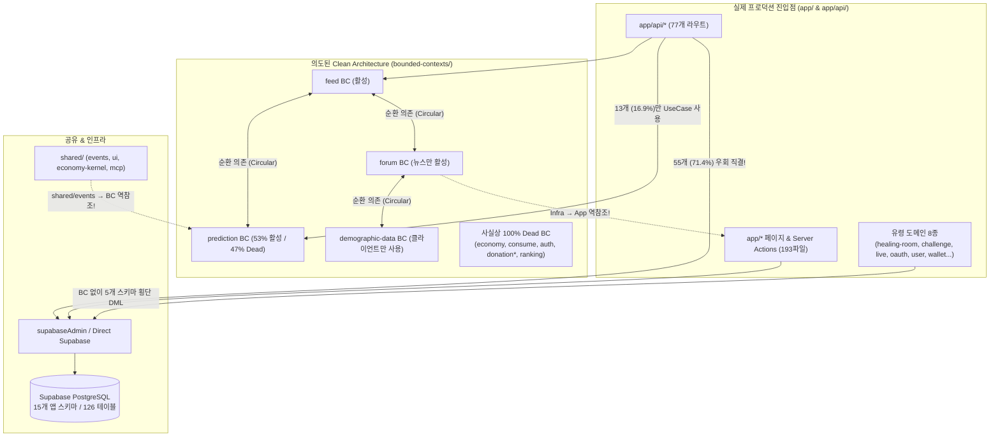

# PosMul 모노레포 종합 아키텍처 · DDD · Clean Architecture · Supabase DB 정밀 감사 보고서

> **감사 일시**: 2026-11-19  
> **대상 브랜치 / 환경**: `develop` (`c:\G\posmul`) + 라이브 Supabase 프로젝트 `posmul` (`fabyagohqqnusmnwekuc`, PostgreSQL 17.4.1.064, `ap-northeast-2`)  
> **기준 문서**: [POSMUL_WHITEPAPER.md](file:///c:/G/posmul/docs/POSMUL_WHITEPAPER.md) (v3.0), [DOMAIN_FLOW_AND_DECISIONS.md](file:///c:/G/posmul/docs/DOMAIN_FLOW_AND_DECISIONS.md), [Posmul_projectrule.md](file:///c:/G/posmul/.agent/rules/Posmul_projectrule.md), [Posmul_tdd-rules.md](file:///c:/G/posmul/.agent/rules/Posmul_tdd-rules.md)  
> **감사 범위**: 전수 조사 (스킵 없음) — `apps/posmul-web` (697파일), `apps/housing-pro` (69파일), `packages/auth-economy-sdk` (24파일), `supabase/` (로컬 2 Edge Function + 6 Migration), 원격 Supabase DB (179 테이블, 87 함수, 175 마이그레이션, 3 Edge Function, RLS/성능 어드바이저, pg_cron)  
> **시정 상태**: **`.agent` v3.1 재정비 + Phase 0 ~ Phase 3 전 항목 완료 및 검증 완료 (2026-11-19, `develop` 브랜치)**

---

## 0. Phase 0 ~ Phase 3 시정 조치 완료 현황 (2026-11-19 실측)

본 보고서에서 도출된 핵심 결함에 대해 `.agent` 에이전트 지침 전면 재정비 및 **Phase 0(긴급 보안·RLS 핫픽스) → Phase 1(금융 원장 원자화·계약 복구·Edge Function 동기화) → Phase 2(DDD/CA 순환 의존 절단·Dead 파일 청산·SDK 재정비) → Phase 3(DB 성능 인덱스·테스트/린트/설정 위생 정리)**를 순차 완료하고, 라이브 Supabase MCP 어드바이저·타입체크·Jest·양대 앱 프로덕션 빌드로 실측 검증을 마쳤습니다.

### Before → After 정량 지표 비교

| 항목 | 감사 시점 (Before) | Phase 0~3 완료 (After) | 비고 |
| --- | :---: | :---: | --- |
| **RLS 미활성 앱 테이블 (`rls_disabled_in_public`)** | 7건 (public 3 + 비공개 4) | **0건** | 전 테이블 RLS 활성화 완료 (`20261119123000`) |
| **무조건 허용 RLS (`rls_policy_always_true`)** | 다수 치명적 구멍 | **0건** | 공짜 베팅·예측 사후 조작·시리얼 유출 전면 차단 |
| **`anon` 호출 가능 `SECURITY DEFINER` RPC** | **40건** | **3건** | 공개 읽기 3종(`calculate_current_odds`, `get_active_games`, `get_economy_stats`)만 허용 |
| **`authenticated` 호출 가능 `SECURITY DEFINER` RPC** | **40건+** | **6건** | 공개/인증 읽기 5종 + `auth.uid()` 검증 베팅 1종만 허용 |
| **`function_search_path_mutable` 경고** | 1건 | **0건** | `touch_user_prediction_stats_updated_at` 고정 완료 |
| **중복 인덱스 (`duplicate_index`)** | 4건 | **0건** | `donation` 1건 + `study_cycle` 3건 제거 (`20261119133000`) |
| **미인덱싱 외래키 (`unindexed_foreign_keys`)** | 21건 | **6건** | 핵심 FK 15건 커버링 인덱스 생성 완료 |
| **유령/무인증 Edge Function** | `auto-settle-games`(유령), `auto-settle`(미동기), `moneywave` v3 불일치 | **전량 동기화 + `verify_jwt: true`** | `auto-settle-games` 410 비활성화, `moneywave` v4 원격·로컬 일치 |
| **원장 원자화 & 무단 민팅 차단** | 비원자 read-modify-write + 신규 계정 1,000 PMC 무단 지급 | **원자 RPC + `0 PMC` 시작** | `grant_forum_pmp_capped`, `grant_vertical_pmp_capped`, `execute_ledger_transaction` 교정 |
| **DDD/CA 순환 의존 & 역참조** | `feed↔prediction`, `shared→BC`, `BC→app`, `forum→prediction` | **0건 (기계적 ESLint 가드레일 도입)** | `shared/domain/region`, `shared/infrastructure/llm` 승격 + `no-restricted-imports` |
| **Dead/쓰레기 파일 & 가짜 테스트** | Dead 파일 7개 + 껍데기 테스트 8개 | **15개 전량 삭제 + 실질 테스트 2개 신설** | `DeletePredictionGameUseCase` 권한 테스트 + SDK 경제 유틸 테스트 추가 |
| **`@posmul/auth-economy-sdk` 타입 엄격성** | `strict` 미설정 + 6개월 전 타입 + `PmpAmount` 오타 | **`strict: true` 0 error + 2026-11-19 최신 DB 타입** | 크로스 런타임 `crypto.randomUUID()` 순수화 + 환율 `10:1` 통일 |
| **Gate 1 검증 (`type-check` · Jest · `next build`)** | 가짜 테스트 포함 45 suites | **3개 패키지 `tsc` 0 error · 39 suites / 431 tests PASS · 양대 앱 `next build` PASS** | `posmul-web`(106p) + `housing-pro`(23p) 프로덕션 빌드 통과 |

### 적용된 DB 마이그레이션 (원격 적용 & 로컬 Git 동기화 완료)
1. [20261119123000_phase0_security_rls_and_rpc_hardening.sql](file:///c:/G/posmul/supabase/migrations/20261119123000_phase0_security_rls_and_rpc_hardening.sql) — Phase 0 RLS·RPC 보안 하드닝
2. [20261119130000_phase1_atomic_ledger_and_settlement_fixes.sql](file:///c:/G/posmul/supabase/migrations/20261119130000_phase1_atomic_ledger_and_settlement_fixes.sql) — Phase 1 원장 원자화·KST 일일 상한·정산/이의제기·트리거 정리
3. [20261119133000_phase3_db_performance_and_hygiene.sql](file:///c:/G/posmul/supabase/migrations/20261119133000_phase3_db_performance_and_hygiene.sql) — Phase 3 중복 인덱스 제거·핵심 FK 15건 인덱싱

### 후속 중장기 과제 (운영/인프라 단계)
- Supabase 대시보드에서 **Postgres 17.4.1 보안 패치 업그레이드** 및 **Auth Leaked Password Protection(HaveIBeenPwned)** 활성화
- `apps/posmul-web/tsconfig.json`의 `"strict": true` 점진적 전환 및 잔존 `any` 축소
- 원격 DB 175개 과거 마이그레이션의 베이스라인 스키마 덤프(`supabase db dump`)를 통한 로컬 재현성 100% 확보
- `economy.pmp_pmc_accounts` 고아 계정 101건의 비즈니스 정산/정리 여부 정책 결정 후 일괄 아카이빙

---

## 목차
0. [Phase 0 ~ Phase 3 시정 조치 완료 현황 (2026-11-19 실측)](#0-phase-0--phase-3-시정-조치-완료-현황-2026-11-19-실측)
1. [총괄 요약 (Executive Summary & 종합 성적표)](#1-총괄-요약-executive-summary--종합-성적표)
2. [코드베이스 전수 정량 메트릭](#2-코드베이스-전수-정량-메트릭)
3. [긴급(P0) 보안 · 금전 원장 · DB 취약점 전수 목록](#3-긴급p0-보안--금전-원장--db-취약점-전수-목록)
4. [DDD & Clean Architecture 준수 여부 정밀 감사](#4-ddd--clean-architecture-준수-여부-정밀-감사)
5. [`apps/posmul-web` 9개 Bounded Contexts 전수 심층 분석](#5-appsposmul-web-9개-bounded-contexts-전수-심층-분석)
6. [유령 도메인(Shadow Domains) 8종 & `shared/` · `lib/` 감사](#6-유령-도메인shadow-domains-8종--shared--lib-감사)
7. [`apps/housing-pro` & `packages/auth-economy-sdk` 전수 분석](#7-appshousing-pro--packagesauth-economy-sdk-전수-분석)
8. [Supabase 라이브 DB 정밀 감사 (MCP 실측)](#8-supabase-라이브-db-정밀-감사-mcp-실측)
9. [Edge Functions · Migrations · 테스트 · 빌드/린트/CI 인프라 감사](#9-edge-functions--migrations--테스트--빌드린트ci-인프라-감사)
10. [v3.0 정본 백서 대비 코드·DB 정합성 갭(Gap) 분석](#10-v30-정본-백서-대비-코드db-정합성-갭gap-분석)
11. [단계별 시정 로드맵 & 검토용 DB Remediation SQL 초안](#11-단계별-시정-로드맵--검토용-db-remediation-sql-초안)

---

## 1. 총괄 요약 (Executive Summary & 종합 성적표)

PosMul은 **총 792개 TS/TSX 파일, 약 25만 줄(250,770 LoC)** 규모의 대형 모노레포이며, 126개 앱 테이블(15개 앱 스키마)과 87개 PostgreSQL 함수로 구성된 방대한 플랫폼입니다.  
전수 정적 분석·코드 정독·라이브 Supabase DB 실측 결과, **핵심적인 구조적 진단**은 다음 4문장으로 요약됩니다.

1. **"이중 세계(Split-Brain) 아키텍처"**: 설계상으로는 `bounded-contexts/` 아래 9개 DDD 도메인과 Clean Architecture 4계층을 갖추었으나, 실제 프로덕션 트래픽(`app/`, `app/api/` 77개 라우트)의 **71.4%(55개)가 DDD/Application 레이어를 완전히 우회하여 `supabaseAdmin`으로 DB에 직결**하고 있습니다. 그 결과 9개 BC 중 **`economy`(100% Dead), `consume`(100% Dead), `auth`(app 참조 0건), `donation`(UseCase/Repo 0건), `ranking`(Hook 1개 껍데기)**가 런타임에서 사실상 사문화되었고, 핵심인 **`prediction`마저 파일 기준 46.9%(13,273줄)가 Dead Code**입니다.
2. **치명적(P0) DB·보안·원장 취약점 다수 라이브 노출**:
   - PostgREST 노출 스키마(`pgrst.db_schemas`)에 `economy`, `prediction`, `public`, `oauth_provider`, `cron`이 모두 열린 상태에서 **40개의 `SECURITY DEFINER` DB 함수**(`economy.grant_pmc`, `economy.grant_pmp`, `economy.execute_ledger_transaction`, `public.grant_pmc`, `prediction.trigger_http_cron` 등)가 **비로그인 `anon` 롤에서 직접 실행 가능**합니다.
   - **7개 앱 테이블에 RLS가 꺼져 있고**(`oauth_provider.{clients, auth_codes, tokens}`, `prediction.scheduler_config`, `user.healing_rooms`, `user.healing_room_guestbooks`, `vertical_housing.theory_sections`), **`prediction.user_challenge_bets` 공짜 베팅**, **`prediction.predictions` 정산 직전 `UPDATE` 조작**, **`vertical_housing.book_serials` 미등록 정품 시리얼 전량 유출**, **무인증 무한 원장 민팅(`POST /api/user/profile`)**, **이메일 `"admin"` 문자열 포함 시 타인 글/댓글 삭제(`gallery.actions.ts`)**, **예측 철회 3중 경로의 PMP 무한 이중 환불 Race Condition**, **로컬에 없는 원격 유령 Edge Function `auto-settle-games`(`verify_jwt: false`)** 등이 확인되었습니다.
3. **코드 ↔ DB 스키마/RPC 계약 파손 및 데이터 오염**:
   - 코드가 호출하지만 **라이브 DB에 존재하지 않는 RPC 9종**(특히 `@posmul/auth-economy-sdk`의 `transfer_pmp`, `transfer_pmc`, `reward_pmc_for_prediction`, `award_study_reward`) 및 **미존재 테이블/뷰 참조 21건**이 확인되었습니다.
   - `economy.pmp_pmc_accounts` 129건 중 **101건(78.3%)이 `auth.users`에 없는 고아 계정**(총 2,619만 PMP / 1,181만 PMC)으로 전체 경제 통계를 10배 이상 왜곡하고 있습니다.
   - 원격 DB에는 **175개 마이그레이션**이 적용되어 있으나 Git 로컬 `supabase/migrations/`에는 **6개**만 남아 있어 재해 복구(DR) 및 로컬 재현이 불가능합니다.
4. **품질 게이트의 명목화(Paper Gates)**:
   - 규칙상 `TypeScript Strict`와 `any` 금지를 천명했으나, 실제로는 **`apps/posmul-web/tsconfig.json`이 `"strict": false`**, **`packages/auth-economy-sdk/tsconfig.json`도 `strict` 누락**이며 비테스트 코드에만 **`any` 422건**이 존재합니다.
   - 양대 앱(`posmul-web`, `housing-pro`) 모두 `next.config`에 `eslint: { ignoreDuringBuilds: true }`가 걸려 있으며, Jest 단위 테스트(45 suites / 506 tests 통과) 중 8개 파일은 프로덕션 코드 import가 0줄이거나 `toBeDefined()`만 검사하는 껍데기 테스트이며, `consume`·`demographic-data`·`ranking`·`housing-pro`·`auth-economy-sdk`·API Route 77개는 테스트가 **0건**입니다.

### 종합 평가 스코어카드

| 평가 영역 | 등급 | 점수(100) | 핵심 근거 |
|---|:---:|:---:|---|
| **DDD 전략적 설계 (BC 경계·Schema 격리)** | **D+** | 38 | Schema-per-BC 방향성은 우수하나 8개 유령 도메인, Cross-BC 35건(순환 3개), `public` 고아 8테이블, 3중 사용자 테이블 분열 |
| **DDD 전술적 설계 (Aggregate·VO·Event·Repo)** | **D** | 32 | `collective-intelligence-engine` 등 일부 우수 자산 존재하나, 다수 Aggregate 상태머신 파손·Reconstitution 부재·Event 100% 유실·스텁 Repo |
| **Clean Architecture (의존성 역전·계층 격리)** | **D** | 35 | API Route 71.4% 우회, Application→Infra 28건, Shared→BC 3건, Infra→App 1건, `housing-pro` CA 미적용(God File 3,828줄) |
| **보안 & 금융 원장 무결성 (Security / Ledger)** | **F (긴급)** | 18 | `anon` 실행 가능 금전 RPC 40개, RLS OFF 7테이블, 무인증 원장 민팅/업로드, IDOR 다수, 비원자적 잔액 갱신 & 이중 환불 Race |
| **DB 설계 & 코드-DB 정합성** | **C-** | 45 | 멀티스키마 구조화 시도 긍정적이나 원격 175 vs 로컬 6 마이그레이션, 고아 계정 78.3%, 미존재 RPC 9개/테이블 21건, 성능 Lints 259건 |
| **코드 품질 · 타입 안전 · 테스트 · CI** | **D+** | 40 | `strict: false`, `any` 422건, `ignoreDuringBuilds: true`, ESLint 3중 충돌, 핵심 5영역 테스트 0건, E2E 구버전 라우트 파손 |
| **종합 아키텍처 건전성** | **D** | **35** | **비즈니스 비전과 도메인 아이디어는 탁월하나, 빠른 기능 확장 과정의 기술 부채·보안 구멍·이중화 코드의 대대적 정리 시급** |

---

## 2. 코드베이스 전수 정량 메트릭

### 2.1 워크스페이스 영역별 규모 (실측)

| 영역 | 프로덕션 파일 | 테스트 파일 | 총 코드 라인(LoC) | 비테스트 `any` 건수 |
|---|---:|---:|---:|---:|
| `apps/posmul-web/src/bounded-contexts` | 339 | 41 | 115,239 | 187 |
| `apps/posmul-web/src/app` (페이지/액션) | 193 | 1 | 62,115 | 104 |
| `apps/posmul-web/src/app/api` (API Routes) | 77 | 0 | 14,671 | 75 |
| `apps/posmul-web/src/shared` | 80 | 4 | 13,746 | 53 |
| `apps/posmul-web/src/lib` & `middleware.ts` | 8 | 0 | 620 | 0 |
| `apps/housing-pro/src` | 69 | 0 | 40,303 | 3 |
| `packages/auth-economy-sdk/src` | 24 | 0 | 3,571 | 0 |
| `supabase/functions` (로컬) | 2 | 0 | 505 | 0 |
| **합계** | **792 (프로덕션 746 + 테스트 46)** | **46** | **250,770** | **422** |

> 부가 정적 지표 (비테스트 코드): `@ts-ignore` **4건**, `@ts-expect-error` **0건**, `eslint-disable` **59건**, `console.log` **23건**.

### 2.2 `apps/posmul-web` 9개 Bounded Context 계층별 분포 및 실사용률

| Bounded Context | Domain | App | Infra | Pres | 기타 | 테스트 | 총 라인 | `app/` 도달성(실사용) 상태 |
|---|---:|---:|---:|---:|---:|---:|---:|---|
| **`prediction`** | 20 | 25 | 19 | 64 | 2 | 11 | 38,472 | **부분 활성 (Live 53.1% / Dead 46.9%)** |
| **`economy`** | 28 | 16 | 8 | 4 | 1 | 18 | 30,044 | **100% Dead (`app/` 도달 0줄)** |
| **`donation`** | 12 | 5 | 5 | 9 | 1 | 4 | 13,833 | **95%+ Dead** (원장 유틸 1개 + UI 카드 2개만 사용) |
| **`forum`** | 6 | 4 | 3 | 8 | 1 | 2 | 11,158 | **뉴스 경로만 활성** (게시판/댓글/추천/보상은 100% 우회) |
| **`consume`** | 22 | 13 | 4 | 6 | 1 | 0 | 10,632 | **100% Dead (`app/` import 0건)** |
| **`feed`** | 7 | 5 | 10 | 0 | 1 | 2 | 5,353 | **활성 (유일하게 파이프라인이 DI/UseCase 사용)** |
| **`auth`** | 8 | 2 | 5 | 3 | 0 | 4 | 3,577 | **사실상 Dead** (타 BC 타입 참조만, 실제 인증 0건) |
| **`demographic-data`** | 4 | 2 | 3 | 0 | 1 | 0 | 1,984 | **부분 사용** (`kosis.client`만 직접 호출, UseCase/Repo 미사용) |
| **`ranking`** | 0 | 0 | 0 | 1 | 0 | 0 | 186 | **껍데기 BC** (Hook 1개만 존재, 로직 전체 API Route 집중) |

---

## 3. 긴급(P0) 보안 · 금전 원장 · DB 취약점 전수 목록

> [!CAUTION]
> 아래 P0 항목들은 현재 **라이브 운영 환경(`fabyagohqqnusmnwekuc` 및 프로덕션 앱 코드)**에서 악용 가능한 치명적 취약점입니다. 리팩토링보다 먼저 최우선으로 차단해야 합니다.

### 3.1 DB · Supabase 인프라 계층 P0 취약점

| ID | 심각도 | 취약점 | 정확한 위치 / 실측 근거 | 공격 시나리오 및 영향 |
|---|:---:|---|---|---|
| **SEC-DB-01** | **P0** | **`anon`/`authenticated` 롤에서 실행 가능한 `SECURITY DEFINER` 금전·관리자 DB 함수 40개/42개** | PostgREST `pgrst.db_schemas`에 `economy`, `prediction`, `public` 노출 + `has_function_privilege('anon', ...)` TRUE (`economy.grant_pmc`, `economy.grant_pmp`, `economy.execute_ledger_transaction`, `public.grant_pmc`, `public.grant_pmp`, `prediction.trigger_http_cron`, `prediction.auto_settle_expired_games`, `prediction.void_stale_games` 등) | 브라우저 공개 `NEXT_PUBLIC_SUPABASE_ANON_KEY`만으로 `/rest/v1/rpc/grant_pmc` 등을 직접 호출해 **비로그인 공격자가 무한 PMC/PMP 민팅, 타인 잔액 조작, `trigger_http_cron`을 통한 SSRF** 가능 |
| **SEC-DB-02** | **P0** | **7개 앱 테이블 RLS 비활성화(OFF) + 과도 권한** | `oauth_provider.{clients, auth_codes, tokens}` (PostgREST 스키마 노출 중), `prediction.scheduler_config` (`authenticated`에 `ALL/TRUNCATE`), `user.healing_rooms` (`ALL/TRUNCATE`), `user.healing_room_guestbooks` (`ALL/TRUNCATE`), `vertical_housing.theory_sections` | 일반 로그인 유저가 브라우저에서 `scheduler_config` 변조/삭제, `healing_rooms` 아이템 무료 해금, 타인 방명록 삭제, `theory_sections` 훼손 가능. `oauth_provider`는 `client_secret`·`access_token` 평문 유출 시한폭탄 |
| **SEC-DB-03** | **P0** | **`user_challenge_bets` 공짜 베팅 & PMP 무한 증식** | `20261111_fix_security_advisor_and_settlement_rpc.sql:143-145` (`user_challenge_bets_insert_own` RLS 정책 유지) + 라이브 테이블 트리거 0개 | 로그인 유저가 `prediction.user_challenge_bets`에 `amount_pmp = 10000000` 직접 INSERT(PMP 미차감) → 이후 `void_challenge_refund_internal` 또는 정산 시 공짜 PMP 무한 수령 |
| **SEC-DB-04** | **P0** | **`prediction.predictions` `UPDATE` RLS + `INSERT` 전용 결제 트리거 조합 취약점** | 라이브 `pg_policies`: `predictions_update_policy` (`authenticated` UPDATE 허용) vs `trigger_process_prediction_payment` (`AFTER INSERT`만) | 1 PMP로 베팅 후 정산 직전에 본인 행을 직접 `UPDATE`하여 `bet_amount`와 `selectedOptionId`를 정답으로 위조 → 추가 차감 없이 대형 보상 탈취 |
| **SEC-DB-05** | **P0** | **원격 유령 Edge Function `auto-settle-games` & `auto-settle` 무인증 공개** | 원격 `auto-settle-games` (`verify_jwt: false`, 로컬 repo 미존재), `auto-settle` (`verify_jwt: false`, 내부 인증 0줄) | 누구나 인증 없이 호출 시 마감된 모든 예측 게임을 강제 `CLOSED` + 예측 비활성화 + 잘못된 환불 시도(또는 `auto-settle`이 RPC 미호출로 **승자 보상 0원 마감**) |
| **SEC-DB-06** | **P0** | **`vertical_housing` 정품 시리얼 전량 유출 & 과도한 `ALL (true)` 정책** | `book_serials_user_read` (`registered_user_id IS NULL` SELECT 허용), `ai_scan_logs_user_all`/`study_cones_user_all` (`FOR ALL`), `study_question_logs`/`study_option_logs` (`ALL USING (true)`) | 비로그인 포함 누구나 미등록 POD 종이책 정품 `serial_code` 전량 조회, 본인 스캔 로그 삭제로 일일 제한 우회, 유료 스터디콘 가격/레벨 위조, 타인 학습 로그 삭제 |

### 3.2 애플리케이션 · API · Server Action P0 취약점

| ID | 심각도 | 취약점 | 파일 및 라인 | 상세 및 영향 |
|---|:---:|---|---|---|
| **SEC-APP-01** | **P0** | **미인증 무한 PMP/PMC 원장 민팅 + TOCTOU Race** | [route.ts](file:///c:/G/posmul/apps/posmul-web/src/app/api/user/profile/route.ts#L319-L395) | 비로그인 시 `DEMO_USER_ID`로 폴백되며 24시간 제한이 `if (user)` 안에만 있어 **무인증으로 `execute_ledger_transaction(+5000 PMP, +500 PMC)` 무한 호출** 가능 |
| **SEC-APP-02** | **P0** | **이메일 문자열 `"admin"` 포함 시 전체 게시글/댓글 임의 수정·삭제** | [gallery.actions.ts](file:///c:/G/posmul/apps/posmul-web/src/app/forum/actions/gallery.actions.ts#L875) (L875, 940, 998, 1050) | `user.email?.includes("admin")`로 어드민 판별 → 일반 사용자가 `myadmin@gmail.com`으로 가입하면 전 사이트 게시글·댓글 삭제 가능 |
| **SEC-APP-03** | **P0** | **미인증·무제한 임의 파일 업로드 (`supabaseAdmin` 우회)** | [upload/route.ts](file:///c:/G/posmul/apps/posmul-web/src/app/api/forum/upload/route.ts#L5-L44) | 인증 0, 크기 제한 0, 확장자/MIME 검증 0 (`file.name` 확장자 그대로 `.html`/`.svg`/`.js` 업로드 가능) |
| **SEC-APP-04** | **P0** | **예측 철회 3중 경로의 PMP 무한 이중 환불 Race Condition** | [withdraw/route.ts](file:///c:/G/posmul/apps/posmul-web/src/app/api/predictions/%5BpredictionId%5D/withdraw/route.ts#L105-L126), [actions.ts](file:///c:/G/posmul/apps/posmul-web/src/bounded-contexts/prediction/presentation/components/actions.ts#L79-L139), [soccer/actions.ts](file:///c:/G/posmul/apps/posmul-web/src/app/prediction/sports/soccer/%5Bslug%5D/actions.ts#L308-L360) | 3곳 모두 `UPDATE predictions SET is_active = false`에 `.eq("is_active", true)` 조건 누락 → 동시 요청 시 동일 베팅 N배 환불(PMP 무한 복사) |
| **SEC-APP-05** | **P0** | **`housing-pro` Server Action 4종 IDOR + `HP26-` 시리얼 백도어 + 10,000 PMP 가입 어뷰징** | [prediction-widget.actions.ts](file:///c:/G/posmul/apps/housing-pro/src/app/actions/prediction-widget.actions.ts#L30), [serial.actions.ts](file:///c:/G/posmul/apps/housing-pro/src/app/actions/serial.actions.ts#L126), [study-cone.actions.ts](file:///c:/G/posmul/apps/housing-pro/src/app/actions/study-cone.actions.ts#L36), [study-economy.actions.ts](file:///c:/G/posmul/apps/housing-pro/src/app/actions/study-economy.actions.ts#L126), [auth-profile.actions.ts](file:///c:/G/posmul/apps/housing-pro/src/app/actions/auth-profile.actions.ts#L101-L145) | `sessionUser?.id \|\| params.userId`로 비로그인 공격자가 타인 `pmp_pmc_accounts` 잔액 차감 가능; `HP26-*` 임의 문자열 자동 정품 통과; 이메일 미인증(`email_confirm: true`) + 10,000 PMP 즉시 지급 |
| **SEC-APP-06** | **P0** | **비원자적 PMC 기부 Double-Spend & 실제 PMC 증발 버그** | [pmc-donation-ledger.ts](file:///c:/G/posmul/apps/posmul-web/src/bounded-contexts/donation/infrastructure/pmc-donation-ledger.ts#L12-L70), [donation-v2.actions.ts](file:///c:/G/posmul/apps/posmul-web/src/app/donation/actions/donation-v2.actions.ts#L188-L274), [wishlist.actions.ts](file:///c:/G/posmul/apps/posmul-web/src/app/donation/direct/wishlist.actions.ts#L67-L94), [donation/presentation/actions.ts](file:///c:/G/posmul/apps/posmul-web/src/bounded-contexts/donation/presentation/actions.ts#L1-L59) | `SELECT`→`UPDATE` 비원자 차감 + 절대값 롤백 원장 파괴; `donatePmcAction`이 실제 `pmc_balance` 차감 후 메모리 Mock 배열만 변이; `approveWishlistRequest` 인증 0줄; 미사용 `"use server"` 파일이 클라이언트 `donorId`/`donorBalance` 맹신 |
| **SEC-APP-07** | **P0** | **광고 시청 PMP 무한 중복 적립 & 서버 시간 미검증** | [time/view/[id]/route.ts](file:///c:/G/posmul/apps/posmul-web/src/app/api/consume/time/view/%5Bid%5D/route.ts#L58-L365) | `started_at` 경과 시간 미검증 + `updateAdView`에 `.is('ended_at', null)` 누락 → 병렬 PATCH로 N배 중복 적립 |
| **SEC-APP-08** | **P0** | **`DeletePredictionGameUseCase` 전체 허용 + `housing-pro` 일일 300 PMP 상한 0줄** | [delete-prediction-game.use-case.ts](file:///c:/G/posmul/apps/posmul-web/src/bounded-contexts/prediction/application/use-cases/delete-prediction-game.use-case.ts#L144-L155), [study-economy.actions.ts](file:///c:/G/posmul/apps/housing-pro/src/app/actions/study-economy.actions.ts#L77-L111) | `canDeleteGame` 무조건 `return true`; `grantAppStudyPmpAction`에 일일 상한·중복 검증·원장 기록 전무로 초당 무한 PMP 채굴 |
| **SEC-APP-09** | **P1 (High)** | **소셜 OAuth CSRF 미검증 + 이메일 기반 계정 탈취 + 50명 로그인 장애** | [auth/callback/route.ts](file:///c:/G/posmul/apps/posmul-web/src/app/auth/callback/route.ts#L58-L263), [kakao/callback/route.ts](file:///c:/G/posmul/apps/posmul-web/src/app/api/auth/kakao/callback/route.ts#L13-L86), [naver/callback/route.ts](file:///c:/G/posmul/apps/posmul-web/src/app/api/auth/naver/callback/route.ts#L13-L86) | `state` 쿠키 대조 부재, 소셜 이메일 검증 확인 없이 MagicLink 세션 발급, `listUsers()` 기본 50명 제한으로 51번째 회원부터 로그인 장애 |
| **SEC-APP-10** | **P1 (High)** | **OAuth 2.0 Provider 프로토콜 결함 + 미인증 라이브 채팅 사칭 + 타인 잔액 IDOR + `housing-pro` AI API 무인증 노출** | [oauth/token/route.ts](file:///c:/G/posmul/apps/posmul-web/src/app/api/oauth/token/route.ts), [live.actions.ts](file:///c:/G/posmul/apps/posmul-web/src/app/live/actions/live.actions.ts#L403-L426), [economy/balance/route.ts](file:///c:/G/posmul/apps/posmul-web/src/app/api/economy/balance/route.ts#L8-L49), [predictions/simple/route.ts](file:///c:/G/posmul/apps/posmul-web/src/app/api/predictions/simple/route.ts#L67-L100), [scan/vision/route.ts](file:///c:/G/posmul/apps/housing-pro/src/app/api/scan/vision/route.ts), [books/parse-toc/route.ts](file:///c:/G/posmul/apps/housing-pro/src/app/api/books/parse-toc/route.ts) | OAuth `redirect_uri` 미검증·평문 `secret`·Code Replay Race; `saveLiveMessageBufferAction` 인증 0(`teamTag: "HOST"` 사칭); `?userId=` 타인 잔액 조회; Gemini 유료 API 무인증·무제한 노출 |

---

## 4. DDD & Clean Architecture 준수 여부 정밀 감사

### 4.1 의도된 아키텍처 vs 실제 코드베이스 의존성 그래프



### 4.2 정적 스캔으로 검출된 Clean Architecture 위반 총집계

| 위반 유형 | 검출 건수 | 대표 위반 파일 및 상세 |
|---|---:|---|
| **API Route의 Application Layer 우회 (직접 Supabase 쿼리)** | **55 / 77 (71.4%)** | UseCase를 쓰는 라우트는 단 13개(`prediction`·`feed`·`cron`·`admin/scheduler` 한정). `consume`, `donation`, `forum`, `economy`, `ranking`, `wallet`, `user`, `healing-room`, `oauth` 전 라우트 우회 |
| **Application → Infrastructure / Supabase 직접 의존 (DIP 위반)** | **28건** | `prediction/application` 10개 파일(`settlement-orchestrator.service.ts` Oracle 어댑터 11개 직접 new, `balanced-briefing.service.ts` 타 BC LLM 클라이언트 3개, `auto-settle-by-bill`, `game-scheduling`, `scheduler-config` 등 `supabaseAdmin` 직결), `feed/application` 3개(`create-prediction-draft`, `feed-lifecycle`, `fetch-rss-items`), `forum/application` 2개(`publish-ai-news`, `verify-prediction-result`), `demographic-data/application` 1개(`collect-demographics`) |
| **Cross-Bounded-Context 직접 Import 위반** | **35건** | `feed → prediction`(8), `forum → auth`(8), `forum → demographic-data`(5), `prediction → feed`(5), `demographic-data → forum`(3), `forum → feed`(2), `feed → forum`(1), `forum → economy`(1), `forum → prediction`(1), `prediction → auth`(1) |
| **Bounded Context 간 순환 의존성 (Circular Cycle)** | **3개 사이클** | ① `feed ↔ prediction` (`create-prediction-draft` ↔ `balanced-briefing` ↔ `feed/adapters/*`)<br>② `feed ↔ forum` (`publish-ai-news`/`supabase-news.repo` ↔ `ai-newsroom-desk.adapter`)<br>③ `forum ↔ demographic-data` (`forum-value-objects` ↔ `statistic.entity`/`statistics-value-objects`)<br>+ `feed ↔ forum → prediction → feed` **3각 순환 고리** |
| **Domain → Infrastructure / 외부 라이브러리 직접 의존** | **1건 + `zod` 3건** | `consume/domain/repositories/investment-opportunity.repository.ts:3` → `shared/mcp` import; `consume/domain` 3개 파일의 `zod` 직접 결합; `packages/auth-economy-sdk/src/types/domain-events.ts:5`의 Node `crypto` 결합 |
| **Shared Kernel → Bounded Context 역방향 의존** | **3건** | `shared/events/index.ts:62, 76, 88`이 `prediction/domain/events`, `prediction/application/event-handlers`, `auth/domain/events`를 역참조 |
| **Infrastructure → Next.js App Layer 역방향 의존** | **1건** | `forum/infrastructure/repositories/supabase-news.repository.ts:2` → `app/forum/forum-pmp-ledger.ts` import |
| **Presentation → Infrastructure 직접 의존** | **3건+** | `donation/presentation/hooks/useDonationData.ts:2,5`, `donation/presentation/actions.ts:8-10`, `app/forum/news/components/NewsArticleDetailView.tsx:27`, `shared/ui/components/layout/{CompactBalanceWidget,JourneyBarContainer,MoneyWave/useWaveCalculation}` |

### 4.3 DDD 전술적 패턴 준수 진단 요약

1. **Aggregate Root & 불변성**:
   - `economy`의 `MoneyWave1/2/3` Aggregate는 `AggregateRoot` 미상속, 도메인 이벤트 큐 없음, `MoneyWave2`는 초기 상태 `SCANNING`에서 어떤 전이 메서드도 호출할 수 없는 **영구 데드락 상태 머신**, `MoneyWave1/3`은 JS 삼항연산자가 문자열 따옴표에 갇힌 에러 메시지 버그(`"error instanceof Error ? ..."`) 보유.
   - `prediction`의 `PredictionGame`은 `reconstitute()` 없이 DB 조회 시마다 `PredictionGame.create()`와 `Prediction.create()`를 호출하여 **기존 DB `prediction_id`가 새 UUID로 덮어쓰기되고 유령 `Created`/`Participated` 이벤트가 매 조회마다 쌓임**. 또한 기본 상태 `PENDING` vs 수정 메서드 `CREATED` 전용 조건의 영구 불일치.
2. **Domain Events**:
   - `SimpleDomainEventPublisher`(구독자 0명 + `publishBatch` 미구현으로 런타임 `TypeError`), `shared/events/domain-events.ts`(`globalEventBus`), `shared/events/event-publisher.ts`(`globalEventPublisher`, 에러 전면 묵살) **3중 분열 상태**로 사실상 이벤트 기반 BC 간 통신이 **0% 작동**.
3. **Repository (Port & Adapter)**:
   - `economy/infrastructure/repositories/*` 3개는 인터페이스를 `implements`하지 않고 `create-infrastructure.ts:78-83`에서 `as unknown as I...Repository`로 컴파일러를 기만 + `$1` 파라미터 미전달 SQL + SQL Injection.
   - `shared/mcp` 및 `sdk/mcp-adapter.ts`는 Next.js 런타임에 존재하지 않는 `declare const mcp_supabase_execute_sql` 전역 심볼을 호출하는 **동작 불능 Phantom 어댑터**(`MCP*Repository`로 명명된 다수 레포지토리가 실제로는 실행 불가하거나 내부에서 `supabaseAdmin` 직접 호출).
   - `demographic-data/mcp-statistic.repository.ts`와 `forum/mcp-post.repository.ts`는 `.from("schema.table")` 문법 오류로 PostgREST 호출 시 100% 실패.
4. **우수 도메인 자산 (유지 및 발전 권장)**:
   - `prediction/domain/services/collective-intelligence-engine.ts` (1,027줄, 콩도르세·보르다·베이지안 집계, 외부 의존 0, `any` 0, 단위테스트 완비)
   - `prediction/domain/services/prediction-economic-model.ts` (433줄, 순수 함수형 모델)
   - `shared/lib/security/admin-auth.ts` (fail-closed, `user_metadata` 스푸핑 차단, 단위테스트 완비)

---

## 5. `apps/posmul-web` 9개 Bounded Contexts 전수 심층 분석

### 5.1 `prediction` (141파일 / 38,472줄 — 플랫폼의 심장, 46.9% Dead)
- **실사용 상태**: 프로덕션 핵심 경로(게임 조회/참여/정산/브리핑/오라클)의 약 53%는 LIVE이나, 61개 파일(13,273줄: `presentation` 46파일, `types/supabase-prediction.ts` 2,880줄, `application` 6파일, `domain` 5파일, `infrastructure` 3파일, 0줄 빈 파일 `RealtimePredictionStatus.tsx`)이 미도달 Dead Code.
- **치명적 결함**:
  1. **참여(Participate) 3중 분열**: `POST /api/predictions/participate`(존재하지 않는 컬럼 `selected_option_id`/`stake_amount`로 100% 실패), `POST /api/predictions/games/[gameId]/participate`(DI Container 우회로 `EconomyKernel` 미초기화 크래시), `ParticipatePredictionUseCase`(DB RPC 생성 `predictionId` 폐기 + 올인 베팅 시 사후 잔액 재검사 실패 + `publishBatch` TypeError).
  2. **철회(Withdraw) 3중 중복 & 무한 환불 Race**: API Route / Presentation Action / Soccer Action 3곳이 각기 다른 RPC·원장 방식으로 중복 구현되었고 모두 `.eq("is_active", true)` 조건 누락.
  3. **정산(Settle) 3중 수식 & 검증 우회**: Aggregate(PMP 패리뮤추얼) vs `PredictionSettlementService`(Dead, 2% 수수료) vs DB RPC `settle_prediction_game`(순수 MoneyWave 풀 최대 20,000 PMC) 수식 3분열; `settlement-orchestrator.service.ts:288-326`이 UseCase 검증 실패 시 강제 RPC 직접 호출로 검증 무력화; `supabase-prediction.repository.ts`(1,212줄)가 `public.predictions` 구 컬럼을 조회해 `GET /api/predictions/games/[gameId]/settle`의 `canSettle`이 항상 `false`.
  4. **삭제 권한 붕괴**: `delete-prediction-game.use-case.ts:144-155`에서 `canDeleteGame` 무조건 `true`, `hasParticipants` 무조건 `false`, 실제 삭제는 주석 처리(No-Op).
  5. **기타**: `auto-settle-by-bill.use-case.ts:116`이 배열형 `game_options`를 파싱하지 못해 의안 자동 정산 스킵; `mcp-prediction-game.repository.ts:110-114`가 upsert DB 에러를 `void error;`로 삼키고 성공 반환.

### 5.2 `economy` (75파일 / 30,044줄 — **100% Dead** + `shared/economy-kernel` 부분 활성)
- **실사용 상태**: `bounded-contexts/economy` 프로덕션 57파일(22,051줄)은 **`src/app/**` 진입점에서 도달 가능한 파일이 0개(100% Dead)**입니다. 내부에 `Math.random()`으로 회귀 계수·p-value·클러스터를 생성하는 가짜 계량경제학/ML 서비스(`panel-data-analysis.service.ts`, `machine-learning-analysis.service.ts`), `as unknown as`로 컴파일러를 속인 스텁 Repository 3종, `any` 91건, 2,880줄 중복 DB 타입 파일(`supabase-economy.ts`)이 방치되어 있습니다.
- **실제 동작하는 `shared/economy-kernel` & `app/api/economy/*` 결함**:
  1. **MoneyWave 일일 풀 5중 불일치**: `MoneyWaveCalculatorService`(기본 72,000원 vs `isAfterTaxEat=true` 100,000원), `money-wave1.aggregate.ts`(25% 차감), `api/economy/moneywave`(폴백 80,000+20,000), `api/economy/pmp-pmc-overview`(`dailyPrizePool: 5000` 하드코딩) 등 호출 경로마다 상금 풀이 다름.
  2. **Wave 2 / Wave 3 100% 스텁**: `money-wave-calculator.service.ts:131-201`에서 DB 조회 SQL이 주석 처리되고 고정 비율(`0.3`, `0.2`)과 `assumedPartners = 5` 하드코딩.
  3. **DB↔API 대소문자 단절 버그**: DB `settle_prediction_game`은 `wave_type = 'MONEY_WAVE_1'`, `status = 'COMPLETED'`로 기록하지만 `app/api/economy/moneywave/route.ts:42,48-50`은 소문자 `'completed'`, `'wave1'`으로 필터링해 정산 발행 이력이 **항상 0건** 조회됨.
  4. **`app/economy/page.tsx:11`**: DB에 존재하지 않는 `get_global_economy_stats` RPC 호출(실제는 `get_economy_stats`).
  5. **IDOR**: `GET /api/economy/balance` 및 `GET /api/economy/pmp-pmc-overview`가 인증/소유권 검사 없이 `?userId=`로 타인 잔액 노출.

### 5.3 `forum` (24파일 / 11,158줄 — 뉴스만 BC 연결, 커뮤니티 본체는 100% 우회)
- **실사용 상태**: AI 뉴스 경로(`SupabaseNewsRepository`, `PublishAiNewsUseCase`)만 BC를 쓰며, 게시판·댓글·추천·투표·활동 요약은 전부 `app/forum/actions/gallery.actions.ts` 및 `app/api/forum/*`가 BC를 우회해 `supabaseAdmin` 직결. `app/api/forum/delegate/route.ts:17-24`는 DB 저장 없는 가짜 성공 스텁.
- **핵심 결함**:
  1. **PMP 보상 정책 3중 불일치**: `Post` Entity(15~30) vs `RewardForumActivityUseCase`(20~200, Cap 1,350) vs `app/forum/forum-pmp-policy.ts`(10~100, Cap 1,000).
  2. **KST 타임존 버그 & Race Condition (`forum-pmp-ledger.ts:4-133`)**: `setHours(0,0,0,0)` 사용으로 Vercel(UTC)에서 KST 오전 9시 리셋; 일일 상한 체크·잔액 적립이 비원자적이고 DB 에러를 미검사.
  3. **추천/개념글 Race & 중복 적립**: `voteGalleryPostAction` 동시 클릭 중복 추천, `newLikeCount === 3` 엄격 등치 체크로 개념글 보너스(100 PMP) 누락 또는 이중 지급.
  4. **보안 치명타**: `gallery.actions.ts`의 `email.includes("admin")` 권한 상승, 비로그인 `DEMO_FALLBACK_USER_ID` 글/댓글 허용, `app/api/forum/upload/route.ts` 무인증·무제한 업로드, `mcp-forum-activity-log.repository.ts` SQL Injection.
  5. **DB 스키마 불일치**: `app/api/forum/vote/route.ts:21,32` 존재하지 않는 `forum.topics` 참조; `gallery.actions.ts:359,664` 존재하지 않는 `prediction_bets` 및 RPC `increment_post_view_count`/`increment_post_comment_count` 호출; `mcp-post.repository.ts:735` `.from("forum.forum_posts")` 파손.

### 5.4 `consume` (46파일 / 10,632줄 — **100% Dead** + UI↔API 전면 계약 불일치)
- **실사용 상태**: `bounded-contexts/consume` 46개 파일은 **`app/` import 0건(100% Dead)**이며 테스트도 **0건**. DB `consume.*` 12개 테이블도 **전부 0행**.
- **핵심 결함**:
  1. **프론트↔API JSON 계약 전면 불일치 (실DB 동작 불가)**: `POST /api/consume/time/view`는 `data.data.viewId`를 반환하지만 `major-league/[adId]/page.tsx:124`는 `data.adView?.id`를 읽어 `adViewId`가 항상 `null` → 보상 수령 시 **`PATCH /view/[id]`를 호출조차 안 하고 가짜 "+50 PMP 획득 완료!" 출력**. 캠페인/통계/상점/펀딩 전 목록도 동일하게 `data.data` 래핑 불일치로 영원히 `MOCK_*`만 렌더링.
  2. **Phase 3 잠금 우회 가짜 성공 UI**: `minor-league/[merchantId]/page.tsx:120-135` 및 `cloud-funding/[projectId]/page.tsx:125-149`가 서버의 `403 PHASE_3_LOCKED` 에러를 `else`/`catch`에서 삼키고 **"결제/펀딩 완료! +PMC 적립"** 가짜 영수증 표시.
  3. **Phase 3 활성화 시 치명적 잔액 파괴**: `money/payment/route.ts:104-125`가 `upsert({ user_id, pmc_balance: pmcEarned })`로 기존 누적 잔액을 전액 덮어쓰기(증발) + 존재하지 않는 `increment_pmc` RPC 오용; `cloud/contribute/route.ts:151-194`는 원장만 쓰고 `pmc_balance` 미갱신.
  4. **광고 시청 어뷰징**: `time/view/[id]/route.ts` 서버 경과 시간 미검증 + `.is('ended_at', null)` 누락으로 병렬 PATCH 무한 중복 적립.

### 5.5 `donation` (36파일 / 13,833줄 — 95%+ Dead + 4중 도메인 모델 분열)
- **실사용 상태**: UseCase·Repository 호출 0건. 오직 `infrastructure/pmc-donation-ledger.ts`와 UI 카드 2개만 재사용. 실제 앱은 `funding_projects`(B2C Tied Aid) / `direct_donation_items`(C2C 매칭) / `funding_wishlist_requests`(시설 신청) / `DEFAULT_V2_PROJECTS`(메모리 Mock) 4개 모델로 분열.
- **핵심 결함**:
  1. **Double-Spend & 원장 파괴**: `pmc-donation-ledger.ts`가 비원자적 Read-Modify-Write + 실패 시 `previousBalance` 절대값 덮어쓰기 롤백.
  2. **실제 PMC 증발 (`donation-v2.actions.ts:188-274`)**: `pmp_pmc_accounts`에서 진짜 PMC를 차감하고 메모리 상수 `DEFAULT_V2_PROJECTS` 배열만 수정(원장·기부 테이블 미기록).
  3. **Phase 2 잠금 누락**: `/donation` 메인 카드에만 `comingSoon`을 걸고 실제 `/donation/opinion-leader` 페이지와 `POST /api/donation/opinion-leader/{support,follow}` API는 무방비 개방(게다가 `support`는 타인 계좌 UPDATE RLS 실패 무시 + `donor_user_id` 미존재 컬럼 오류 무시 후 HTTP 200 반환).
  4. **보안/스키마 파손**: `wishlist.actions.ts:67-94` `approveWishlistRequest` 인증 0줄; 미사용 `"use server"` 파일 `bounded-contexts/donation/presentation/actions.ts` 노출; `api/donation/direct/match/*`가 DB에 없는 `direct_donation_matches` 참조; `api/donation/leaderboard/route.ts:147`이 없는 `public.user_profiles` 참조; 리팩토링 잔해 `donation.entity.clean.ts`, `donation.entity.failed.ts` 방치.

### 5.6 `feed` (25파일 / 5,353줄 — 유일하게 파이프라인 활성, 단 3각 순환 의존 중심축)
- **실사용 상태**: `api/ingest`, `api/cron/feed-ingest`, `api/cron/prediction-pipeline`, `admin/feed/actions.ts`가 `feed/di-container.ts`와 UseCase 4종을 실사용.
- **핵심 결함**:
  1. **3각 순환 의존성 및 타 BC DB 침범**: `CreatePredictionDraftUseCase`가 `supabaseAdmin`으로 `prediction.prediction_games`와 `forum.forum_posts`에 직접 INSERT하고, `feed ↔ prediction ↔ forum` 양방향 순환 참조.
  2. **DI 설정 불일치**: `feed/di-container.ts:27`에서 `FetchBillsUseCase`에 `OPEN_ASSEMBLY_API_KEY` 주입 누락 + `feed-ingest/route.ts:101`에서 기본값 21대 국회 호출(`ingest/route.ts`는 22대).
  3. **무한 재시도 큐 점유**: `ClassifyContentUseCase:38-43`이 LLM 실패 시 `PENDING` 상태 유지(재시도 횟수/실패 상태 없음). `feed-lifecycle.service.ts`의 DB 에러 미검사.

### 5.7 `auth` (22파일 / 3,577줄 — 실제 인증 0건 Dead + SQLi/빈 파일 방치)
- `app/auth/*`, `app/api/auth/*`가 `bounded-contexts/auth`를 전혀 쓰지 않음.
- `User` 엔티티가 `economy` 영역인 `pmpBalance`/`pmcBalance` 소유(BC 경계 침범); `mcp-auth-hybrid.repository.ts` 0바이트 빈 파일 & `mcp-auth.repository.ts.tmp` 커밋 방치; `mcp-auth.repository.ts` 전 쿼리 SQL Injection + 미존재 `auth.roles` 참조; `supabase-auth.service.ts:207-213` `deleteUser()` 빈 스텁으로 가입 롤백 불능.

### 5.8 `demographic-data` (10파일 / 1,984줄 — `kosis.client`만 직결, 100% 실패 Repo)
- `app/api/demographic-data/route.ts`가 UseCase/Repo 우회 후 `kosis.client` 직접 호출.
- `forum` BC와 양방향 Domain 순환 의존; `mcp-statistic.repository.ts`가 `.from("demographic_data.statistics")` 14곳 호출로 PostgREST 100% 실패; `kosis.client.ts`가 `regionCode`를 받아놓고 `objL1` 파라미터 미전달; 테스트 0건; DB `demographic_data.*` 3개 테이블 전부 0행.

### 5.9 `ranking` (1파일 / 186줄 — 껍데기 BC)
- `domain/`·`application/`·`infrastructure/` 전무, `presentation/hooks/use-ranking.ts` 1개 파일뿐(필터 변경마다 API 2회 중복 호출 버그).
- `app/api/ranking/route.ts`에 350줄 로직 집중: `period` 필터 파싱만 하고 미적용, `limit` 상한 검증 없음, 미존재 `public.user_profiles` 참조, 데이터 부재 시 가짜 비율·지역 합성 반환.

---

## 6. 유령 도메인(Shadow Domains) 8종 & `shared/` · `lib/` 감사

### 6.1 `bounded-contexts/` 밖에 방치된 8개 유령 도메인
프로젝트 규칙은 9개 BC를 정의하지만, 실제로는 아래 **8개 도메인**이 BC 없이 `app/`에 직접 구축되어 `supabaseAdmin`으로 여러 DB 스키마를 횡단하고 있습니다.

| 유령 도메인 | 구현 위치 및 규모 | 관여 DB 스키마 | 핵심 문제 |
|---|---|---|---|
| **1. `healing-room`** | `app/healing-room/healing-room-service.ts` (**1,609줄**), `app/api/(admin/)?healing-room/*` | `user` (6개 전용 테이블, 2개 RLS OFF), `economy`, `prediction`, `donation`, `ranking` | 5개 스키마 직접 DML; PMP 차감 낙관적 락/롤백 누락; 비로그인 `viewerKey` 조작으로 무제한 공명 |
| **2. `challenge`** | `app/challenge/actions/challenge.actions.ts` (**873줄**) | `prediction.user_challenges*`, `economy` | `prediction` BC에도 독립 BC에도 없음; 베팅 INSERT/풀 갱신 Race Condition + PostgREST `.or()` 인젝션 |
| **3. `live`** | `app/live/actions/live.actions.ts` (**814줄**) | `forum.live_room_messages`, `prediction.*` | `saveLiveMessageBufferAction` 무인증 사칭/강제 LIVE 오픈; 타 페이지 코드 교차 import |
| **4. `oauth`** | `app/api/oauth/{authorize,token,userinfo}/route.ts` | `oauth_provider.*` (3개 테이블 **전부 RLS OFF**) | `.from('oauth_provider.clients')` 문법 오류로 기능 파손 + 프로토콜 보안 결함(Silent Auth, PKCE/`redirect_uri` 미검증, 평문 secret) |
| **5. `user`** | `app/api/user/profile/route.ts` (403줄), `app/auth/auth-helper.ts` | `user.*` (13개 테이블) | 무인증 무한 5000 PMP/500 PMC 민팅; 가입 보너스 10,000 PMP 원장(`pmp_pmc_transactions`) 미기록 |
| **6. `wallet`** | `app/api/wallet/transactions/route.ts`, `app/wallet/*` | `economy.*`, `prediction.*` | `economy` BC 우회 + 가짜 거래(`tx-starter-grant`, `tx-don-001`)를 실제 유저 거래 내역에 강제 병합 |
| **7. `characters`** | `app/characters/*`, `shared/characters/*` | 정적 카탈로그 | 세계관 도메인이 `app`과 `shared`에 양분 |
| **8. `admin` / `other` / `gate`** | `app/admin/*`, `app/api/admin/*` (11개), `app/gate/*` | 전 스키마 (`prediction.scheduler_config` RLS OFF 등) | `admin/page.tsx` 미존재 테이블(`feed_items`, `assembly_bills`), `api/admin/games` `.from('prediction.games')` 오류; `gate` 패스워드 하드코딩(`"modoo3gi"`, `"posmul2026"`) + `httpOnly: false` 정적 쿠키 |

### 6.2 `shared/` & `lib/` 레이어 핵심 결함
- **`shared/ui` Local First 원칙 위반**: `UnifiedGameCard.tsx`(예측 도메인), `LoginForm/SignUpForm`(bc/auth와 중복·비밀번호 규칙 6자 vs 8자 충돌), `CompactBalanceWidget.tsx`·`JourneyBarContainer.tsx`·`MoneyWave/useWaveCalculation.ts`(UI 컴포넌트에서 직접 `economy`/`prediction` DB 쿼리!), `ThreeRowNavbar.tsx`(965줄 도메인 라우트 하드코딩).
- **`shared/events`**: BC 3곳 역의존성(`index.ts:62,76,88`) + `globalEventBus`/`globalEventPublisher` 2중 분열 + 구독자 에러 묵살 + 더미 상태 반환.
- **`shared/mcp`**: 런타임 동작 불능 가짜 어댑터 + `supabase-client.ts:128,131,167,208,272-278`에 자동 치환 사고로 완전히 망가진 SQL(`SELECT * FROM usersas participant_count`, `"Invalid state"`).
- **`lib/supabase/admin.ts`**: `import "server-only"` 가드 부재 + `"placeholder"` fallback 때문에 키 미설정 체크가 영구 dead check.
- **`shared/lib/security/`**: `admin-auth.ts`는 전반적으로 견고하나 `allowSecretQueryParam` 기본 `true`(URL 로그 유출 위험) 및 길이 조기반환 비교 개선 필요; `ip-ban.ts`는 `x-forwarded-for` 첫 IP 맹신으로 스푸핑 우회 가능; `banned-words.ts`/`ip-ban.ts`가 `forum` 스키마에 직접 결합.

---

## 7. `apps/housing-pro` & `packages/auth-economy-sdk` 전수 분석

### 7.1 `apps/housing-pro` (69파일 / 40,303줄 / 테스트 0건)
1. **아키텍처 (DDD/CA 0% 적용 + 초대형 God File)**:
   - 평면 App Router 구조(`app/`, `components/`, `data/`, `lib/`)이며 단일 파일 1,000~3,800줄대 God File 다수: `study/planner/page.tsx` (**3,828줄**), `actions/exam-study.actions.ts` (**2,138줄**), `lib/study-curriculum-store.ts` (**2,051줄**), `study/stats/page.tsx` (1,944줄), `study/books/page.tsx` (1,444줄), `study/solve/page.tsx` (1,340줄), `scan/page.tsx` (1,266줄).
   - `contextual-prediction-widget.tsx:107,252`에 **`http://localhost:3000/prediction` 프로덕션 링크 하드코딩** 버그; `timer-tool-panels.tsx:157` `Function(...)` 동적 실행(CSP 위배); 미사용 데드 파일/함수 6건.
2. **DB 실연동 vs Mock 의존도 (실측)**:
   - **실제 DB 중심 (~35%)**: 기출 20제(`exam_questions` 1,400행, `exam_options` 5,880행), 3초 O/X, 2차 이론서(`theory_sections` 67행), 기출 통계.
   - **하이브리드 (~20%)**: 플래너·타이머(`localStorage` 주 저장소 + `study_user_profiles.planner_state` JSONB 백업; 단 `page.tsx:314`에서 공부시간 0초면 2시간 가짜 표시!).
   - **순수 Mock + `localStorage` (~45%)**: **현직 소장 Pro 모드(`/pro/*` 5개 페이지 전부 — 독립된 가짜 `userPmpBalance: 1250`, `userPmcBalance: 340` 사용)**, 스터디그룹(열공방), 종이책 AI 스캔 문항 마스터(48문항 Mock + `"user-demo-housing-1"` 하드코딩), 스터디콘 결제(PG 없이 무료 INSERT + `console.log` EAT 시뮬레이션), 예측 위젯(Mock 게임 목록 + **실제 PMP만 차감하고 `prediction` 스키마에 참여 기록 미저장 — PMP 증발!**).
3. **SDK 미사용 & 버티컬 일일 300 PMP 상한 미구현**:
   - `package.json`에만 `@posmul/auth-economy-sdk`를 걸어놓고 **실제 코드 import 0건**.
   - `study-economy.actions.ts`가 `supabaseAdmin`으로 비원자적 Read-Modify-Write + `pmp_pmc_transactions` 원장 미기록 + `grantAppStudyPmpAction`에 **300 PMP 일일 상한 및 중복 방지 0줄(무한 채굴 가능)**.
4. **SSO & 보안**:
   - `.posmul.com` 크로스 서브도메인 SSO 쿠키(`sso-cookie.ts`)와 PKCE 백업 쿠키 설계는 견고하나, Server Action 4종 IDOR(`sessionUser?.id || params.userId`), `HP26-` 시리얼 백도어, 이메일 미인증 10,000 PMP 가입 어뷰징, `POST /api/scan/vision` & `POST /api/books/parse-toc` 무인증 Gemini API 노출, PostgREST `.or()` 인젝션 등 시급한 보안 보완 필요.

### 7.2 `packages/auth-economy-sdk` (24파일 / 3,571줄 / 테스트 0건)
1. **실제 사용률 vs 런타임 파손**:
   - `posmul-web`에서 261건 import되나 **95% 이상은 단순 타입/헬퍼(`Result`, `UserId`, `AggregateRoot`)**이며, 실제 런타임 서비스 호출은 단 5개 파일에 불과(`housing-pro`는 **0건**).
   - 핵심 `SupabaseEconomyService`가 **라이브 DB에 없는 RPC 4개**(`transfer_pmp`, `transfer_pmc`, `reward_pmc_for_prediction`, `award_study_reward`)와 **없는 테이블 1개**(`public.economic_transactions`), 그리고 `.schema('economy')` 누락(`stake_pmp_on_prediction`)으로 **대부분의 핵심 메서드가 런타임 실패**.
   - 백서에서 SDK 책임으로 명시한 **일일 리워드 상한(300 / 1,000 PMP) 로직은 SDK에 단 1줄도 없음**.
2. **내부 구조 부채**:
   - `tsconfig.json` `strict` 누락 (`strict: false` 기본값 컴파일).
   - `database.types.ts`가 **2025-01-27자 구버전** (이미 삭제된 `public.user_profiles` 등 4개 테이블만 포함).
   - **Branded Type 3~4중 중복 및 export 충돌** (`domain/identifiers.ts` 데드코드 + `types/index.ts` vs `types/branded.types.ts` 심볼 덮어쓰기 + `auth/types/index.ts`), **Error 계층 2벌**, **Result 2벌**, `export * from "./utils"` 2회 중복.
   - **기계적 치환 버그**: `formatPmpAmount(1000)` → `"1,000 PmpAmount"` 출력; **환율 100배 모순** (`economy/utils`: `1 PMP = 10 PMC` vs `branded.types.ts`: `1 PMP = 0.1 PMC`).
   - **세션 설계 충돌**: `client/index.ts`가 `localStorage` 세션을 고정하고 `syncSessionAcrossApps()`가 평문 토큰을 `localStorage`에 저장(XSS 위험 + 크로스 서브도메인 동작 불가)하여 `posmul-web`과 `housing-pro`가 결국 `@supabase/ssr` + `sso-cookie.ts`를 각자 중복 구현하게 만든 근본 원인.

---

## 8. Supabase 라이브 DB 정밀 감사 (MCP 실측)

### 8.1 스키마별 테이블 · 행 수 · RLS 현황 (총 179 테이블 = 앱 126 + 시스템 53)

| 스키마 | 테이블 수 | 0행 테이블 | RLS OFF | 정책 0개 | 실태 진단 |
|---|---:|---:|---:|---:|---|
| `economy` | 20 | 11 | 0 | 0 | 핵심 원장(`pmp_pmc_accounts` 129, `transactions` 245, `hourly_game_pools` 3,071) 활성. 단 **고아 계정 101건(78.3%)** 및 미사용 이론 테이블 11개 방치 |
| `prediction` | 13 | 2 | **1** | **1** | 핵심 활성. **`scheduler_config` RLS OFF**, `predictions` 중복 트리거(2개) + `UPDATE` RLS 취약점, `user_challenge_bets` 공짜 베팅 취약점 |
| `user` | 13 | 6 | **2** | **3** | `profiles`(30) vs `users`(25) vs `auth.users`(31) 3중 불일치. **`healing_rooms`/`healing_room_guestbooks` RLS OFF**, `healing_creation_resonances` 정책 0개 |
| `donation` | 13 | 9 | 0 | 0 | `donation_institutes`(22), `donations`(17), `funding_projects`(6), `wishlist_requests`(7) 활성. 나머지 9개 0행 + `user.opinion_leaders`와 중복 |
| `forum` | 12 | 4 | 0 | 0 | `forum_posts`(149), `prediction_links`(28), `live_room_messages`(16) 활성. `categories`/`tags`/`votes` 등 4개 0행 |
| `consume` | 12 | **12** | 0 | 0 | **12개 테이블 전부 0행** (`funding_projects`가 `donation`과 중복) |
| `vertical_housing` | 12 | 5 | **1** | **1** | `exam_questions`(1,400), `exam_options`(5,880), `theory_sections`(67) 활성. **`theory_sections` RLS OFF**, `book_serials` 유출 정책, `study_*_logs` `ALL(true)` |
| `study_cycle` | 9 | **9** | 0 | 0 | **완전 유령 스키마(9/9 0행)** — 과거 제거된 `@posmul/study-cycle-core` 잔재 |
| `public` | 8 | 1 | 0 | 0 | **Schema-per-BC 규칙 위반**: `housing-pro` 1차 프로토타입(2026-09-22) 고아 테이블 8개(코드 참조 0건, 6개 `ALL(true)`) |
| `assessment` | 3 | **3** | 0 | 0 | **완전 유령 스키마(3/3 0행)** |
| `demographic_data` | 3 | **3** | 0 | 0 | **전부 0행** (코드 `mcp-statistic.repository` 문법 오류로 저장 불가) |
| `feed` | 3 | 0 | 0 | 0 | `items`(1,055), `rss_sources`(33), `bills`(10) — **유일하게 전 테이블 실데이터 가동** |
| `oauth_provider` | 3 | 2 | **3** | **3** | **`clients`(1), `auth_codes`, `tokens` 전부 RLS OFF + PostgREST 스키마 노출** |
| `ranking` | 2 | 1 | 0 | 0 | `user_scores`(2), `ranking_history`(0) |
| **앱 합계** | **126** | **68 (54%)** | **7** | **8** | **앱 테이블의 절반 이상(54%)이 0행(미사용/유령) 상태** |

### 8.2 데이터 정합성 · 크로스 스키마 FK · 원장 감사
1. **3중 사용자 ID 참조 파편화 & 고아 경제 계정 78.3%**:
   - `auth.users` (**31명**) ≠ `user.profiles` (**30명**) ≠ `user.users` (**25명**) ≠ `economy.pmp_pmc_accounts` (**129건**).
   - `economy.pmp_pmc_accounts` 중 **`auth.users`에 없는 고아 계정이 101건(78.3%)**이며, 이 고아 계정들이 **`26,193,600 PMP` / `11,811,190 PMC`**를 보유(실제 28명의 `2,022,600 PMP` / `1,035,450 PMC`의 11~13배!)하여 전체 유통량·지니계수 통계를 심각하게 왜곡합니다.
   - 크로스 스키마 FK 실측(46건): `forum.*`와 `donation.donation_certificates`는 `user.users`를 참조, `donation.donations`/`prediction.prediction_games`/`vertical_housing.*`는 `auth.users`를 참조, `prediction.predictions`/`consume.consume_participations`는 `economy.pmp_pmc_accounts`를 참조하며, `economy.transparency_reports` → `donation.donation_institutes`, `demographic_data.*` → `forum.forum_regions` 등 **도메인 스키마 간 물리적 FK 결합**도 존재합니다.
2. **원장 부호 불일치 & 감사 누락**:
   - `economy.pmp_pmc_transactions`의 `PMP_SPEND`/`PMP_BURN`이 `process_prediction_payment`/`settle_prediction`에서는 **양수(+)**, `deduct_challenge_pmp`/`finalize_challenge_settlement`에서는 **음수(-)**로 기록되어 `SUM(pmp_amount)` 감사 뷰(`v_account_audit_ledger`) 정합성이 깨집니다.
   - `auth-helper.ts`(가입 10,000 PMP), `housing-pro` `study-economy.actions.ts`(학습 PMP), `soccer/actions.ts:withdrawBet` 등이 `pmp_pmc_transactions` 원장 기록을 생략합니다.
3. **PostgREST 노출 스키마 (`authenticator` 역할)**:
   - `pgrst.db_schemas = public, graphql_public, prediction, economy, user, forum, investment, donation, consume, cron, ranking, demographic_data, oauth_provider, study_cycle, feed, vertical_housing`
   - 내부 전용이어야 할 `oauth_provider`, `cron`, 미사용 `study_cycle`, 그리고 존재하지 않는 `investment`가 노출 목록에 포함되어 있습니다.

### 8.3 Supabase Security & Performance Advisor 실측 결과

- **Security Advisor (총 8개 항목 / 90건 세부 findings)**:
  - `[ERROR]` `rls_disabled_in_public` (3건: `prediction.scheduler_config`, `user.healing_rooms`, `user.healing_room_guestbooks`) + `list_tables` 추가 검출 4건(`oauth_provider.*` 3개, `vertical_housing.theory_sections`) = **총 7개 테이블 RLS OFF**
  - `[WARN]` `anon_security_definer_function_executable` (**40건**) — [수정 가이드](https://supabase.com/docs/guides/database/database-linter?lint=0028_anon_security_definer_function_executable)
  - `[WARN]` `authenticated_security_definer_function_executable` (**42건**) — [수정 가이드](https://supabase.com/docs/guides/database/database-linter?lint=0029_authenticated_security_definer_function_executable)
  - `[WARN]` `function_search_path_mutable` (1건: `prediction.touch_user_prediction_stats_updated_at`) — [수정 가이드](https://supabase.com/docs/guides/database/database-linter?lint=0011_function_search_path_mutable)
  - `[WARN]` `extension_in_public` (1건: `pg_trgm`) — [수정 가이드](https://supabase.com/docs/guides/database/database-linter?lint=0014_extension_in_public)
  - `[WARN]` `auth_leaked_password_protection` (1건: 비활성화) — [수정 가이드](https://supabase.com/docs/guides/auth/password-security#password-strength-and-leaked-password-protection)
  - `[WARN]` `vulnerable_postgres_version` (1건: `supabase-postgres-17.4.1.064` 보안 패치 필요) — [수정 가이드](https://supabase.com/docs/guides/platform/upgrading)
  - `[INFO]` `rls_enabled_no_policy` (1건: `user.healing_creation_resonances`) — [수정 가이드](https://supabase.com/docs/guides/database/database-linter?lint=0008_rls_enabled_no_policy)

- **Performance Advisor (총 5개 항목 / 259건 세부 findings)**:
  - `[WARN]` `multiple_permissive_policies`: **57건** (동일 역할/액션에 중복 permissive 정책)
  - `[WARN]` `auth_rls_initplan`: **55건** (`auth.uid()`를 `(select auth.uid())`로 감싸지 않아 매 행 재평가)
  - `[WARN]` `duplicate_index`: **4건** (`donation.donations` 1쌍, `study_cycle.sc_study_sessions` 3쌍)
  - `[INFO]` `unused_index`: **122건**
  - `[INFO]` `unindexed_foreign_keys`: **21건** (`feed.items.source_id`, `oauth_provider.*`, `donation.funding_wishlist_requests.project_id` 등)

### 8.4 코드 ↔ 라이브 DB 불일치 (미존재 RPC 9종 · 미존재 테이블 10종)

| 구분 | 코드 호출 대상 | 실제 라이브 DB 상태 | 호출 파일 위치 |
|---|---|---|---|
| **RPC 부재** | `transfer_pmp`, `transfer_pmc`, `reward_pmc_for_prediction`, `award_study_reward` | **DB 미존재** | `packages/auth-economy-sdk/src/economy/services/supabase-economy.service.ts:212,244,341,403` |
| **RPC 부재** | `get_global_economy_stats` | **DB 미존재** (실제 `get_economy_stats`) | `apps/posmul-web/src/app/economy/page.tsx:11` |
| **RPC 부재** | `increment_post_view_count`, `increment_post_comment_count` | **DB 미존재** | `apps/posmul-web/src/app/forum/actions/gallery.actions.ts:216,706` |
| **RPC 부재** | `increment_pmc` | **DB 미존재** | `apps/posmul-web/src/app/api/consume/money/payment/route.ts:121` |
| **RPC 부재** | `exec_sql` | **DB 미존재** | `apps/posmul-web/src/bounded-contexts/prediction/infrastructure/migrations/run-migrations.ts:81` |
| **테이블 부재** | `economic_transactions` | **DB 미존재** (`economy.pmp_pmc_transactions`) | `packages/auth-economy-sdk/src/economy/services/supabase-economy.service.ts:277` |
| **테이블 부재** | `direct_donation_matches` | **DB 미존재** | `apps/posmul-web/src/app/api/donation/direct/match/(route\|[matchId]/route).ts` |
| **테이블 부재** | `feed_items`, `assembly_bills` | **DB 미존재** (`feed.items`, `feed.bills`) | `apps/posmul-web/src/app/admin/page.tsx:58,62` |
| **테이블 부재** | `prediction.games` (`.from()` 오용) | **DB 미존재** (`.schema('prediction').from('prediction_games')`) | `apps/posmul-web/src/app/api/admin/games/route.ts:73,113` |
| **테이블 부재** | `public.user_profiles` | **삭제됨** (`user.profiles`) | `api/donation/leaderboard/route.ts:147`, `api/ranking/route.ts:255` |
| **테이블 부재** | `forum.topics`, `prediction_bets`, `economic_events` | **DB 미존재** | `api/forum/vote/route.ts:21,32`, `gallery.actions.ts:359,664`, `economic-realtime-publisher.ts` |

---

## 9. Edge Functions · Migrations · 테스트 · 빌드/린트/CI 인프라 감사

### 9.1 Supabase Edge Functions & Migrations 드리프트
- **마이그레이션 169건 유실**: 원격 DB **175개** vs 로컬 Git `supabase/migrations/` **6개** (파일명/타임스탬프도 불일치).
- **원격 유령 Edge Function `auto-settle-games`**: 로컬에 없으나 원격 ACTIVE(`verify_jwt: false`), 무인증 호출 시 마감 게임 강제 종료·예측 비활성화 + 깨진 fallback 코드(`pmp_balance: supabase.rpc ? undefined : refundAmount`).
- **`auto-settle`**: `verify_jwt: false` 무인증 + `settle_prediction_game()` RPC를 부르지 않고 `status = 'SETTLED'`만 직접 업데이트해 **승자 보상 0원 마감** + DB 에러 무시 후 `settlement_sources` 삭제.
- **`moneywave-daily-snapshot`**: 원격은 구 `v2_signals_based`, 로컬은 신 `v3_social_learning_time_weighted`(미배포 드리프트); `verify_jwt: true`이나 일반 유저 JWT도 `POST { force: true }` 실행 가능; 회계 수식 오류(`annualEbitda * (1 - taxRate - interestRate)`); `pg_cron`은 DB 함수 `refresh_daily_money_wave_snapshot()`을 별도 호출해 스케줄러가 `pg_cron` / Edge Function / GitHub Actions로 **3원화**.
- **정산·에스크로 SQL 내부 결함**: `settle_prediction_game`의 옵션 유효성 미검증 및 `predictions.is_active` 미갱신; `void_challenge_refund_internal` `FOR UPDATE` 락 및 상태 가드 부재(이중 환불 Race); `dispute_challenge_settlement` 10분 만료 시각 미검증; `finalize_challenge_settlement` 패배자 1명 단독 GG 어뷰징 가능; 플랫폼 2% 소각이 `host_id` 원장에 귀속.

### 9.2 테스트 스위트 실측 (`pnpm -F @posmul/posmul-web test`)
- **실행 결과**: `45 suites passed, 506 tests passed (12.3s)` (표면상 100% 통과).
- **실질 품질 진단**:
  - **완전 공백 영역 (테스트 0개)**: `bc/consume` (46파일), `bc/demographic-data` (10파일), `bc/ranking`, **`apps/housing-pro` (69파일)**, **`packages/auth-economy-sdk` (24파일)**, **`app/api/` 전체 77개 엔드포인트**, React UI 컴포넌트 전체.
  - **가짜/껍데기 테스트 8개**: `economy-infrastructure.test.ts` 2개(프로덕션 import 0줄, 자가 Mock 검증), `regression`/`econometric`/`panel-data`/`ab-testing`/`machine-learning`/`economic-forecasting` 6개(`toBeDefined()` 또는 로컬 객체 리터럴 자가 검증, `typeof result.success === "boolean"`).
  - **파손된 통합/E2E 테스트**: `core-flow.integration.test.ts`는 1인 베팅으로 v3 정산 규칙과 충돌(무조건 실패)하고 `package.json` `test:integration` 스크립트도 깨짐; Playwright `tests/basic.spec.ts`는 이미 삭제된 `/investment`, `/prediction/samples` 라우트를 테스트하고 `expect([200, 404, 500])`로 500 에러를 통과시키며 `playwright.config.ts`의 `webServer`가 주석 처리됨(`test-results/.last-run.json` 실패 로그가 Git에 커밋됨).

### 9.3 빌드 · 린트 · TypeScript · CI 결함
- **TypeScript Strict 규칙 위반**: `apps/posmul-web/tsconfig.json:11` (`"strict": false`), `packages/auth-economy-sdk/tsconfig.json` (`strict` 누락).
- **ESLint 3중 충돌 & 빌드 무력화**: 루트 `eslint.config.js` + `posmul-web/eslint.config.mjs`(미등록 `react` 플러그인 규칙으로 크래시) + `posmul-web/.eslintrc.json` 공존 + ESLint v8 강제 오버라이드 + 양대 앱 `next.config` 모두 `eslint: { ignoreDuringBuilds: true }` + `housing-pro`에 `eslint` 패키지 자체가 미설치.
- **유령 패키지 & 루트 오염**: `next.config.mjs`와 `jest.config.js`에 미존재 `@posmul/shared-types`, `@posmul/study-cycle-core` 잔존; 루트 `GeminiSetup.exe` (12.4MB, untracked, `.gitignore`에 `*.exe` 누락 → `scripts/ship.ps1` `git add -A` 시 커밋 위험); 빈 `vercel.json` (`{}`); `ship.ps1`에 `lint`/`type-check`/`test` 게이트 부재 및 `.vercel/project.json` 스왑 크래시 위험; `.github/workflows/ci.yml` 비표준 액션 태그(`checkout@v7`, `setup-node@v7`) 및 `e2e` job 미완성.

---

## 10. v3.0 정본 백서 대비 코드·DB 정합성 갭(Gap) 분석

| v3.0 정본 백서 원칙 | 현재 코드·DB 실태 | 판정 |
|---|---|:---:|
| **1. 입구 단일화 (`Forum`·`Consume`·`Housing-Pro`는 오직 `PMP`만 지급)** | `auth-helper.ts`는 0으로 조정됐으나, `api/user/profile` 일일 보너스에서 **`+500 PMC` 직접 민팅** 잔존 + `housing-pro` Pro 모드 가짜 PMC 표시 + `consume` Phase 3 UI가 403 에러를 삼키고 `+PMC` 가짜 성공 표시 | **🔴 충돌** |
| **2. `PMC` 단일 생성 (오직 `Prediction` 예측 성공 보상)** | `api/user/profile`에서 일일 +500 PMC 발행, `economy.grant_pmc`/`public.grant_pmc`가 `anon`에게 공개, `sdk/grantDevLoginBonus` 10,000 PMC 잔존 | **🔴 충돌** |
| **3. `EAT`(세후 순이익) 기반 `MoneyWave`** | DB `money_wave_config`는 `annual_ebitda = 36,500,000`, **`tax_rate = 0`, `interest_rate = 0`** 고정; 코드 내 일일 풀 계산식 5종 난립; 실제 광고 수익과 미연동 | **🔴 충돌** |
| **4. 버티컬(`Housing-Pro`) 중앙 SDK 일일 300 PMP 통제** | `housing-pro`는 SDK import **0건**, `grantAppStudyPmpAction` 일일 상한 **0줄(무한 채굴)**, 원장 미기록 | **🔴 미구현** |
| **5. `Donation` Phase 1(기관·K-물품만) & Phase 2(팔로잉·미래꿈) 잠금** | `/donation/opinion-leader` 페이지와 API 잠금 미적용; `donation-v2.actions.ts` 실제 PMC 차감 후 메모리 Mock 변이; `collective-intelligence-engine` 보르다·콩도르세는 완비됐으나 Donation 미연결 | **🟡 부분 충돌** |
| **6. `Forum` 일일 상한 1,000 PMP + 추천/개념글 보상** | 정책 파일 존재하나 UTC 타임존 버그(KST 오전 9시 리셋) + 비원자적 동시성 초과 지급 + 개념글 `=== 3` 레이스 버그 | **🟡 결함** |

---

## 11. 단계별 시정 로드맵 & 검토용 DB Remediation SQL 초안

### 11.1 우선순위 실행 로드맵

#### Phase 0 — 긴급 보안·금전 지혈 (1~2일, 최우선)
1. **라이브 Supabase DB 보안 패치 (아래 11.2 SQL 검토 후 MCP `apply_migration`으로 적용)**:
   - `anon`/`authenticated`로부터 40개/42개 `SECURITY DEFINER` 금전·관리자 함수 `EXECUTE` 권한 즉시 회수 (`REVOKE ALL ON FUNCTION ... FROM PUBLIC, anon, authenticated; GRANT EXECUTE ... TO service_role;`).
   - 7개 RLS OFF 테이블(`oauth_provider.*` 3, `prediction.scheduler_config`, `user.healing_rooms`, `user.healing_room_guestbooks`, `vertical_housing.theory_sections`) RLS 활성화 및 최소 권한 정책 적용 + `authenticated`의 불필요한 `TRUNCATE`/`ALL` GRANT 회수.
   - `user_challenge_bets_insert_own`, `predictions_update_policy`, `book_serials_user_read`(`IS NULL` 조건), `ai_scan_logs`/`study_cones`/`study_*_logs` 과도 허용 정책 즉시 축소.
   - PostgREST `pgrst.db_schemas`에서 `oauth_provider`, `cron`, `investment`, `study_cycle` 제거.
   - 원격 유령 Edge Function `auto-settle-games` 즉시 삭제 및 `auto-settle` 비활성화(또는 `verify_jwt: true` + `settle_prediction_game()` RPC 전환).
2. **앱 P0 보안/금전 핫픽스**:
   - `app/api/user/profile/route.ts`: 미인증 `DEMO_USER_ID` 폴백 제거(401) + PMC 직접 지급 제거 + 일일 보너스 DB RPC 원자화.
   - `app/forum/actions/gallery.actions.ts`: `email.includes("admin")` 제거 → `requireAdmin` 교체 + 비로그인 `DEMO_FALLBACK_USER_ID` 제거.
   - `app/api/forum/upload/route.ts`: 로그인 인증 + MIME/확장자 화이트리스트(`image/jpeg,png,webp,gif`) + 5MB 용량 제한.
   - `app/donation/direct/wishlist.actions.ts` (`approveWishlistRequest` 관리자 가드), `bounded-contexts/donation/presentation/actions.ts` 삭제, `app/donation/actions/donation-v2.actions.ts` 비활성화, `opinion-leader` API Phase 2 잠금 가드 적용.
   - `apps/housing-pro`: 4개 Server Action의 `|| params.userId` IDOR 제거, `HP26-` 백도어 제거, `signUpStudyUserWithPosmulAction` 이메일 인증 강제, `api/scan/vision` & `api/books/parse-toc` 인증 및 Rate Limit 적용.
   - `app/live/actions/live.actions.ts` (`saveLiveMessageBufferAction` 인증), `api/economy/balance` & `pmp-pmc-overview` 인증/소유권 검증, `api/predictions/simple` 폐기, `DeletePredictionGameUseCase` 권한 검증 구현.

#### Phase 1 — 금융 원장 원자화 & 코드-DB 계약 복구 (1주)
1. **단일 원자적 DB RPC로 금융 트랜잭션 일원화**:
   - 예측 철회(`withdraw_prediction_bet` — `WHERE is_active = true` 원자 락), 기부 차감(`deduct_pmc_for_donation`), 포럼 보상(`grant_forum_pmp_capped`, KST 기준), 광고 시청 완료(`complete_ad_view_reward`, `started_at` 검증 + `WHERE ended_at IS NULL`), 버티컬 학습 보상(`grant_vertical_pmp_capped`, 300 PMP 일일 상한) 모두 DB RPC로 단일화.
   - `economy.pmp_pmc_transactions`의 `PMP_SPEND`/`PMP_BURN` 부호 규약 통일 + 누락된 원장 기록(가입 보너스, 학습 보상, 철회) 보강.
2. **런타임 깨진 계약 수정**:
   - `api/economy/moneywave` 대소문자 필터 수정(`COMPLETED`, `MONEY_WAVE_1`), `app/economy/page.tsx` `get_economy_stats` 수정, `admin/page.tsx`(`feed.items`, `feed.bills`), `api/admin/games`(`.schema('prediction').from('prediction_games')`), `api/ranking` & `api/donation/leaderboard`(`user.profiles`).
   - `consume` 프론트↔API JSON 래핑 통일 및 거짓 성공 `catch` 제거.
   - `housing-pro` `participateHousingPredictionAction`이 실제 `prediction.predictions`에 참여 기록을 남기도록 수정 & `localhost:3000` 링크 제거.
   - 소셜 OAuth(카카오/네이버) 쿠키 `state` CSRF 검증 추가 및 `listUsers()` 50명 제한 제거.
   - 원격 `moneywave-daily-snapshot` v3 동기화 + `service_role` 검사 추가 + 회계 수식 `(EBIT - Interest) * (1 - TaxRate)` 수정.

#### Phase 2 — DDD/Clean Architecture 구조 정상화 & 대규모 Dead Code 청산 (2~3주)
1. **현실적 Bounded Context 재편 (Dead Code 40,000+ 줄 청산)**:
   - 100% Dead인 `bounded-contexts/economy`(26,672줄), `bounded-contexts/consume`(10,632줄), `bounded-contexts/auth`(3,577줄), `donation` 데드 레이어, `prediction` Dead 61파일(13,273줄), 0바이트·`.tmp`·`*.clean.ts`·`*.failed.ts`·가짜 `shared/mcp`를 아카이브/제거하고 **실제로 API가 호출하는 슬림한 Port/UseCase/Repository 구조**로 통합.
   - 유령 도메인 중 핵심인 `healing-room`, `challenge`, `user`는 정식 Bounded Context로 승격하거나 소속 BC(`prediction/challenge`, `user/healing-room`)로 편입.
2. **순환 의존성 3개 사이클 및 계층 위반 해소**:
   - LLM 클라이언트(`exaone`, `gemini`, `openrouter`) → `shared/infrastructure/llm/`, 지역 계층(`region-hierarchy`) → `shared/domain/region/`으로 승격하여 `feed ↔ prediction ↔ forum ↔ demographic-data` 순환 절단.
   - `shared/events/index.ts`의 BC 역참조 제거, `shared/ui`에서 도메인 카드·DB 쿼리 컴포넌트를 각 BC `presentation`으로 이동.
   - `prediction/application` 10개 파일의 `supabaseAdmin`/Oracle 어댑터 직접 import를 Port 인터페이스로 추상화하고 DI Container로 단일 주입.
3. **`@posmul/auth-economy-sdk` 재정비**:
   - `tsconfig.json` `strict: true` 복구, `database.types.ts` 최신 멀티스키마 자동생성, Branded Type/Error/Result 중복 제거, `"PmpAmount"` 오타 및 환율 모순 수정, `@supabase/ssr` 기반 `sso-cookie.ts`를 SDK로 승격해 `posmul-web`/`housing-pro` 공통 사용.
   - `housing-pro` God File(`planner/page.tsx` 3,828줄 등) 도메인별 모듈 분리.

#### Phase 3 — DB 위생 · 품질 게이트 · 테스트 재건 (2주)
1. **DB 정리**:
   - 원격 175개 마이그레이션의 베이스라인 스키마 덤프를 `supabase/migrations/`에 동기화.
   - `economy.pmp_pmc_accounts` 고아 계정 101건 검증 후 아카이브/정리, `public` 고아 8테이블 및 `study_cycle`/`assessment` 유령 스키마 폐기 검토.
   - `prediction.predictions` 중복 no-op 트리거(`public.update_prediction_statistics`) 제거, Performance Advisor 조치(`duplicate_index` 4건 삭제, `unindexed_foreign_keys` 21건 추가, `auth_rls_initplan` 55건 `(select auth.uid())` 전환, `multiple_permissive_policies` 57건 병합).
   - PostgreSQL 17.4.1.064 보안 패치 업그레이드 & Supabase Auth Leaked Password Protection 활성화.
2. **품질 게이트 복원**:
   - `apps/posmul-web/tsconfig.json` `strict: true` 단계적 복구 (`any` 422건 축소).
   - ESLint 단일 설정 통합 + `next.config` 양대 앱 `ignoreDuringBuilds: false` 복원.
   - 가짜 테스트 8개 삭제, `core-flow.integration.test.ts` 및 Playwright `basic.spec.ts` 현행화, 핵심 금전/인증/정산 API Route·`auth-economy-sdk`·`housing-pro` 테스트 구축, 루트 `GeminiSetup.exe` 제거 및 `.gitignore`에 `*.exe` 추가.

---

### 11.2 검토용 DB 긴급 보안 Remediation SQL 초안 (※ 자동 실행 금지 — 검토 후 정책 확정하여 적용)

> [!WARNING]
> 아래 SQL은 **자동 적용되지 않았습니다.** RLS를 정책 없이 활성화하면 해당 테이블 접근이 전면 차단되므로, 각 서비스 코드(`service_role` vs `authenticated` 클라이언트 호출 여부)를 확인한 뒤 적절한 정책과 함께 Supabase MCP(`apply_migration`)로 적용하세요.

```sql
-- ============================================================================
-- [초안 1] RLS 비활성화 7개 테이블 활성화 + 최소 권한 정책 예시 (검토 후 조정 필수)
-- ============================================================================

-- 1. OAuth Provider 테이블: 서버(service_role) 전용. 클라이언트(anon/authenticated) 접근 전면 차단
ALTER TABLE "oauth_provider"."clients" ENABLE ROW LEVEL SECURITY;
ALTER TABLE "oauth_provider"."auth_codes" ENABLE ROW LEVEL SECURITY;
ALTER TABLE "oauth_provider"."tokens" ENABLE ROW LEVEL SECURITY;
REVOKE ALL ON ALL TABLES IN SCHEMA "oauth_provider" FROM anon, authenticated;

-- 2. Prediction Scheduler Config: 서버(service_role) 전용 (클라이언트 변조/TRUNCATE 차단)
ALTER TABLE "prediction"."scheduler_config" ENABLE ROW LEVEL SECURITY;
REVOKE ALL ON TABLE "prediction"."scheduler_config" FROM anon, authenticated;

-- 3. Vertical Housing Theory Sections: 공개 읽기 전용 (쓰기는 service_role만)
ALTER TABLE "vertical_housing"."theory_sections" ENABLE ROW LEVEL SECURITY;
REVOKE INSERT, UPDATE, DELETE, TRUNCATE ON TABLE "vertical_housing"."theory_sections" FROM anon, authenticated;
CREATE POLICY "theory_sections_public_read"
  ON "vertical_housing"."theory_sections"
  FOR SELECT TO anon, authenticated
  USING (true);

-- 4. Healing Rooms & Guestbooks: 공개 조회 + 본인 소유만 수정 (현재 서비스가 supabaseAdmin 사용 시 쓰기 전면 차단 가능)
ALTER TABLE "user"."healing_rooms" ENABLE ROW LEVEL SECURITY;
ALTER TABLE "user"."healing_room_guestbooks" ENABLE ROW LEVEL SECURITY;
REVOKE TRUNCATE ON TABLE "user"."healing_rooms", "user"."healing_room_guestbooks" FROM anon, authenticated;
CREATE POLICY "healing_rooms_public_read"
  ON "user"."healing_rooms" FOR SELECT TO anon, authenticated USING (true);
CREATE POLICY "healing_rooms_owner_update"
  ON "user"."healing_rooms" FOR UPDATE TO authenticated
  USING ((select auth.uid()) = user_id) WITH CHECK ((select auth.uid()) = user_id);
CREATE POLICY "healing_room_guestbooks_public_read"
  ON "user"."healing_room_guestbooks" FOR SELECT TO anon, authenticated USING (true);

-- ============================================================================
-- [초안 2] 치명적 SECURITY DEFINER 금전/관리자 RPC 권한 회수 (최우선 검토)
-- ============================================================================
-- 주의: 클라이언트에서 직접 호출하는 RPC가 있는지 확인 후, 서버(service_role) 전용 함수는 모두 anon/authenticated 회수
REVOKE EXECUTE ON FUNCTION economy.grant_pmc(uuid, bigint, text, text) FROM PUBLIC, anon, authenticated;
REVOKE EXECUTE ON FUNCTION economy.grant_pmp(uuid, bigint, text, text) FROM PUBLIC, anon, authenticated;
REVOKE EXECUTE ON FUNCTION economy.execute_ledger_transaction(uuid, text, bigint, numeric, text, jsonb, uuid) FROM PUBLIC, anon, authenticated;
REVOKE EXECUTE ON FUNCTION economy.stake_pmp_on_prediction(uuid, uuid, bigint) FROM PUBLIC, anon, authenticated;
REVOKE EXECUTE ON FUNCTION economy.refresh_daily_money_wave_snapshot(date) FROM PUBLIC, anon, authenticated;
REVOKE EXECUTE ON FUNCTION economy.compute_prediction_hourly_category_allocations(timestamptz) FROM PUBLIC, anon, authenticated;
REVOKE EXECUTE ON FUNCTION economy.compute_prediction_hourly_game_pools(timestamptz) FROM PUBLIC, anon, authenticated;
REVOKE EXECUTE ON FUNCTION public.grant_pmc(uuid, numeric, text) FROM PUBLIC, anon, authenticated;
REVOKE EXECUTE ON FUNCTION public.grant_pmp(uuid, integer, text) FROM PUBLIC, anon, authenticated;
REVOKE EXECUTE ON FUNCTION prediction.auto_settle_expired_games() FROM PUBLIC, anon, authenticated;
REVOKE EXECUTE ON FUNCTION prediction.close_expired_games() FROM PUBLIC, anon, authenticated;
REVOKE EXECUTE ON FUNCTION prediction.void_stale_games(interval) FROM PUBLIC, anon, authenticated;
REVOKE EXECUTE ON FUNCTION prediction.sync_pg_cron_with_config() FROM PUBLIC, anon, authenticated;
REVOKE EXECUTE ON FUNCTION prediction.trigger_http_cron(text, text, jsonb) FROM PUBLIC, anon, authenticated;

-- ============================================================================
-- [초안 3] 치명적 기존 RLS 정책 구멍 차단 (공짜 베팅 / 정산 변조 / 시리얼 유출)
-- ============================================================================
-- 1. user_challenge_bets 직접 INSERT 차단 (반드시 서버 RPC deduct_challenge_pmp 경유)
DROP POLICY IF EXISTS "user_challenge_bets_insert_own" ON prediction.user_challenge_bets;

-- 2. prediction.predictions 직접 UPDATE 차단 (정산 직전 bet_amount/selectedOptionId 변조 방지)
DROP POLICY IF EXISTS "predictions_update_policy" ON prediction.predictions;

-- 3. vertical_housing.book_serials 미등록 정품 시리얼 전량 조회 차단
DROP POLICY IF EXISTS "book_serials_user_read" ON vertical_housing.book_serials;
CREATE POLICY "book_serials_owner_read"
  ON vertical_housing.book_serials FOR SELECT TO authenticated
  USING ((select auth.uid()) = registered_user_id);

-- 4. ai_scan_logs, study_cones 유저 직접 삭제/변조 차단 (읽기 전용으로 축소, 쓰기는 서버 Admin만)
DROP POLICY IF EXISTS "ai_scan_logs_user_all" ON vertical_housing.ai_scan_logs;
CREATE POLICY "ai_scan_logs_owner_read"
  ON vertical_housing.ai_scan_logs FOR SELECT TO authenticated
  USING ((select auth.uid()) = user_id);

DROP POLICY IF EXISTS "study_cones_user_all" ON vertical_housing.study_cones;
CREATE POLICY "study_cones_owner_read"
  ON vertical_housing.study_cones FOR SELECT TO authenticated
  USING ((select auth.uid()) = user_id);
```

---

*본 보고서는 `c:\G\posmul` 코드베이스 전수 정적 스캔, 5개 전문 영역 병렬 코드 정독, Jest 단위 테스트 실측, 및 Supabase MCP(`fabyagohqqnusmnwekuc`) 읽기 전용 실측 결과를 종합하여 작성되었습니다.*
