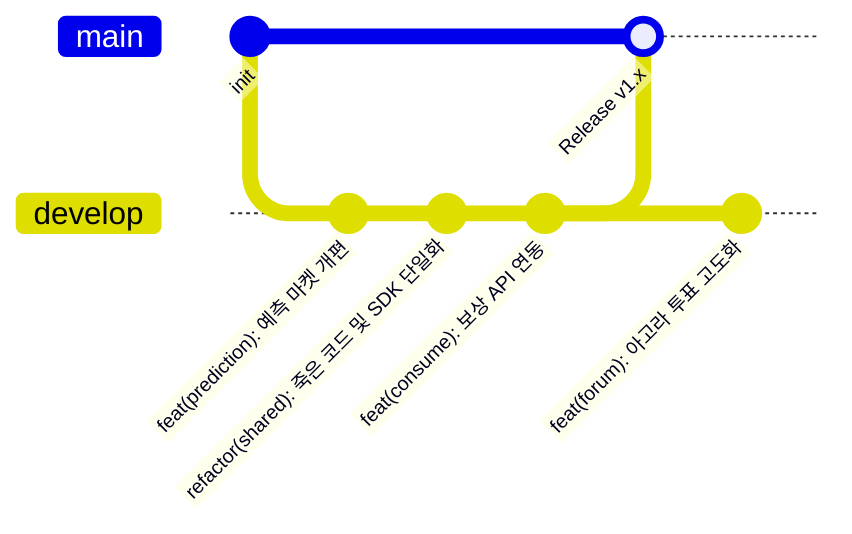

# 🌿 PosMul Git 전략 가이드 (1인 + AI 고속 개발 표준)

> **목적**: 1인 개발자 + AI 에이전트 페어 프로그래밍 환경에서 불필요한 브랜치 오버헤드를 제거하고, 빠른 이터레이션과 안정적인 배포를 동시에 달성합니다.

---

## 🌳 1. 브랜치 전략 (Lightweight Trunk-Based)



| 브랜치 | 역할 | 운용 규칙 |
|--------|------|-----------|
| **`develop`** | **주 작업 브랜치 (Default Work Branch)** | 일상적인 기능 개발, 리팩토링, 버그 수정, UI 개선을 직접 커밋 및 푸시 (`origin/develop`) |
| **`main`** | **프로덕션 릴리즈 브랜치 (Production)** | `develop`에서 `type-check` 및 핵심 플로우 검증이 완료된 시점에 Fast-forward / Merge 배포 |
| `experiment/*` | 실험용 임시 브랜치 (선택) | 대규모 구조 변경 등 롤백 가능성이 높은 실험 시에만 일시 생성 후 즉시 머지 및 삭제 |

> [!TIP]
> **다인 팀용 GitFlow(`feature/*` → PR → `develop` → `release/*` → `main`)는 사용하지 않습니다.**  
> 모든 작업 전후에는 `pnpm -F @posmul/posmul-web type-check`를 통과한 상태에서 `develop`에 논리적 단위로 자주 커밋합니다.

---

## ✍️ 2. 커밋 메시지 컨벤션 (Conventional Commits)

### 기본 형식
```text
<type>(<scope>): <한글 요약 메시지>
```

### Type 목록
| Type | 설명 | 예시 |
|------|------|------|
| `feat` | 새로운 기능 및 API 연동 | `feat(consume): 광고 시청 완료 시 PMP 보상 지급 API 연동` |
| `fix` | 버그 및 타입/런타임 오류 수정 | `fix(prediction): 정산 스케줄러 타임존 계산 오류 수정` |
| `refactor` | 기능 변경 없는 구조 개선·죽은 코드 정리 | `refactor(shared): 레거시 호환 래퍼 제거 및 SDK 단일화` |
| `style` | UI/UX 디자인, 레이아웃, 스타일 개선 | `style(ui): 상단 네비게이션 글래스모피즘 개선` |
| `docs` | 문서 및 AI 에이전트 규칙 업데이트 | `docs(readme): Diataxis 문서 구조 개편 및 인덱스 최신화` |
| `test` | 단위/통합/E2E 테스트 추가 및 수정 | `test(economy): MoneyWave1 일일 풀 계산 테스트 보강` |
| `chore` | 패키지, 빌드, CI/CD, 환경 설정 | `chore(ci): develop 브랜치 타입 체크 워크플로우 추가` |

### Scope (현행 9개 Bounded Context + 공통 영역)
- **도메인(9개)**: `auth`, `consume`, `demographic-data`, `donation`, `economy`, `feed`, `forum`, `prediction`, `ranking`
- **공통 영역**: `shared`, `ui`, `sdk`, `admin`, `cron`, `db`, `ci`, `docs`

---

## 🚀 3. 일상 작업 워크플로우 (PowerShell)

### 1) 일상 개발 및 푸시 (`develop`)
```powershell
Set-Location "c:\G\posmul"

# 1. 타입 체크 검증 (필수)
pnpm -F @posmul/posmul-web type-check

# 2. 변경 상태 확인 및 스테이징
git status -s
git add -A

# 3. 커밋 및 원격 반영
git commit -m "feat(consume): 광고 시청 및 QR 결제 보상 API 연동"
git push origin develop
```

### 2) 프로덕션 배포 (`develop` → `main` 동기화)
```powershell
Set-Location "c:\G\posmul"

git checkout main
git merge develop
git push origin main
git checkout develop
```

---

## 🛡️ 4. 금지 사항
1. **깨진 타입 상태로 커밋 금지**: 반드시 `tsc --noEmit`(`type-check`) 에러 0건 확인 후 커밋합니다.
2. **빌드 산출물 및 시크릿 커밋 금지**: `.env.local`, `debug.log`, `src/` 내부의 컴파일된 `.js`/`.d.ts` 파일이 스테이징되지 않도록 주의합니다.
3. **장기 방치 브랜치 금지**: 병합이 끝난 임시/백업 브랜치는 즉시 삭제(`git branch -d`)하여 저장소를 깨끗하게 유지합니다.
