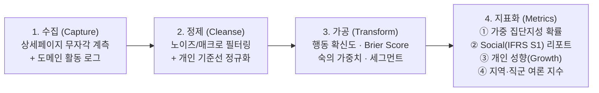

# PosMul 내부 데이터 수집 · 정제 · 가공 · 지표화 설계 명세서 (v1.0)

> **작성일**: 2026-11-23  
> **목적**: 별도의 복잡한 UI(`분석가 모드`, 강제 설문) 없이 유저의 **자연스러운 행동 궤적**에서 고순도 의사결정 데이터를 수집하고, 이를 **정제 → 가공 → 4대 핵심 지표(집단지성·`Social IFRS S1`·개인 성향·지역/직군 통계)**로 전환하기 위한 청사진입니다.  
> **연계 정본**: [POSMUL_WHITEPAPER.md](file:///c:/G/posmul/docs/POSMUL_WHITEPAPER.md) · [project_economy_2027.md](file:///c:/G/posmul/docs/2027/project_economy_2027.md) · [MONEYWAVE_RETENTION_STRATEGIES.md](file:///c:/G/posmul/docs/MONEYWAVE_RETENTION_STRATEGIES.md)

---

## 1. 핵심 철학: "마찰 0의 무자각(Implicit) 계측"

1. **유저에게 귀찮은 입력을 요구하지 않는다**: 참여 패널은 단순하게(`옵션 선택 → PMP 입력 → 참여`) 유지해 전환율을 높입니다.
2. **행동이 곧 진짜 확신도(Revealed Preference)**: 유저가 슬라이더로 "80% 확신"을 찍는 것보다, **보유한 `PMP` 중 몇 %를 걸었는지**, **몇 초 동안 논거와 AI 예측을 읽고 눌렀는지**가 훨씬 정직하고 왜곡 없는 데이터입니다.
3. **원장/결제 경로와 텔레메트리 분리**: 금전 트랜잭션(`predictions` / `pmp_pmc_accounts`)과 행동 수집(`decision_telemetry`)을 분리해 수집 오류가 발생해도 참여 자체가 실패하지 않도록 설계합니다.

---

## 2. 데이터 파이프라인 4단계 구조

---

## 3. 단계별 상세 설계

### 3.1 [1단계] 수집 (Capture) — 무엇을 어떻게 모으는가?

#### A. 1차 즉시 구현 항목 (`prediction.decision_telemetry`)
예측 상세페이지 진입 후 사용자가 `예측 투표 참여하기`를 완료할 때 서버 인증(`getUser()`) 기반으로 자동 적재합니다.

| 필드명 | 정의 및 계산식 | 데이터 의미 |
|---|---|---|
| `deliberation_sec` | 페이지 마운트/가시 상태 기준 참여까지 경과 초 (`0 ~ 86400`) | 즉흥 클릭 vs 숙의 판단 구분 |
| `stake_amount` | 이번 참여 `PMP` | 절대 참여 강도 |
| `user_pmp_balance_before` | 참여 직전 보유 `PMP` | 지갑 규모 컨텍스트 |
| `stake_conviction_ratio` | `stake_amount / user_pmp_balance_before` (`0.0001 ~ 1.0000`) | **행동 기반 실질 확신도(Revealed Conviction)** |
| `option_prob_at_time` | 선택 당시 시장 확률 (`0 ~ 1`) | 다수 추종 vs 소수 소신 구분 |
| `viewed_briefing` | `BalancedDecisionBriefing` 영역 열람/클릭 여부 | 균형 논거 소비 여부 |
| `viewed_ai_forecasts` | `AiForecastSection` 영역 열람 여부 | AI 예측 참고 여부 |
| `chart_tab_switches` | `추이`/`비중`/`내 참여` 탭 전환 횟수 | 데이터 탐색 깊이 |
| `device_type` | `mobile` / `desktop` | 접속 환경 |

#### B. 2차 확장 수집 대상 (추후 단계적 추가)
- **비참여 숙의 이탈 로그**: 브리핑을 30초 이상 읽고도 참여하지 않은 이유(잔액 부족 / 확신 부족 / 마감 임박)
- **도메인 횡단 여정**: `Forum` 게시글/댓글 → `Prediction` 전환율, `Housing-Pro` 학습 완료 → 본진 예측 전환율
- **기부 연결 궤적**: `Prediction` 적중 `PMC` 수령 후 실제 `Donation` 집행까지 걸린 시간(Velocity)

---

### 3.2 [2단계] 정제 (Cleanse) — 노이즈 제거 & 정규화

원본 데이터를 그대로 평균 내면 봇·연타·초보 어뷰징에 지표가 오염됩니다.

1. **노이즈/저신뢰 표본 분리 (Quality Flagging)**:
   - **초고속 즉흥 클릭**: `deliberation_sec < 3`초이면서 `viewed_briefing = false`인 참여 → `noise_flag = 'INSTANT_CLICK'` (보상/참여는 유효하되, 고순도 여론 지표 가중치에서는 `0.2x`로 하향).
   - **초기 탐색 극소액**: `stake_amount == min_bet_amount`이면서 `stake_conviction_ratio < 0.02` → 가벼운 탐색 표본으로 태깅.
2. **개인 기준선 정규화 (Personal Baseline Z-Score)**:
   - 어떤 유저는 늘 `100 PMP`씩 걸고, 어떤 유저는 늘 `5,000 PMP`씩 겁니다.
   - 따라서 절대 금액 대신 **해당 유저 최근 20회 평균 베팅 비율 대비 이번 비율($Z_i = \frac{r_i - \mu_i}{\sigma_i}$)**로 정규화해야 *"평소보다 2배 확신하고 들어온 한 수"*를 포착할 수 있습니다.
3. **이상치(Outlier) 캡핑**:
   - `deliberation_sec`는 탭 열어두고 자리 비움 방지를 위해 **분석 집계 시 상한 600초(10분)**로 윈저라이징(Winsorizing).

---

### 3.3 [3단계] 가공 (Transform) — 복합 파생 변수 생성

정제된 행동을 조합해 4가지 핵심 파생 피처를 계산합니다.

1. **숙의 품질 점수 (`Deliberation Quality Score`, 0 ~ 100)**:
   $$\text{DQS} = 40 \cdot \min\left(1, \frac{\text{deliberation\_sec}}{45}\right) + 30 \cdot \mathbb{I}(\text{viewed\_briefing}) + 15 \cdot \mathbb{I}(\text{viewed\_ai\_forecasts}) + 15 \cdot \min\left(1, \frac{\text{chart\_tab\_switches}}{2}\right)$$
2. **행동 확신도 (`Revealed Confidence`, 0.50 ~ 0.95 매핑)**:
   - 유저가 슬라이더를 움직이지 않아도 `stake_conviction_ratio` + `DQS` 조합으로 서버에서 추정 확신도를 산출.
3. **사후 정산 실력 (`Calibrated Skill`)**:
   - 정산 시 `Brier Score`와 결합해 **"오래 숙고하고 높은 비중을 걸었을 때 실제로 맞히는 유저"**(진성 고수) 식별.
4. **AI 독립성 지수 (`AI Independence`)**:
   - AI 다수 픽과 같은 선택지인지, 다른 선택지인지, 그리고 AI 미참고/참고 후 판단 변화를 기록해 **인간 고유의 통찰 기여도** 측정.

---

### 3.4 [4단계] 지표화 (Metrics) — 서비스 · B2B · 리서치 출력

| 지표군 | 산출 지표 | 활용처 (어디에 쓰는가?) |
|---|---|---|
| **① 가중 집단지성 지표 (`Weighted Truth Index`)** | • 단순 인원 비율 vs **`DQS`·`Brier Skill` 가중 확률** • AI 4인방 예측 vs 시민 숙의 가중 예측 비교 | • 상세페이지 예측 정밀도 고도화 • `Prediction` 명예의 전당 실력 랭킹 |
| **② `Social (IFRS S1)` 임팩트 지표 (B2B 수익 핵심)** | • 의제별 **총 숙의 시간(인·분)** • **양측 균형 논거 열람률(%)** • 참여 시민 수 → 연결된 `PMC` 및 `K-물품` 기부 수량 | • 기업 직접 광고(`Consume` 트랙 B) 고객사에게 제공하는 **공식 ESG Social 정량 리포트** |
| **③ 개인 성향 세그먼트 (`posmul-growth` 연동)** | • `숙의·분석형` (DQS 높음) • `직관·스릴형` (짧은 체류, 다빈도) • `소신·역발상형` (저확률 옵션 선호) • `기부·가치형` (빠른 PMC→기부 전환) | • 성향별 맞춤형 `MoneyWave` 알림·브리핑 추천 (예: 숙의형에게는 아침 30초 브리핑, 스릴형에게는 정각 골든웨이브) |
| **④ 지역·직군 여론 지표 (익명 집계)** | • `user.profiles(sido, sigungu, dong, job_group)` 조인 집계 • 예: *"직군/지역별 특정 경제·정책 의제 전망 분포 및 평균 숙의 시간"* | • 최소 익명성 보호 기준($N \ge 30$) 충족 시 공공 리서치·동네 랭킹 인사이트로 활용 |

---

## 4. 구현 및 고도화 로드맵

- **Phase 1 (현재 구현)**: `prediction.decision_telemetry` 스키마·RLS 구축 + 상세페이지(`client.tsx`)에서 무자각 행동 시그널(`deliberation_sec`, `stake_conviction_ratio`, `viewed_briefing`, `viewed_ai_forecasts`, `chart_tab_switches`) 자동 수집.
- **Phase 2 (정제 & 집계 뷰)**: `prediction` 스키마 내 정제 SQL 뷰(`v_clean_decision_telemetry`) 및 게임별 **총 숙의 시간 · `DQS` 평균 · 가중 집단지성 확률** 집계 RPC 추가.
- **Phase 3 (`Social IFRS S1` & Growth 자동 연동)**: 기업 의뢰 캠페인 리포트 PDF/대시보드 자동 산출 + 유저별 성향 태그 배치(`posmul-growth` 연계).
