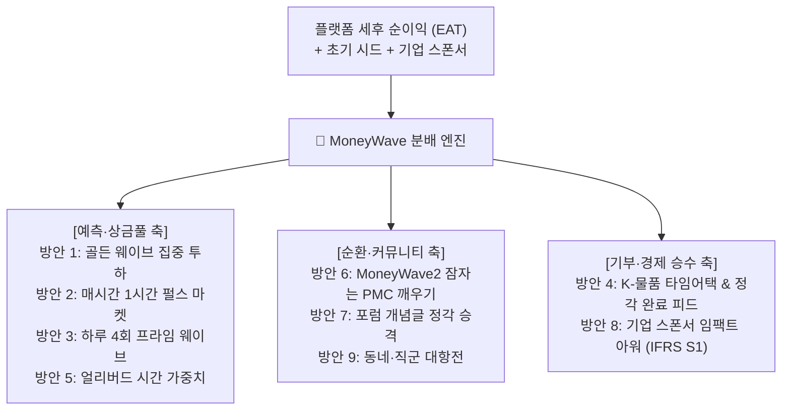

# PosMul MoneyWave 심장 박동(Cadence) & 유저 리텐션 · 승수효과 전략안 (10대 방안 — Living Playbook)

> **작성일**: 2026-11-22  
> **전담 참모**: [posmul-growth](file:///c:/G/posmul/.agent/skills/posmul-growth/SKILL.md) (경제 수호자 [posmul-economy](file:///c:/G/posmul/.agent/skills/posmul-economy/SKILL.md)와 균형 협업)  
> **운영 원칙**: 본 문서의 전략 방안들은 **절대적인 고정 규칙이 아니며**, 유저 성향·운영 데이터에 따라 **언제든 새로운 방안을 추가하거나 효과가 낮은 방안을 과감히 삭제(Pruning)**할 수 있는 실험 플레이북입니다.  
> **정본 연계**: [POSMUL_WHITEPAPER.md](file:///c:/G/posmul/docs/POSMUL_WHITEPAPER.md) · [DOMAIN_FLOW_AND_DECISIONS.md](file:///c:/G/posmul/docs/DOMAIN_FLOW_AND_DECISIONS.md) · [project_economy_2027.md](file:///c:/G/posmul/docs/2027/project_economy_2027.md)  
> **핵심 질문**: *"MoneyWave(EAT → PMC 환류)를 어떻게 설계해야 각기 다른 성향의 유저가 지루해하지 않고 자주 찾아오며, 사회적·국가적 긍정승수(Positive Multiplier)를 피부로 체감하게 만들 것인가?"*

---

## 1. 먼저 점검: 지금 우리 기획 의도대로 잘 가고 있는가?

| 축 | 현재 상태 평가 | 진단 |
| :--- | :---: | :--- |
| **경제 헌법 (v3.0 불변식)** | **✅ 궤도 안착** | `PMP` 입구 단일화, `Prediction` 유일 `PMC` 생성, `EAT`(세후 순이익) 상한, 무경쟁 `0 PMC` 가드, 일일 Cap 등 적자 방지·사행성 차단 설계는 매우 견고함 |
| **의사결정 훈련 UX** | **✅ 개선 진행 중** | 상세페이지 불필요 요소 다이어트 및 유형별(VS / 3요약 / 아코디언) 고가독성 균형 브리핑 개편으로 본질에 집중됨 |
| **MoneyWave 체감 루프 (Heartbeat)** | **🟡 핵심 숙제** | 현재 모래시계 카운트다운은 존재하지만, **정각이 되었을 때 유저에게 "지금 들어가야 할 사건(Event)"과 "내 PMC가 사회를 움직였다는 즉각적 피드백"**이 약함 |

### ⚠️ "1시간 주기" 설계 시 반드시 피해야 할 2가지 함정
1. **유동성 파편화 함정 (초기 유저 적을 때)**: 24시간 내내 매시 정각마다 새 게임을 마구 찍어내면, 참여자가 24개 게임에 흩어져 **무경쟁 게임(`N < 2` 또는 한쪽 풀 0원 → `0 PMC`)**이 속출하고 화면이 썰렁해집니다.
2. **정적 누적의 지루함**: 반대로 `EAT / 24`를 모든 게임에 조용히 1/N 균등 누적만 하면, 유저는 정각이 되어도 아무 변화를 못 느껴 **"굳이 지금 들어올 이유"**를 잃습니다.

> **해법의 핵심**: MoneyWave의 **"재원 적립(회계적 1시간)"**과 **"유저가 체감하는 사건(게임플레이/기부 리듬)"**을 분리·조합하여 **매번 들어올 때마다 새로운 변화와 기대감**을 설계해야 합니다.

---

## 2. MoneyWave 활성화 & 리텐션 극대화 9대 전략 방안

---

### 방안 1. [누적 부스팅형] 매시 정각 `Golden Wave Drop` — 기본 누적 + 1~2개 의제 집중 폭격
> *"1시간마다 계산된 EAT를 매 게임에 누적시키되, 지루한 균등 분배 대신 '이번 시간의 주인공 의제'에 집중 투하한다."*

- **작동 방식**:
  - 매시 정각 발생하는 시간당 `EAT` 재원 중 **60~70%는 전체 활성 게임에 기본 누적**하고, **30~40%는 매시 정각 딱 1~2개 "골든 웨이브(Golden Wave)" 의제에 보너스로 집중 투하**합니다.
  - 투하 대상 선정 기준(투명한 알고리즘): ① 양측 비율이 가장 팽팽한 접전 의제(예: 48% vs 52%) ② 직전 1시간 내 토론/참여 열기가 급등한 의제.
- **유저 재방문 심리 (Hook)**: *"지금 오후 3시 골든 웨이브가 어떤 의제에 터졌지?"* → 정각마다 상금풀이 갑자기 커진 '황금 의제'를 확인하고 예측에 참여할 이유가 생김.
- **v3.0 헌법 정합성**: ✅ 완벽 (`EAT` 총량 불변, 승자 `PMC` 유일 생성 유지).
- **장단점**: 초기 유저가 적어도 기존 게임에 열기를 집중시킬 수 있음(유동성 분산 0) / 단, 정산까지 시간이 걸리는 장기 게임만 있으면 즉각적 승패 쾌감은 약함.

---

### 방안 2. [초단기 정산형] 매시 정각 `1시간 펄스(Hourly Pulse)` — 50분 참여 · 정각 즉시 정산
> *"장기 의제만 있으면 1주일 뒤까지 안 들어온다. 매시 정각마다 승패가 갈리고 PMC가 터지는 초단기 1시간 마켓을 돌린다."*

- **작동 방식**:
  - 일반 예측(1일~1개월)과 별도로, **매시 정각 개설 → 50분 마감 → 다음 정각 공인 오라클 자동 정산**되는 **'1시간 펄스' 전용 슬롯 1개**를 운영합니다.
  - 시간대별 공인 오라클 자동 편성:
    - `09:00 ~ 15:00` (장중): 코스피/코스닥 대표 종목·원/달러 환율 1시간 등락
    - `15:00 ~ 22:00` (오후·저녁): BTC/ETH 시세, 프로야구/축구 특정 이닝·전반전 결과, 실시간 영화 예매율/날씨
    - `22:00 ~ 08:00` (심야·새벽): 미국 증시(나스닥·엔비디아·테슬라), 글로벌 코인
- **유저 재방문 심리 (Hook)**: **1시간 안에 `PMP 투입 → 결과 확인 → PMC 획득(또는 PMP 소멸 후 포럼/광고/공부로 재충전)` 전체 루프가 완결**되어 플랫폼 심장이 쉴 새 없이 뜀.
- **v3.0 헌법 & 주의점**: ⚠️ 단순 홀짝 도박처럼 보이지 않도록 **반드시 직전 3시간 추세·핵심 변수 1줄 브리핑**을 함께 제공하고, 1시간 펄스 배정 `EAT`는 일일 총량의 20~30% 이내로 상한 통제.
- **장단점**: 재방문 빈도·화폐 유통속도(Velocity) 최강 / 단, 동시접속자가 아주 적은 극초기에는 반대편 참여자 확보(최소 2인 가드)가 관건.

---

### 방안 3. [프라임 편성형] 하루 4회 `Prime Wave` — 한국인 생활 리듬 맞춘 "TV 편성표" 집중 운영
> *"24시간 쪼개서 썰렁하게 돌리지 말고, 하루 4번 피크타임 정각에 신규 의제·정산·상금풀을 한꺼번에 몰아 터뜨린다."*

- **작동 방식**:
  - 매시간 소액씩 흩뿌리는 대신, 하루 `EAT` 재원의 80%를 **한국인의 스마트폰 피크타임 4회**에 집중 편성합니다:
    1. **08:00 출근 웨이브 (경제·시황)**: 오늘의 증시·환율·뉴스 핵심 의제 2~3건 오픈 + 밤새 미장 의제 정산
    2. **12:00 점심 웨이브 (이슈·사회·생활)**: 가볍게 3분 만에 참여하는 점심 특선 의제 오픈 + 오전 의제 정산
    3. **18:00 퇴근 웨이브 (스포츠·엔터·소비)**: 저녁 경기·영화·방송 의제 오픈 + 장마감 경제 의제 정산
    4. **22:00 나이트 웨이브 (글로벌·심야·내일 준비)**: 미국 증시/유럽축구 의제 오픈 + 오늘 기부 결산 리포트 발표
  - 모래시계 카운트다운도 *"다음 프라임 웨이브(18:00 퇴근 웨이브)까지 01:24:10"*처럼 명확한 목적지를 보여줌.
- **유저 재방문 심리 (Hook)**: **"12시 점심엔 PosMul, 6시 퇴근길엔 PosMul"**이라는 강력한 일일 습관(Habit Loop) 형성 + 동시접속자가 한 시간대에 몰려 **유동성과 토론 열기 극대화**.
- **v3.0 헌법 정합성**: ✅ 완벽 (초기 극소수 유저 단계에서 가장 안전하고 밀도 높은 운영 가능).

---

### 방안 4. [기부 결실·승수 체감형] `Donation Wave` — 매시간/타임어택 K-물품 달성 카운트다운 & 정각 발주 피드
> *"예측만 돌리면 반쪽짜리다. 내 PMC가 현실의 한국 물품으로 바뀌어 공장과 복지관을 움직이는 '긍정승수의 순간'을 매시간 목격시켜야 한다."*

- **작동 방식**:
  - **타임어택 K-물품 매칭(Donation Flash Goal)**: *"오늘 18:00~20:00 사이 지역아동센터 국산 운동화 10켤레(5,000 PMC) 달성 시, PosMul 매칭 풀(또는 기업 스폰서)이 2켤레를 추가 보태 12켤레를 발주합니다!"*
  - **정각 임팩트 티커(Hourly Impact Feed)**: 매시 정각(또는 목표 달성 즉시) 상단/홈에 실시간 영수증 발행 — *"방금 15:00 기준, 시민 63명의 PMC로 국산 운동화 10켤레 발주 완료! (국내 제조·유통 경제 승수 추정 +72만 원)"*
  - 참여자는 힐링룸에 **'15시 웨이브 나눔 참여자' 타임스탬프 영수증/트로피**를 즉시 수령.
- **유저 재방문 심리 (Hook)**: 예측에서 `PMC`를 딴 유저가 **기부 페이지로 즉시 넘어가 '마지막 10% 채우기(막타 쾌감)'**에 참여하고, 기부 인증 사진을 보며 도박 사이트에서는 절대 느낄 수 없는 자부심과 애착을 형성.
- **거시경제 승수 연결**: K-물품 직구매(Tied Aid)가 실시간 숫자로 누적·시각화되어 **"PosMul이 실제로 한국 중소기업과 내수 경제를 돌리고 있다"**는 정체성을 각인.

---

### 방안 5. [조기 참여 보상형] `Early-Bird Wave Weighting` — 일찍 참여할수록 더 많은 웨이브 물결을 탄다
> *"마감 1분 전에 눈치 보고 찍는 얌체보다, 먼저 뉴스를 분석해 용기 있게 판단한 시민에게 더 많은 MoneyWave 지분을 준다."*

- **작동 방식**:
  - 1시간마다 `MoneyWave`가 활성 게임에 적립될 때, **그 1시간 동안 적립된 상금풀은 "그 정각 시점에 이미 참여해 있던 유저들"의 지분으로 스냅샷**됩니다.
  - 예시 (24시간짜리 의제):
    - 1시간 차에 일찍 예측해 맞힌 유저 → **1시~24시까지 총 24번의 MoneyWave 물결에 모두 지분 보유**
    - 마감 1시간 전에 들어와 맞힌 유저 → **마지막 24시 1번의 물결에서만 지분 배분**
- **유저 재방문 심리 (Hook)**: *"새 의제 뜨자마자 빨리 들어가서 근거 보고 먼저 찍어야 웨이브를 2배, 3배 더 먹는다!"* → **신규 의제 오픈 직후 즉각 접속 + 알림 구독률 폭발**.
- **경제학적 의의 (Agency Theory)**: 정보 탐색을 먼저 수행해 시장 확률을 조기에 형성하는 **'선도적 가격 발견자(Early Price Discoverer)'**에게 정당한 초과 보상을 주는 교과서적 메커니즘.

---

### 방안 6. [역손실회피 순환형] `MoneyWave2` — "잠자는 PMC 깨우기(Dormant Wave)" 환류 이벤트
> *"기부하지 않고 묵혀둔 PMC를 정각에 깨워 다시 사회로 흘려보낸다. 추가 현금(EAT) 0원으로 상금풀을 키우고 기부도 촉진한다."*

- **작동 방식** (백서 v3.0 `MoneyWave2` 실체화):
  - `PMC`를 획득한 뒤 일정 기간(예: 30일) 동안 기부하지 않고 방치하면, **만료 72시간 전 알림**을 발송합니다: *"당신의 450 PMC가 3일 뒤 잠듭니다! 지금 K-물품 기부에 쓰면 내 이름으로 기록되고, 미사용 시 다음 정각 MoneyWave2로 환류됩니다."*
  - 정각마다 회수된 휴면 `PMC`가 **'시민 환류 보너스 웨이브(MoneyWave2)'**로 투명하게 공개되며, 당일 활성 예측 상금풀 또는 K-물품 기부 매칭풀에 보너스로 쏟아짐.
- **유저 재방문 심리 (Hook)**:
  - **보유자**: 손실회피 심리(Prospect Theory) 발동 → *"아깝다! 지금 들어가서 내가 고른 복지관에 기부하자!"* (기부 전환율 급상승)
  - **일반 유저**: *"오늘 저녁 8시엔 잠자는 PMC 12,000개가 보너스 웨이브로 풀린다!"* → 기대감 상승.
- **v3.0 헌법 정합성**: ✅ 100% (신규 `PMC` 순증가 0, 기존 발행분의 순환 속도만 증가 → **적자 리스크 0원**).

---

### 방안 7. [유저 참여·커뮤니티 융합형] `Community Wave Pick` — 매시간/매일 포럼 개념글 → 공식 예측 마켓 승격
> *"운영자가 주는 문제만 푸는 시험장이 아니라, 내 아이디어가 다음 정각 MoneyWave의 공식 무대가 되는 살아있는 광장."*

- **작동 방식**:
  - `Forum`의 "예측 의제 제안" 게시판에서 시민 추천을 가장 많이 받고 AI/오라클 검증을 통과한 **1등 제안 의제**가 다음 정각(또는 프라임 웨이브)에 **공식 MoneyWave 예측 마켓으로 자동 승격**됩니다.
  - 채택된 제안자에게는 **`PMP` 창작자 보너스(포럼 일일 1,000 PMP Cap 내)** + 의제 상단에 *"제안자: @닉네임 (우리 동네 ○○동)"* 크레딧 + 힐링룸 '미래 설계자' 트로피 부여.
- **유저 재방문 심리 (Hook)**: *"내가 올린 이슈가 지금 추천 1등인데, 6시 정각에 공식 마켓으로 채택될까?"* → `Forum` ↔ `Prediction`을 하루에도 수차례 오가는 자생적 트래픽 생성.
- **v3.0 헌법 정합성**: ✅ 완벽 (`PMC` 직접 지급 없이 `PMP` 일일 Cap 내 보상 + 명예 보상).

---

### 방안 8. [B2B 수익·승수 폭발형] `MoneyWave3` — 기업 스폰서 "임팩트 아워(Brand Impact Wave)"
> *"기업이 특정 정각의 MoneyWave를 통째로 스폰서하고, 그 1시간의 시민 참여와 K-물품 기부 결과를 'IFRS S1 Social 리포트'로 가져간다."*

- **작동 방식** (Phase 2 `Consume` 트랙 B 직결):
  - 예: *"오늘 밤 9시 웨이브는 [친환경 브랜드 A]가 함께합니다 — 특별 상금풀 3배 + 참여자 적중 PMC 전액 국내 친환경 생필품 매칭 기부!"*
  - 기업이 후원한 예산에서 운영비를 제외한 금액이 해당 시간 `MoneyWave3` 상금풀과 K-물품 매칭 재원으로 직접 투입됨.
  - 종료 후 기업에는 **"1시간 동안 시민 2,400명이 의사결정 훈련 참여 · 평균 체류 6분 20초 · 국내 중소기업 물품 85박스 복지기관 전달"**이라는 정량 `Social(IFRS S1)` 인증 리포트 발급.
- **유저 재방문 심리 (Hook)**: 평소보다 상금풀과 기부 임팩트가 2~3배 큰 **'스페셜 이벤트 아워'**가 캘린더에 예고되어 유저가 알람 맞추고 접속.
- **국가 경제 승수효과**: 기업 마케팅비(원래 해외 빅테크 광고비로 유출되던 돈) → **PosMul 시민 의사결정 훈련 → 국내 제조사 K-물품 직구매 → 취약계층 전달**이라는 완벽한 내수 선순환 달성!

---

### 방안 9. [풀뿌리·버티컬 크로스형] `Local & Vertical Wave Rush` — 동네·직업군 대항전 & `Housing-Pro` 저녁 환류
> *"전국 1등은 남의 얘기지만, '우리 동네(읍·면·동)'와 '우리 직업군(주택관리사)'의 승부는 내 일처럼 끓어오른다."*

- **작동 방식**:
  - **버티컬(`Housing-Pro`) → 본진(`PosMul`) 일일 다리**: 낮 동안 `Housing-Pro`에서 종이책 AI 스캔·O/X 복습으로 모은 `일일 300 PMP`를 저녁 프라임 웨이브에 투입하도록 맥락 연결(*"오늘 공부로 모은 220 PMP, 18시 주택·부동산 웨이브에 도전해 보세요!"*).
  - **동네/직군 웨이브 러시**: 매일 저녁 1회, 당일 적중률·기부 참여가 가장 뜨거웠던 **1위 읍·면·동(또는 1위 직업군)** 이름으로 해당 지역 복지시설에 K-물품 보너스 기부를 실행하고 명예의 전당에 등재.
- **유저 재방문 심리 (Hook)**: 개인 승패를 넘어 **소속감(동네·직업군)**과 **학습 보상(`Housing-Pro`)의 실제 사회적 가치 전환**이 매일 저녁 완결됨.

---

### 방안 10. [전문가·출근길 루틴형] `Morning Brief-to-Predict` — 매일 아침 30초 전문가 브리핑 → 원탭(1-Tap) 예측
> *"바쁜 전문직·직장인은 긴 예측 게임에 들어올 시간이 없다. 매일 아침 내 일과 투자에 진짜 도움되는 3줄 브리핑을 먼저 주고, 끝부분에서 1초 원탭으로 예측까지 자연스럽게 잇는다."*

- **대표님 고민("바쁘면 안 할 것 같다")에 대한 3가지 마찰 돌파 설계**:
  1. **실무·정보 가치 선제공**: 예측을 강요하지 않고, 아침 7~8시에 **"출근길 30초 브리핑"** 자체로 열 이유를 줍니다.
     - 일반/투자자: 오늘의 핵심 경제·정책·증시 3줄 요약
     - 전문직 버티컬(`Housing-Pro` 현직 소장): 오늘의 공동주택관리법·국토부 유권해석·단지 실무 3줄 브리핑 (`Pro View` 톤 유지)
  2. **페이지 이동 없는 `1-Tap` 원클릭 예측**: 브리핑 카드 맨 아래에 *"오늘의 1분 예측: [A안] vs [B안]"*을 붙이고, 복잡한 금액 입력 없이 **기본 `100 PMP`로 원탭 1번**에 참여 완료.
  3. **무죄책감(No Guilt) & 유연한 소비**: 바쁜 아침에 못 보거나 브리핑만 10초 보고 닫아도 스트릭 파괴 같은 스트레스를 주지 않으며, 점심·퇴근길에도 당일 브리핑 카드가 유지되어 언제든 소화 가능.
- **유저 재방문 심리 (Hook)**: 게임하러 들어오는 게 아니라 **"아침에 내 분야 핵심 브리핑 챙겨 보러 들어왔다가, 겸사겸사 1초 예측으로 PMC와 기부까지 연결"**되는 가장 고급스럽고 지속 가능한 습관 루프.
- **v3.0 헌법 정합성**: ✅ 완벽 (브리핑 완독만으로 `PMC` 지급 금지, 원탭 예측 참여 시 기존 `PMP` 차감 → 정산 적중 시에만 `MoneyWave EAT` 한도 내 `PMC` 발행).

---

## 3. 10대 전략 방안 한눈에 비교 매트릭스

| 번호 | 방안명 | 주요 타겟 성향 | 유저 체감 주기 | 리텐션 폭발력 | 초기 저유동성 안전성 | 적자 리스크 | 구현 난이도 | 추천 도입 시점 |
| :---: | :--- | :--- | :---: | :---: | :---: | :---: | :---: | :---: |
| **1** | **골든 웨이브 집중 투하** | 단타·스릴형 | 매시 정각 | ★★★★☆ | **매우 높음** | 0 (EAT 내) | 낮음 | **Phase 1 (즉시)** |
| **2** | **1시간 펄스 초단기 정산** | 단타·스릴형 | 매시 정각 | **★★★★★** | 낮음 (초기 주의) | 낮음 (Cap) | 중간 | **Phase 1.5** |
| **3** | **하루 4회 프라임 웨이브** | 소통·광장형 | 1일 4회 | **★★★★★** | **최상** | 0 (EAT 내) | 낮음 | **Phase 1 (즉시)** |
| **4** | **K-물품 타임어택 & 정각 피드** | 가치·기부형 | 1~2시간/일 | ★★★★☆ | **높음** | 0 | 낮음~중간 | **Phase 1 (즉시)** |
| **5** | **얼리버드 시간 가중치** | 분석·고수형 | 매시 누적 | ★★★★☆ | **최상** | 0 (배분식) | 중간 | **Phase 1~1.5** |
| **6** | **MoneyWave2 잠자는 PMC 깨우기** | 가치·기부형 | 매일/주간 | ★★★★☆ | **최상** | **0 (재순환)** | 중간 | **Phase 1.5~2** |
| **7** | **포럼 개념글 정각 마켓 승격** | 소통·광장형 | 1일 1~4회 | ★★★★☆ | 높음 | 0 (PMP만) | 중간 | **Phase 1.5** |
| **8** | **기업 스폰서 임팩트 아워** | 전 성향(B2B) | 주간/이벤트 | **★★★★★** | **최상** | **0 (외부)** | 높음(영업) | **Phase 2 (트랙 B)** |
| **9** | **동네·직군 웨이브 & 버티컬 연동** | 실용·버티컬형 | 매일 저녁 | ★★★★☆ | 높음 | 0 | 중간 | **Phase 1.5~2** |
| **10** | **아침 30초 전문가 브리핑 → 원탭 예측** | **바쁜 전문가형** | 매일 아침(유연) | **★★★★★** | **최상** | 0 (EAT 내) | 낮음~중간 | **Phase 1 (즉시)** |

---

## 4. 추천 실행 로드맵: "최강 하이브리드 조합"

한 가지 방안만 단독으로 쓰기보다, **성장 단계에 맞춰 3~4개를 톱니바퀴처럼 맞물리는 것**이 가장 강력합니다.

### 🚀 Stage 1 (지금 바로 적용 — 초기 유저 규모에서도 썰렁하지 않게!)
> **핵심 조합: `방안 3 (하루 4회 프라임 웨이브)` + `방안 1 (매시 정각 골든 웨이브 투하)` + `방안 4 (K-물품 실시간 달성 피드)`**

- **회계적 리듬 (매시 정각)**: 모래시계가 00:00을 찍을 때마다 **이번 시간의 `골든 웨이브` 접전 의제 1곳에 상금풀 부스트 + 직전 1시간 기부 달성/발주 영수증 티커 갱신**.
- **콘텐츠 리듬 (하루 4회 — 08시 / 12시 / 18시 / 22시)**: 신규 의제 오픈과 정산을 4개 피크타임에 몰아주어 동시접속자와 토론 열기를 한곳에 집중!
- **기대 효과**: 초기 유저가 100명이어도 24시간 흩어지지 않고 피크타임에 꽉 찬 느낌을 주며, 매시간 들어와도 *"어? 이번 시간 골든 웨이브가 이 의제에 꽂혔네!"*라는 새로운 재미가 생김.

### 🔥 Stage 2 (DAU 증가 후 — 도파민 & 자생 순환 완성)
> **추가 조합: `방안 5 (얼리버드 시간 가중치)` + `방안 2 (장중/저녁 한정 1시간 펄스)` + `방안 6 (MoneyWave2 잠자는 PMC)` + `방안 7 (포럼 개념글 승격)`**

- 일찍 분석해 참여한 시민에게 더 많은 `MoneyWave` 지분을 주고(방안 5), 피크 시간대에만 **1시간 만에 끝나는 초단기 펄스 마켓**을 1슬롯 열어(방안 2) 빠른 `PMP ↔ PMC` 순환을 가속합니다.
- 30일 미기부 `PMC`를 깨워 기부와 보너스 웨이브를 동시에 자극합니다(방안 6).

### 💎 Stage 3 (수익·거시경제 승수 폭발 — B2B & 버티컬 연합)
> **확장 조합: `방안 8 (기업 스폰서 임팩트 아워 — IFRS S1)` + `방안 9 (동네·Housing-Pro 직군 웨이브 러시)`**

- 기업이 스폰서하는 주간 스페셜 웨이브로 상금풀과 K-물품 기부를 3~5배 키우고, `Housing-Pro` 등 전문직 버티컬 유저들이 매일 저녁 본진 웨이브로 합류하는 생태계 완성.

---

## 5. 대표님 의사결정 체크포인트 (다음 논의 주제)

이 9가지 방안 중 대표님의 직관에 가장 강하게 꽂히는 조합을 골라주시면, 바로 **구체적인 수식·DB/크론 설계·화면 UX**까지 이어서 설계하겠습니다.

1. **기본 리듬 선택**: 초기 오픈 기준 **"매시 24번 균등(방안 2 중심)"** vs **"하루 4회 프라임 웨이브 + 매시 정각 골든 부스트(방안 3+1 하이브리드)"** 중 어느 쪽이 우리 현재 유저 규모와 철학에 더 맞다고 보시나요?
2. **기부 연결 감동 장치**: **방안 4(K-물품 타임어택 매칭 & 정각 발주 영수증 피드)**를 메인 피드 상단이나 모래시계 바로 아래에 연결해 "예측 → 기부 → 국내 경제 승수"를 실시간으로 보여주는 방향 어떠신가요?
3. **얼리버드 가중치(방안 5)**: 일찍 예측한 사람에게 더 많은 시간대별 `MoneyWave` 지분을 주는 규칙을 정산 공식에 도입해 볼까요, 아니면 우선 단순하고 직관적인 현재 공식(`베팅 비율 × 게임 누적풀`)을 유지할까요?
