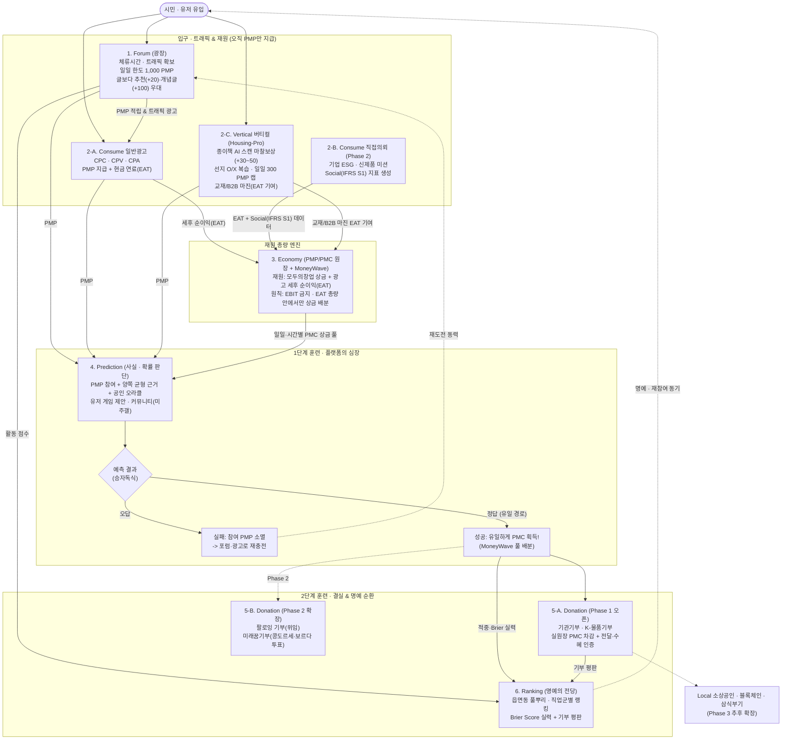
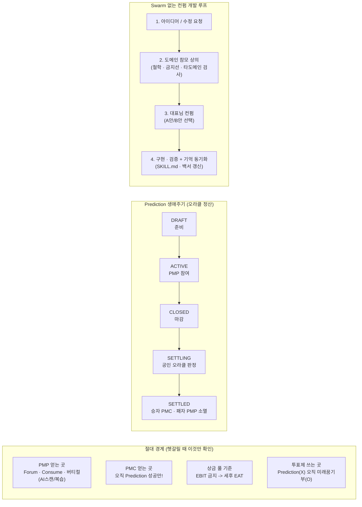

# PosMul 한눈에 보는 전체 지도 (A4 출력용 요약본 · v3.0)

> **한 줄 철학**: *"시간과 참여를 소비해 `PMP`를 얻고, 근거 기반 예측 의사결정 훈련을 통해 `PMC`로 전환하며, 이를 투명하고 즐거운 기부에 사용함으로써 개인의 활동이 측정 가능한 사회적 가치(`Social`)로 전환된다."*
> *(인쇄용 레이아웃 파일: [POSMUL_A4_PRINT.html](file:///c:/G/posmul/docs/POSMUL_A4_PRINT.html) 을 브라우저로 열어 `Ctrl+P` 하시면 A4 2장에 딱 맞게 출력됩니다.)*

---

## 1. 전체 가치 순환 & 6대 도메인 지도

---

## 2. 절대 경계 · 게임 상태 · 컨펌 작업 흐름

---

## 3. 6대 도메인 헌법 초압축표

| 도메인 | 한 줄 철학 | 절대 원칙 (이것만은 지킨다) | 오픈 단계 |
| :--- | :--- | :--- | :---: |
| **Forum (광장)** | 트래픽 · 체류시간 확보 & 재도전 숨통 | 오직 `PMP`만 지급 / 일일 상한 `1,000 PMP` / 추천·개념글 우대 | **Phase 1** |
| **Consume (광고)** | 현금 `EAT` 공급 + 기업 `Social` 지표 | 유저는 `PMP`만 / 일반광고(`EAT`) vs 직접의뢰(`IFRS S1`) 분리 | **트랙A: P1 / 트랙B: P2 / 소상공인: P3** |
| **Economy (원장)** | 적자 없는 `PMP`/`PMC` 순환 통제 | `PMC`는 `Prediction` 성공만 생성 / `EAT` 총량 한도 / 원장 롤백 | **Phase 1** |
| **Prediction (심장)** | 도박이 아닌 1단계 사실 판단 훈련장 | 승자독식(`PMP` 소멸) / 양쪽 균형 근거 / 공인 오라클 정산 | **Phase 1** |
| **Donation (결실)** | 즐거운 기부 + 2단계 가치 배분 훈련 | `pmc_balance` 실차감 / 전달·수혜 인증 *(중복수령은 오픈이슈)* | **기관·물품: P1 / 팔로잉·미래꿈: P2** |
| **Ranking (명예)** | 돈이 아닌 실력·선한 영향력 평판 | 읍면동·직업군 명예의 전당 / `Brier Score` 실력 평판 | **Phase 1 (점수 v3 정렬 진행)** |

