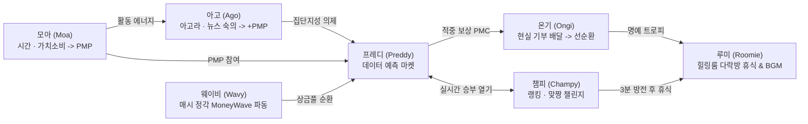

# 포스멀 프렌즈 (PosMul Friends) 공식 세계관 & 캐릭터 바이블

> **문서 성격**: 코드베이스([posmul-friends.ts](file:///c:/G/posmul/apps/posmul-web/src/shared/characters/posmul-friends.ts), [CharactersUniverseClient.tsx](file:///c:/G/posmul/apps/posmul-web/src/app/characters/CharactersUniverseClient.tsx), [healing-room-catalog.ts](file:///c:/G/posmul/apps/posmul-web/src/app/healing-room/healing-room-catalog.ts))에 구현된 캐릭터 설정·에셋·시스템 연동을 한곳에 정리한 공식 세계관 문서입니다.  
> **최종 기준일**: 2026-11-22

---

## 1. 세계관 프롤로그 — 「포스멀 타운 (PosMul Town)」

현실 세계에서 사람들이 보낸 작은 **긍정적 선택의 파동(Positive Multiplier)** 이 모여 탄생한 7명의 친구들, **포스멀 프렌즈(PosMul Friends)** 가 살아가는 세계가 **포스멀 타운**입니다.

이 세계의 모든 활동은 다음 **4단계 에너지 순환**으로 움직입니다.

1. **햇살 에너지 (`PMP`) 생성**: 시민들이 공론장 토론(`Forum`), 시간·가치 소비(`Consume`) 등 선하고 생산적인 일상을 보낼 때 무위험 활동 포인트인 `PMP`가 피어납니다.
2. **황금 모래시계의 파동 (`MoneyWave`)**: 매시 정각, 포스멀 타운 중앙의 **모래시계 강가**에 `PMP`와 플랫폼 파동 에너지가 차올라 상금풀로 재분배됩니다.
3. **집단지성과 나눔 자산 (`PMC`) 전환**: 시민들이 데이터와 직관으로 내일의 확률(`Prediction`)을 맞히고 승부를 겨루며(`Ranking`/`Challenge`), 활동의 결실은 사회적 가치 자산인 `PMC`로 커집니다.
4. **현실의 기적 (`Donation`) & 휴식 (`Healing Room`)**: 모인 `PMC`는 현실 세계의 K-물품·NGO 기부로 배달되어 선순환을 완성하고, 그 명예와 피로는 **노을빛 다락방(힐링룸)** 에 트로피와 휴식으로 기록됩니다.

---

## 2. 포스멀 프렌즈 7인 공식 라인업 요약

| 순번 | 이름 | 종족 | 전담 역할 | 담당 도메인 (경로) | 테마 컬러 | 시그니처 소품 | 힐링룸 미니미 가격 |
| :---: | :--- | :--- | :--- | :--- | :---: | :--- | :---: |
| **#01** | **웨이비** (Wavy) | 황금 꼬리 아기 수달 | MoneyWave 파동 리더 · 경제 회계사 | [경제 · 지갑](/economy) | `#f59e0b` (Amber) | 황금 모래시계 펜던트 | `0 PMP` (기본) |
| **#02** | **프레디** (Preddy) | 예측 탐정 아기 올빼미 | 집단지성 데이터 애널리스트 | [예측 마켓](/prediction) | `#38bdf8` (Sky) | 황금 테두리 진실 돋보기 | `150 PMP` |
| **#03** | **온기** (Ongi) | 나눔 배달부 사모예드 | 공익 물품·나눔 메신저 | [기부 · 나눔](/donation) | `#fb7185` (Rose) | 노란 하트 우체부 가방 | `150 PMP` |
| **#04** | **모아** (Moa) | 볼빵빵 가치소비 쿼카 | 시간·소비·임팩트 큐레이터 | [가치 소비](/consume) | `#34d399` (Emerald) | 황금 스톱워치 & 크림 에코백 | `200 PMP` |
| **#05** | **아고** (Ago) | 아고라 사회자 아기 펭귄 | 공론장 중재자 · 집단지성 서기 | [포럼 · 공론장](/forum) | `#60a5fa` (Blue) | 방송 헤드셋 마이크 & 메모 수첩 | `200 PMP` |
| **#06** | **챔피** (Champy) | 불꽃 갈기 아기 호랑이 | 실시간 챌린지 & 명예의 전당 챔피언 | [랭킹 · 챌린지 · 라이브](/ranking) | `#f97316` (Orange) | 번개 헤어밴드 & 골드 트로피 | `250 PMP` |
| **#07** | **루미** (Roomie) | 다락방 주인 아기 나무늘보 | 힐링룸 호스트 · Lo-Fi BGM 큐레이터 | [힐링룸](/healing-room) | `#a78bfa` (Violet) | 레트로 무선 헤드셋 & 온기 머그컵 | `0 PMP` (기본) |

---

## 3. 캐릭터별 상세 설정

### #01. 웨이비 (Wavy) — 황금 꼬리 아기 수달
- **캐치프레이즈**: *"작은 파동이 모이면 세상을 바꾸는 거대한 물결이 돼!"*
- **거점**: 포스멀 타운 중앙 모래시계 강가
- **성격 & 반전 매력**: 평소엔 강물에 둥둥 떠서 낮잠을 즐기는 여유파지만, 매시 정각 `MoneyWave`가 차오를 때면 누구보다 빠르게 순환 수치를 계산하는 천재 리더.
- **세계관 스토리**: 꼬리 끝의 황금 물결 무늬는 시민들의 작은 참여가 승수 효과를 타고 커질 때마다 반짝입니다.
- **시그니처 소품**: **황금 모래시계 펜던트** — 1시간마다 차오르는 `MoneyWave` 상금풀과 `PMP → PMC` 순환을 기록하는 목걸이.
- **감정 스티커 4종**: `머니웨이브 환호!` (*상금풀이 빵빵하게 차올랐어!*), `정밀 분석 중` (*음, 이번 파동 흐름이 심상치 않은데?*), `강물 위 낮잠` (*정산 전까지 잠깐만 충전할게 Zzz*), `변동성 깜짝!` (*어엇?! 갑자기 파동이 요동친다!*).
- **도메인 가이드 핵심**: `PMP`(무위험 활동 포인트)와 `PMC`(나눔·적중 자산)의 구분, 매시 정각 `MoneyWave` 재분배, 기부 도메인 연결 안내.

---

### #02. 프레디 (Preddy) — 예측 탐정 아기 올빼미
- **캐치프레이즈**: *"데이터는 거짓말하지 않지… 음, 가끔 빼고!"*
- **거점**: 포스멀 도서관 꼭대기 탑
- **성격 & 반전 매력**: 밤새 뉴스와 지표를 분석하느라 다크서클이 짙은 지성파 탐정. 진지하게 추리하다가도 예측이 빗나가면 머리 깃털이 삐죽 솟으며 당황하는 허당미가 매력.
- **세계관 스토리**: 도서관 꼭대기 탑에서 전 세계 뉴스와 우리 동네 날씨까지 돋보기로 훑으며 내일의 확률을 짚어냅니다.
- **시그니처 소품**: **황금 테두리 진실 돋보기** — 수많은 뉴스 소음 속에서 진짜 핵심 시그널만 확대해 보여주는 탐정 도구.
- **감정 스티커 4종**: `날카로운 추리` (*근거와 확률을 꼼꼼히 따져보자!*), `예측 적중! ✨` (*내가 그랬제!! 완벽하게 들어맞았어!*), `예상 빗나감 쇼크` (*이, 이럴 리가 없는데?! 변수가 뭐지?!*), `밤샘 차트 분석` (*커피 한 잔 더 마시고 다음 라운드 분석 중…*).
- **도메인 가이드 핵심**: 전국/우리 동네 예측 마켓, 명예의 전당·랭킹 연동, 유저 직접 제안(`예측 만들기`) 안내.

---

### #03. 온기 (Ongi) — 나눔 배달부 사모예드
- **캐치프레이즈**: *"당신의 마음이 닿는 곳에 따뜻한 기적이 피어나요!"*
- **거점**: 포스멀 타운 ↔ 현실 세계 횡단 우편로
- **성격 & 반전 매력**: 누군가의 `PMC`가 현실의 기부 물품으로 바뀔 때마다 너무 기뻐서 꼬리가 프로펠러처럼 돌아가는 순수 결정체. 작은 칭찬에도 눈물이 그렁그렁해집니다.
- **세계관 스토리**: 작은 파스텔 날개 망토를 두르고 포스멀 타운과 현실 세계를 오가며 운동화, 가전, 장학금 등 따뜻한 선물을 배달합니다.
- **시그니처 소품**: **노란 하트 우체부 가방** — 시민들이 보낸 `PMC`의 온기를 식지 않게 담아 배달하는 마법의 우편 가방.
- **감정 스티커 4종**: `하트 뿜뿜 환호` (*와아! 따뜻한 나눔이 도착했어요!*), `기부 선물 배달` (*소중한 마음, 안전하게 전달할게요!*), `폭풍 감동 눈물` (*너무 따뜻해서 눈물이 나요… 고마워요!*), `고마운 인사` (*오늘도 세상이 조금 더 포근해졌어요.*).
- **도메인 가이드 핵심**: K-물품 직접 기부, 3단계 마일스톤 검증 NGO, 힐링룸 '영광의 선반' 트로피 해금, 국내 제조사 선순환 승수 효과.

---

### #04. 모아 (Moa) — 볼빵빵 가치소비 쿼카
- **캐치프레이즈**: *"일상의 시간도, 소비도 모이면 든든한 자산이 돼요!"*
- **거점**: Major League 캠페인 광장 & 동네 상생 스토어 거리
- **성격 & 반전 매력**: 언제나 해맑게 웃으며 좋은 캠페인과 동네 상점을 찾아다니는 알뜰 살림꾼. 양쪽 볼 안에는 늘 도토리 대신 `PMP` 코인이 한가득 들어 있습니다.
- **세계관 스토리**: 민트색 앞치마를 두르고 `Major League`(시간 가치화)부터 지역 상생 스토어까지 발 빠르게 누비며 가치를 차곡차곡 모읍니다.
- **시그니처 소품**: **황금 스톱워치 & 크림 에코백** — 1분의 시간 참여도 놓치지 않고 `PMP`로 담아주는 타임워치와 장바구니.
- **감정 스티커 4종**: `볼빵빵 적립!` (*오늘도 PMP가 볼 한가득 모였어요!*), `시간 꼼꼼 체크` (*딱 1분만 투자해도 보상이 쏙!*), `꿀혜택 발견!` (*우와! 여기 진짜 착한 브랜드 캠페인이야!*), `만세 환호` (*작은 소비가 모여서 큰 힘이 되네요!*).
- **도메인 가이드 핵심**: 브랜드 캠페인·시간 가치화 `PMP` 적립, 무위험 활동 재화를 통한 예측·힐링룸 진입 관문 역할.

---

### #05. 아고 (Ago) — 아고라 사회자 아기 펭귄
- **캐치프레이즈**: *"다름이 부딪혀야 비로소 더 나은 합의가 탄생하죠!"*
- **거점**: 포스멀 아고라 연단 & 뉴스 데스크
- **성격 & 반전 매력**: 모두의 이야기를 차분히 필기해 주는 점잖은 사회자지만, 논리 없는 억지 주장이 나오면 짧은 날개를 파닥거리며 *"근거를 대시오!"* 하고 열변을 토합니다.
- **세계관 스토리**: 남극 대신 뜨거운 시민 토론장이 좋아 포스멀 아고라에 눌러앉은 아기 황제펭귄. 오늘도 공론장 연단에서 꼼꼼히 메모를 남깁니다.
- **시그니처 소품**: **방송 헤드셋 마이크 & 메모 수첩** — 시민들의 모든 제안과 반론을 한 줄도 놓치지 않고 기록하는 아고라 키트.
- **감정 스티커 4종**: `꼼꼼한 메모` (*오호, 그 관점 아주 흥미로운데요?*), `열정 토론 중!` (*잠깐만요! 거기 근거를 제시해 주세요!*), `합의 성공 엄지척` (*멋진 집단지성! 모두의 의견이 모였어요!*), `진땀 중재 중` (*양쪽 다 일리가 있어서 땀이 나네요…*).
- **도메인 가이드 핵심**: 이슈 갤러리·시민 아고라 참여(`+10 PMP`), 공공 뉴스·예산 감시·정책 브레인스토밍, 개념글(추천 3+)과 예측 의제 연결.

---

### #06. 챔피 (Champy) — 불꽃 갈기 아기 호랑이
- **캐치프레이즈**: *"1등 가즈아!! …잠깐, 나 3분만 쉬고 다시 뛸게!"*
- **거점**: 전국 읍·면·동 명예의 전당 & 맞짱 챌린지 경기장
- **성격 & 반전 매력**: 머리의 불꽃 갈기만큼 승부욕이 활활 타오르는 열혈파! 하지만 체력이 딱 3분짜리라서 챌린지가 끝나면 힐링룸 바닥에 대자로 뻗어 자는 반전 매력의 소유자.
- **세계관 스토리**: 전국 읍·면·동 명예의 전당과 맞짱 챌린지 경기장을 종횡무진 누비며 시민들의 열정을 끌어올리는 응원 대장입니다.
- **시그니처 소품**: **번개 헤어밴드 & 골드 트로피** — LIVE 열기와 랭킹 최상위 시민의 영예를 상징하는 승부사의 트로피.
- **감정 스티커 4종**: `불꽃 질주!` (*포기란 없다! 지금 바로 도전하자!*), `트로피 영광!` (*어흥! 내가 바로 우리 동네 1등이다!*), `3분 체력 방전` (*으아앙… 에너지 완전 바닥났어… 살려줘…*), `자신만만 윙크` (*한 판 붙어볼래? 내가 응원해 줄게!*).
- **도메인 가이드 핵심**: 시·도/구·군/동·읍·면·직업군별 랭킹, 30초 '맞짱 챌린지', 챌린지 후 루미의 힐링룸 휴식 연계.

---

### #07. 루미 (Roomie) — 다락방 주인 아기 나무늘보
- **캐치프레이즈**: *"오늘도 수고 많았어. 여기선 그냥 너만의 속도로 쉬어가."*
- **거점**: 노을빛 다락방 (힐링룸)
- **성격 & 반전 매력**: 바깥 세상과 치열한 예측에서 돌아온 친구들이 유일하게 무장 해제되는 다락방 주인. 느긋하지만 방에 놀러 온 친구 취향의 BGM을 귀신같이 골라주는 감성 장인.
- **세계관 스토리**: 노을빛 다락방 창가에서 따뜻한 차를 우리며, 현실의 내가 아닌 'PosMul에서의 나'가 온전히 쉴 수 있는 공간을 지켜줍니다.
- **시그니처 소품**: **레트로 무선 헤드셋 & 온기 머그컵** — 얼어붙은 온기와 눈꽃 멜로디가 흘러나오는 힐링룸의 심장.
- **감정 스티커 4종**: `BGM 리듬 타기` (*이 멜로디 들으니까 마음이 사르르 녹네~*), `따뜻한 차 한 모금` (*호호~ 따뜻한 차 마시고 천천히 숨 고르기*), `나른한 하품 인사` (*잘 왔어~ 오늘은 어떤 BGM을 틀어줄까?*), `다락방 미소` (*당신의 선한 활동이 여기 트로피로 반짝여요*).
- **도메인 가이드 핵심**: `PMP`로 미니룸·가구·프렌즈 미니미 꾸미기, 일촌 파도타기 & 스티커 방명록, 기부·예측 실적으로만 해금되는 '영광의 선반'.

---

## 4. 캐릭터 간 케미스트리 & 공간 설정

| 구분 | 내용 (코드 기반 설정) |
| :--- | :--- |
| **웨이비 ↔ 프레디** | 매시 정각 `MoneyWave`를 돌리는 웨이비의 수치와, 도서관 탑에서 변수를 추적하는 프레디의 추리가 맞물려 예측 마켓이 굴러감 |
| **모아 → 온기** | 모아가 `PMP`로 모아온 일상 참여와 가치 소비가 예측을 거쳐 온기의 우체부 가방(`PMC` 현실 기부)으로 이어짐 |
| **아고 ↔ 프레디** | 아고라 토론·공공 뉴스에서 검증된 시민 의제가 프레디의 예측 마켓 문제로 승격되는 관계 |
| **챔피 → 루미** | 3분 만에 체력이 방전되는 챔피가 경기가 끝나면 늘 루미의 다락방 바닥에 대자로 뻗어 충전하고 다시 뜀 |
| **루미 & 전체 멤버** | 포스멀 타운 전원이 바깥 활동을 마치고 돌아와 BGM과 차를 나누는 아지트(힐링룸) 호스트가 루미 |

---

## 5. 기술 · 에셋 연동 레퍼런스 (현재 구현 현황)

1. **단일 진실 원천 (SSOT)**: [posmul-friends.ts](file:///c:/G/posmul/apps/posmul-web/src/shared/characters/posmul-friends.ts)
   - `POSMUL_FRIENDS` (7인 프로필), `DOMAIN_FRIEND_MAP` (도메인 자동 매핑), `POSMUL_STICKERS` (28종 스티커)
   - 단위 테스트: [posmul-friends.test.ts](file:///c:/G/posmul/apps/posmul-web/src/shared/characters/__tests__/posmul-friends.test.ts)
2. **UI 컴포넌트 & 페이지**:
   - **도감 페이지 (`/characters`)**: [CharactersUniverseClient.tsx](file:///c:/G/posmul/apps/posmul-web/src/app/characters/CharactersUniverseClient.tsx) — 4방향(정면·45°·측면·후면) 턴어라운드, 좌우 반전, 시그니처 소품, 원화 시트 모달, 4종 감정 스티커 미리보기 지원. `?focus=<id>` 쿼리로 특정 캐릭터 포커스 가능.
   - **도메인 동반자 배너**: [PosMulCharacterCompanion.tsx](file:///c:/G/posmul/apps/posmul-web/src/shared/characters/PosMulCharacterCompanion.tsx) — `compact` / `banner` 형태 지원. 클릭 시 기본 → 4종 표정과 도메인 팁이 순환 전환. [DomainContextHeader.tsx](file:///c:/G/posmul/apps/posmul-web/src/shared/ui/components/layout/DomainContextHeader.tsx) 를 포함해 `/economy`, `/prediction`, `/forum`, `/challenge`, `/healing-room` 등에서 사용 중.
   - **힐링룸 미니미 & 스티커 방명록**: [healing-room-catalog.ts](file:///c:/G/posmul/apps/posmul-web/src/app/healing-room/healing-room-catalog.ts) — `friend-roomie`, `friend-wavy`는 기본 무료(`0 PMP`), 나머지는 `150~250 PMP`로 해금. 방명록 메시지는 `[[pm:<friendId>-expr-<1..4>]]` 토큰으로 28종 스티커 인코딩/디코딩 지원.
3. **이미지 에셋 구조 (`apps/posmul-web/public/images/characters/`)** — 총 70장:
   - `sheets/`: `01-wavy-sheet.png` ~ `07-roomie-sheet.png` (원화 멀티뷰 시트 7장)
   - `sprites/<id>/`: 각 캐릭터당 9장 (`front.png`, `three-quarter.png`, `side.png`, `back.png`, `prop.png`, `expr-1.png` ~ `expr-4.png`)

---

## 6. 향후 세계관 확장 메모 (미구현 · 기획 후보)

- **AI 언론사 · 로컬 기자단 (`아고` + `프레디`)**: `/forum/news` 에서 아고가 지역 공공 보도자료·정책 해설 데스크를 맡고, 프레디가 뉴스 하단 *예측 연결 질문(Prediction Hook)* 을 던지는 역할 부여.
- **수직 확장 게임 (`game.posmul.com` · `챔피` + `루미`)**: 힐링룸 다락방 미니미·표정 4종·턴어라운드 스프라이트를 그대로 활용한 캐주얼/예측 연계 미니게임 주인공으로 확장.
- **로컬 에디션 스킨**: 전남·광주 등 거점 지역별 랜드마크 배경/소품(예: 구별 축제 배지)을 힐링룸 프롭과 캐릭터 팁에 결합.
