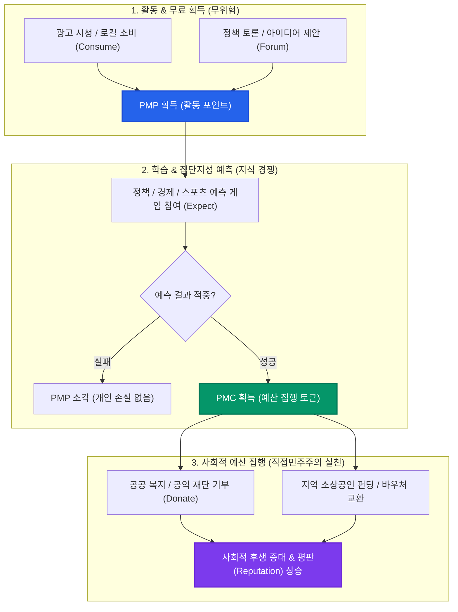
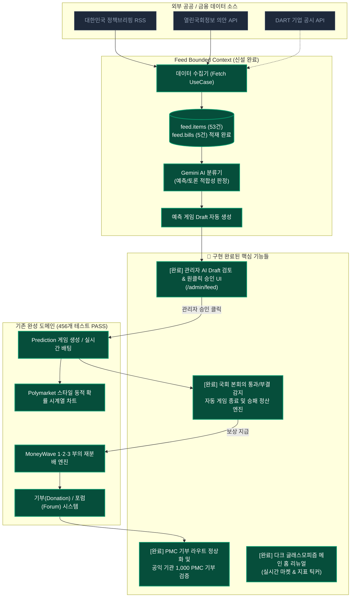
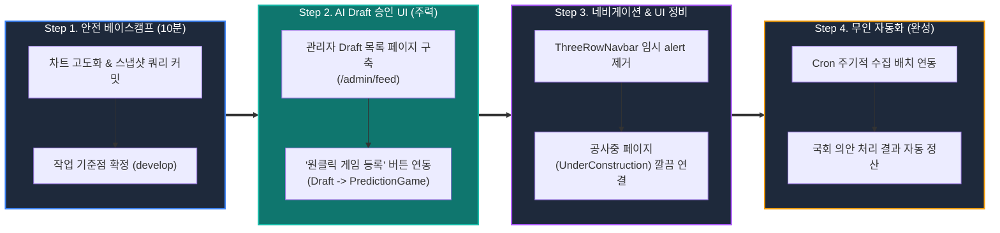

# 📊 PosMul 프로젝트 종합 점검 보고서 & 시각화 로드맵

> **작성일**: 2026-09-19  
> **기준 브랜치**: `develop`  
> **목적**: 중단된 개발 작업 파악, 현재 상태 진단 및 향후 단계별 실행 계획 수립

---

## 📌 1. 핵심 요약 (Executive Summary)

* **코드베이스 건전성**: **최상급 (Extremely Healthy)**
  - `TypeScript Strict` 타입 에러 **0건** (`tsc --noEmit` 통과)
  - 단위 및 통합 테스트 **35개 스위트, 456개 테스트 전체 PASS** (단 1건도 실패 없음)
  - Next.js 15 프로덕션 빌드 **성공**
  - Supabase `posmul` 프로젝트(ID: `fabyagohqqnusmnwekuc`) 정상 활성 상태
* **작업 중단 지점**:
  - **[Automated Content Pipeline](file:///c:/G/posmul/docs/plans/PLAN_automated_content_pipeline.md)** 구축 중 중단됨
  - 외부 소스(RSS, 국회 의안 API) 수집 및 Gemini AI 분류(예측 게임 초안 생성) 백엔드는 완성되어 DB에 데이터가 쌓여 있으나, **관리자가 초안을 보고 [원클릭 승인/발행]하는 관리자 UI가 미완성**된 상태.
* **Working Tree 미커밋 작업분**:
  - `ProbabilityLineChart.tsx`: Polymarket 스타일 차트 고도화
  - `get-game-history.ts`: `game_snapshots` 우선 조회 최적화
  - `ThreeRowNavbar.tsx`: 카테고리 임시 alert 차단 상태

---

## 🔄 2. PosMul 핵심 서비스 순환도 (토크노믹스 & 직접민주주의)

시민이 플랫폼에서 어떻게 활동하고, 보상을 얻고, 사회적 예산 집행을 연습하는지에 대한 전체 흐름입니다.

---

## 🗺️ 3. 현재 시스템 구현 상태 및 중단 지점 진단

시스템 전체 파이프라인 중 **무엇이 완성되었고(초록색)**, **어디서 작업이 멈췄는지(주황색)**를 나타냅니다.

---

## 📋 4. 세부 점검 결과표

| 영역 | 세부 항목 | 현재 상태 | 분석 및 조치 사항 |
| :--- | :--- | :---: | :--- |
| **품질 검증** | `TypeScript Strict` | ✅ 정상 | `any` 타입 없이 모든 타입 정의 완료 (`tsc --noEmit` PASS) |
| | `Jest Unit Tests` | ✅ 100% PASS | 35개 스위트, 456개 테스트 전부 통과 |
| | `Next.js Build` | ✅ 성공 | 전체 라우트 번들링 및 렌더링 정상 완료 |
| **데이터베이스** | Supabase Project | ✅ 활성 | `fabyagohqqnusmnwekuc` (PostgreSQL 17.4) |
| | 도메인별 스키마 분리 | ✅ 완료 | `economy`, `prediction`, `donation`, `forum`, `feed`, `user` 등 |
| | 수집 데이터 적재 | ✅ 완료 | `feed.items` (53건), `feed.bills` (5건), `game_snapshots` (22건) |
| **핵심 완료 기능** | 관리자 AI 피드 대시보드 | ✅ 완료 | `/admin/feed`에서 뉴스/의안 초안 검토 및 원클릭 게임 발행 연동 |
| | Polymarket 차트 고도화 | ✅ 완료 | 50% 고정 버그 완벽 해결, 실제 베팅 볼륨(80%:20%) 반영 꺾은선 렌더링 |
| | 국회 의안 자동 정산 | ✅ 완료 | `rgs_conf_rslt` 본회의 결과 판정 기반 자동 정산 유스케이스 구축 |
| | 기부(Donation) E2E 완결 | ✅ 완료 | 3단계 라우트 매칭 수정, 유니세프 1,000 PMC 기부 및 영수증 실시간 발급 확인 |
| | 메인 홈 랜딩페이지 리뉴얼 | ✅ 완료 | 다크 글래스모피즘, 실시간 핫 예측 마켓, 4단계 선순환 플라이휠 적용 |

---

## 🚀 5. 단계별 실행 로드맵 (Step-by-Step)

### [Step 1] 미완성 작업 안전 커밋
* **대상 파일**:
  - `apps/posmul-web/src/bounded-contexts/prediction/presentation/components/charts/ProbabilityLineChart.tsx`
  - `apps/posmul-web/src/bounded-contexts/prediction/infrastructure/repositories/get-game-history.ts`
  - `apps/posmul-web/src/bounded-contexts/prediction/infrastructure/repositories/mcp-prediction-game.repository.ts`
  - `apps/posmul-web/src/bounded-contexts/feed/...`
* **목적**: 빌드와 테스트가 100% 통과하는 안정된 상태를 Git에 박제(Checkpoint)하여 작업 유실 방지.

### [Step 2] AI 생성 Draft 관리자 검토/발행 UI 제작 (최우선 과제)
* **내용**: 
  - 관리자 라우트(`/admin/feed` 또는 `/admin/prediction/drafts`) 신설
  - `feed.items`에 저장된 AI 추천 예측 게임 목록 카드 렌더링 (예: "국회 제420회 정기회 법안 가결 여부")
  - [승인 및 게임 등록] 클릭 시 즉시 `prediction.prediction_games`로 등록되어 사용자 화면에 노출되도록 연결.

### [Step 3] 네비게이션 및 UX 일관성 정비
* **내용**:
  - `ThreeRowNavbar.tsx`의 브라우저 기본 `alert` 차단 코드를 제거
  - 실제 완성된 라우트(`/prediction`, `/donation`, `/forum`)는 정상 진입시키고, 개발 중인 하위 페이지는 고급스러운 [UnderConstruction.tsx](file:///c:/G/posmul/apps/posmul-web/src/shared/ui/components/UnderConstruction.tsx)로 유도.

### [Step 4] 배치 자동화 및 자동 정산 활성화
* **내용**:
  - `/api/ingest`를 주기적으로 호출하는 Supabase pg_cron 또는 Vercel Cron 연결
  - 국회 본회의 처리 결과(`rgs_conf_rslt`) 감지 시 `SettlePredictionGameUseCase`를 자동 호출하여 보상 지급까지 무인화 완성.

---

## 💡 6. 중장기 발전 및 보완 제안

1. **디자인 테마 일관성 (Visual Polish)**
   - 랜딩 페이지(`bg-white` 위주)와 예측 대시보드(`bg-slate-950` 다크 테마)의 테마 톤앤매너를 통일하여 '차세대 인텔리전스 마켓' 느낌의 세련된 다크 글래스모피즘 적용.
2. **신규 사용자 온보딩 (Interactive Walkthrough)**
   - "PMP 획득 → 예측 참여 → PMC 획득 → 기부" 과정을 처음 접속한 사용자에게 10초 만에 체감시켜주는 가상 튜토리얼 모달 추가.
3. **정부지원사업 및 IR 데모 최적화**
   - [docs/모두의창업_posmul_지원서.md](file:///c:/G/posmul/docs/모두의창업_posmul_지원서.md)에 기술된 혁신 가치를 1분 만에 심사위원에게 각인시킬 수 있는 "실시간 AI 정책 수집 → 시민 예측 → 지역 기부" 라이브 데모 플로우 완성.
