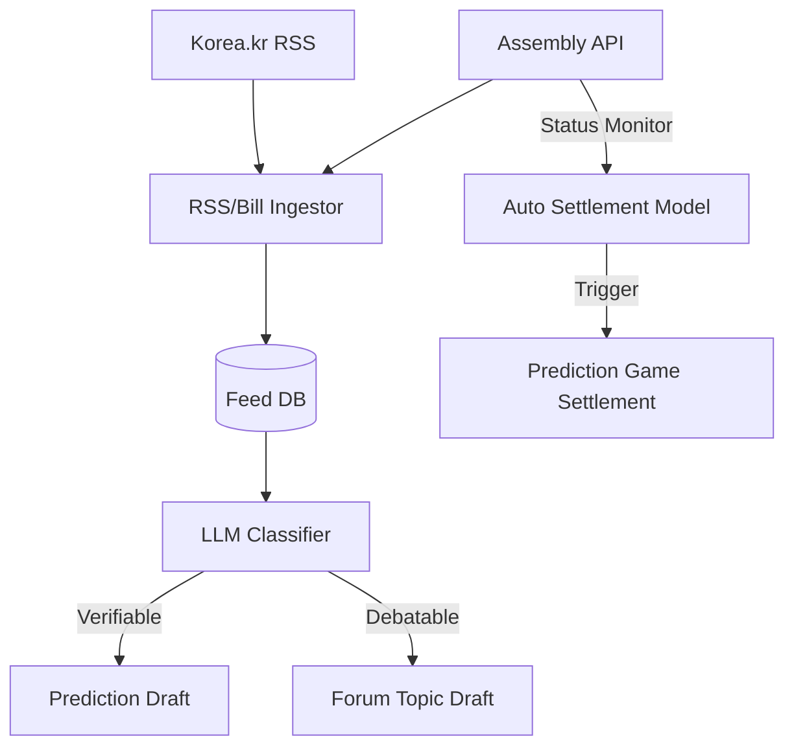
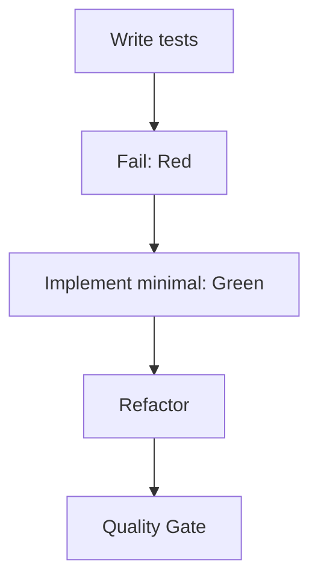
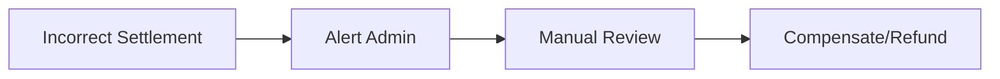

# Implementation Plan: Automated Content Pipeline

**상태**: 🔄 진행 중
**시작일**: 2026-01-19
**마지막 업데이트**: 2026-01-19
**예상 완료**: 2026-01-23

---

**⚠️ 중요 지침(Phase 완료마다 필수)**
1. ✅ 완료한 작업 체크박스 체크
2. 🧪 Quality Gate 커맨드 실행
3. ⚠️ 모든 게이트 통과 확인
4. 📅 "마지막 업데이트" 갱신
5. 📝 Notes에 학습/의사결정 기록
6. ➡️ 그 다음 Phase로 진행

⛔ 실패한 체크가 있으면 다음 Phase로 넘어가지 말 것

---

## 📋 개요

### 기능 설명
대한민국 정책브리핑(RSS)과 열린국회정보 Open API를 연동하여 PosMul의 핵심 콘텐츠인 **예측 게임(Prediction)**과 **공론장 주제(Forum Topic)** 초안을 자동으로 생성하고, 입증 가능한 데이터(국회 의결)를 바탕으로 게임 결과를 **자동 정산**하는 파이프라인을 구축합니다.

### 성공 기준
- [ ] Korea.kr RSS 및 국회 의안 API 수집률 99% 이상 달성
- [ ] AI 분류 정확도 80% 이상 (검증 셋 기준)
- [ ] 의안 처리 결과(`RGS_CONF_RSLT`) 변경 시 1시간 내 Prediction 게임 자동 정산 완료
- [ ] 관리자가 Draft 대시보드에서 1분 내에 콘텐츠 발행 가능

### 사용자 영향
- **관리자**: 콘텐츠 생성 부담 90% 감소 (AI 초안 활용)
- **사용자**: 시의성 있는 정책/이슈 콘텐츠를 실시간으로 접하고, 투명한 결과 처리를 경험

---

## 🏗️ 아키텍처/설계 결정

| Decision | Rationale | Trade-offs |
|----------|-----------|------------|
| **`feed` Bounded Context 신설** | 외부 데이터 수집/가공 로직을 기존 비즈니스 도메인(prediction, forum)과 격리 | 초기 설정 비용 발생, 도메인 간 통신 복잡도 증가 |
| **Edge Function 수집** | 서버리스 환경에서 주기적(Cron) 실행에 적합하며 비용 효율적 | 호출 시간 제한(Function Timeout) 고려 필요 |
| **LLM을 활용한 분류** | 규칙 기반으로 잡기 힘든 "입증 가능성" 및 "주제 적합성" 판단에 유리 | API 비용 발생, 가끔 환각(Hallucination) 가능성 |

---

## 📦 의존성

### 시작 전 필수
- [ ] Supabase Project Credentials
- [ ] Open Assembly API Key (`KEY` 파라미터)
- [ ] OpenAI/Gemini API Key

### 외부 라이브러리
- `rss-parser`: RSS XML 파싱
- `openai` or `@google/generative-ai`: LLM 연동

---

## 🧪 테스트 전략

- 원칙: **TDD**(테스트 먼저)
- 목표: Context별 핵심 로직(Entity, UseCase) 커버리지 80% 이상 준수

---

## 🚀 구현 Phase

### Phase 1: Foundation (Feed Context)
**목표**: `feed` Bounded Context를 생성하고, RSS 및 국회 의안 데이터를 수집하여 DB에 저장하는 인프라 구축
**예상 시간**: 4 hours
**상태**: 🔄 진행 중

#### Tasks
- [ ] 🔴 `FeedItem`, `Bill` Entity 및 Repository Interface 정의 (TDD)
- [ ] 🟢 `feed` DB 스키마 생성 및 Entity 구현
- [ ] 🔴 `FetchRssItemsUseCase`, `FetchBillsUseCase` 테스트 작성
- [ ] 🟢 UseCase 구현 (Adapter: `rss-parser`, `axios`)
- [ ] 🔵 Edge Function (`ingest-rss`, `ingest-bills`) 설정 및 스케줄링

#### Quality Gate ✋
- [ ] `pnpm type-check` 통과
- [ ] `pnpm test` (feed context) 통과
- [ ] Supabase Dashboard에서 `feed.items` 및 `feed.bills` 데이터 적재 확인

---

### Phase 2: AI Classification & Draft
**목표**: LLM을 연동하여 수집된 데이터를 분류하고, 각 도메인(Prediction/Forum)에 Draft를 생성하는 Application 로직 구현
**예상 시간**: 6 hours
**상태**: ⏳ 대기

#### Tasks
- [ ] 🔴 `ContentClassification` VO 및 `ILlmClassifierService` 정의
- [ ] 🟢 `OpenAIClassifierAdapter` 구현 (Prompt Engineering)
- [ ] 🔴 `ClassifyContentUseCase` 테스트 작성
- [ ] 🟢 UseCase 구현 (Prediction/Forum Draft 생성 연동)
- [ ] 🔵 Draft 생성 Event (`DraftCreated`) 발행 및 핸들링

#### Quality Gate ✋
- [ ] LLM 분류 테스트 (샘플 10개) 정확도 확인
- [ ] Prediction/Forum Admin API에서 생성된 Draft 조회 가능

---

### Phase 3: Auto-Settlement
**목표**: 국회 의안 처리 결과(`RGS_CONF_RSLT`) 모니터링을 통한 Prediction 게임 자동 정산 구현
**예상 시간**: 4 hours
**상태**: ⏳ 대기

#### Tasks
- [ ] 🔴 `MonitorBillStatusUseCase` 테스트 작성
- [ ] 🟢 API 상태 변경 감지 로직 구현 (`BillStatusChangedEvent` 발행)
- [ ] 🔴 `AutoSettlePredictionUseCase` 테스트 작성 (Prediction Context)
- [ ] 🟢 기존 `SettlePredictionGameUseCase` 재사용/확장하여 자동 정산 연결
- [ ] 🔵 통합 테스트 (Mock API → 정산 완료)

#### Quality Gate ✋
- [ ] Mock API 테스트: `미처리` -> `가결` 변경 시 게임 상태 `SETTLED` 전환 확인
- [ ] 정산 후 PMC 지급 및 PMP 소각 로그 확인

---

### Phase 4: Integration UI
**목표**: 관리자가 Draft를 검토/수정/발행하고, 자동 정산 현황을 모니터링할 수 있는 대시보드 구현
**예상 시간**: 4 hours
**상태**: ⏳ 대기

#### Tasks
- [ ] `FeedAdminPage`: 수집 현황 및 Draft 목록 조회 UI
- [ ] `DraftReviewModal`: AI 제안 수정 및 `Publish` 버튼 연동
- [ ] `AutoSettlementLog`: 자동 정산 이력 조회 UI

#### Quality Gate ✋
- [ ] UI 컴포넌트 렌더링 테스트
- [ ] E2E 테스트 (Draft 승인 → 게임 생성)

---

## 🧭 리스크/롤백

| Risk | Probability | Impact | Mitigation | Rollback |
|------|-------------|--------|------------|----------|
| **LLM 비용 과다** | Low | Med | 요약 전용 모델 사용, 토큰 제한 | 분류 기능 일시 중지 (수동 전환) |
| **API 스키마 변경** | Med | High | Adapter 계층 격리, 실패 시 Alert | 변경 전 Adapter 코드로 롤백 |
| **잘못된 자동 정산** | Low | Critical | 정산 전 유예 시간(Grace Period) 도입 | 오정산 트랜잭션 보상(Compensating Transaction) 실행 |

---

## 📝 Notes
- 2026-01-19: 프로젝트 룰에 따라 `feed` Context를 신설하여 비즈니스 도메인과 수집 로직을 분리하기로 결정함.
