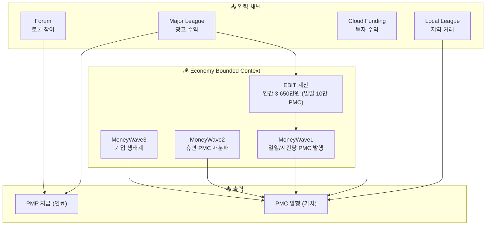
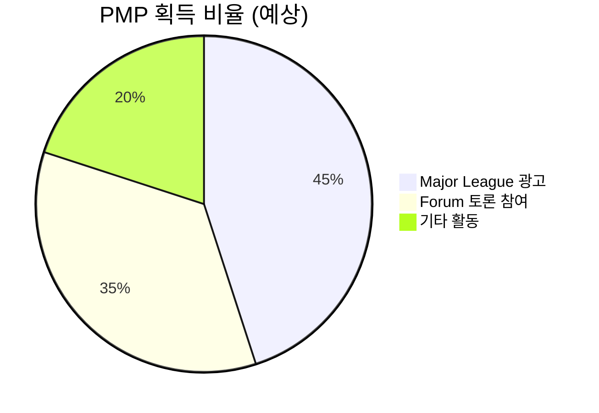
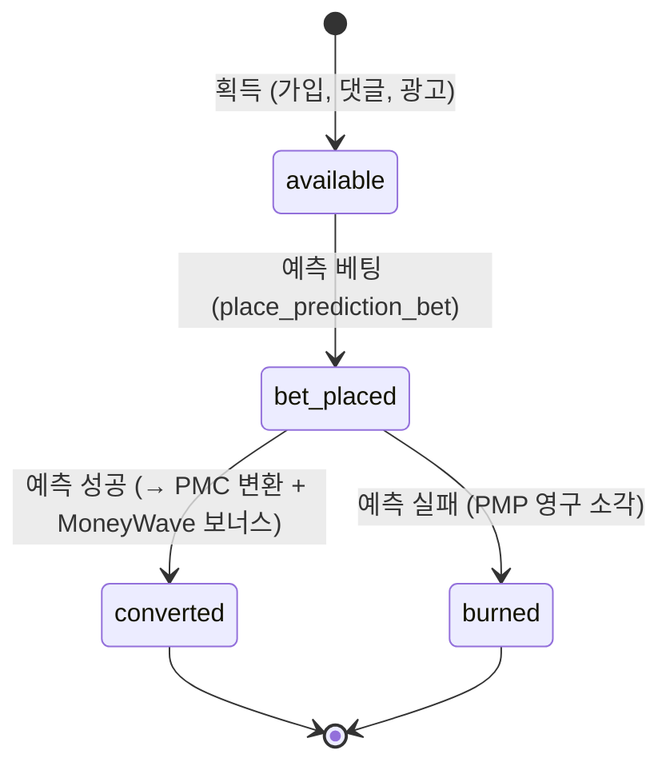

# PosMul 경제 시스템 상세 문서

> PMP/PMC 이중 화폐와 MoneyWave 메커니즘의 기술적 상세

---

## 📖 목차

1. [경제 시스템 아키텍처](#️-경제-시스템-아키텍처)
2. [PMP (Positive Multiplier Point)](#-pmp-positive-multiplier-point)
3. [PMC (Positive Multiplier Coin)](#-pmc-positive-multiplier-coin)
4. [MoneyWave 메커니즘 (v3)](#-moneywave-메커니즘-v3)
5. [경제학 이론 적용](#-경제학-이론-적용)
6. [리스크 관리 및 어뷰징 방지](#-리스크-관리-및-어뷰징-방지)
7. [개발자를 위한 구현 가이드](#-개발자를-위한-구현-가이드)

---

## 🏛️ 경제 시스템 아키텍처

### 전체 흐름도

### 재화-화폐 매핑

| 소비 재화 | 채널 | 획득 화폐 | 경제학적 성격 |
|-----------|------|-----------|---------------|
| **시간** | Major League, Forum | PMP | 무위험 자산 (Risk-Free) |
| **돈** | Local League, Cloud Funding | PMC | 위험 자산 (Risky Asset) |

---

## 💎 PMP (Positive Multiplier Point)

### 속성 정의

| 속성 | 값 | 경제학적 의미 |
|------|-----|---------------|
| **위험도** | 무위험 (Risk-Free) | CAPM 모델의 R_f |
| **변동성** | 없음 | 고정 가치 |
| **발행량** | 활동 기반 | 상한 없음 |
| **소각** | 예측 실패 시 | bet_amount → 영구 소각 |

### 획득 경로 (시간 소비)

| 채널 | 메커니즘 | 보상 기준 |
|------|----------|-----------|
| **신규 가입** | 환영 보너스 (트리거 `handle_new_user`) | +1,000 PMP 즉시 지급 |
| **Forum / 공론장** | 예측 토론 의견(댓글) 작성 (`addPredictionCommentAction`) | 댓글당 +10 PMP 지급 |
| **Major League** | 광고 시청 완료 보너스 | 45% (예정) |
| **기타** | 게임 제안 및 이벤트 참여 | 20% |

### 상태 전이 (State Machine)

---

## 🪙 PMC (Positive Multiplier Coin)

### 속성 정의

| 속성 | 값 | 경제학적 의미 |
|------|-----|---------------|
| **위험도** | 위험 (Risky Asset) | CAPM 모델의 β 반영 |
| **변동성** | 있음 | EBIT 및 집단지성 예측 결과 연동 |
| **발행량** | EBIT 기반 (일일 100,000 PMC) | 연간 예산 상한 있음 |
| **사용** | 기부(Donation, [상세: DONATION_SYSTEM_v2.md](./DONATION_SYSTEM_v2.md)) 및 로컬 투자 전용 | 원화 직접 환금 불가 (사회적 환원) |

### 획득 경로

| 채널 | 메커니즘 | 세부 내용 |
|------|----------|-----------|
| **예측 성공** | PMP $\to$ PMC 전환 + MoneyWave 보너스 | 맞힌 정답자 풀 지분 배당 + 누적 상금 보너스 |
| **Local League** | 지역 소비 즉시 적립 | 착한 소비 마일리지 |
| **Cloud Funding** | 투자 성과 배분 | 소셜 펀딩 성공 리턴 |

---

## 🌊 MoneyWave 메커니즘 (v3)

> 📌 **상세 수식 및 DB 파이프라인 명세**: [MONEYWAVE_V3_SPECIFICATION.md](../explanation/moneywave/MONEYWAVE_V3_SPECIFICATION.md)

MoneyWave는 **일일 100,000 PMC(10만 원 상당)** 예산을 기준으로, KST 활동 시간대 가중치와 공론장 사회적 학습을 결합해 상금을 배분합니다.

### 1. 3단계 파도 구조

1. **MoneyWave 1 (EBIT & 사회적 학습 발행)**:
   - 플랫폼 연간 순이익(EBITDA 3,650만원 / 365) 기반 일일 80,000~100,000 PMC 발행
   - 토론 공론장과 예측 시장에 매시간 공급
2. **MoneyWave 2 (휴면 PMC 재분배 - Behavioral Economics)**:
   - 30일 이상 미활동 계정의 PMC를 감지하여 일일 예산 내 최대 20%(20,000 PMC)까지 활성 게임 풀로 재편입
3. **MoneyWave 3 (기업가·로컬 생태계)**:
   - ESG 파트너 기업 및 지역 소상공인 투자 풀 연동

### 2. KST 활동 시간대 가중치

시민들의 일상 리듬에 맞춰 24시간 동안 파도의 크기를 유동 조절합니다. (24시간 합계는 24.0으로 일일 100,000 PMC 완벽 보존)
- **새벽 (00~06시)**: $0.4\times$ ($1,667\text{ PMC/시간}$)
- **주간 (06~18시)**: $1.0\times$ ($4,167\text{ PMC/시간}$)
- **피크타임 (18~24시)**: $1.6\times$ ($6,667\text{ PMC/시간}$)

### 3. 게임별 파도 흡수 가중치 ($W_g$)

$$\text{Weight}_g = \text{CategoryMult}_c \times \left(\frac{24}{H_g}\right)^{0.75} \times \text{UrgencyBoost}_g \times \Big( 0.40 + 0.30 P_g + 0.30 S_g \Big)$$

- **카테고리 승수**: `POLITICS` (1.3x) > `ECONOMY` / `USER_PROPOSED` (1.2x) > `INVEST` (1.1x) > `SPORTS` / `ENTERTAINMENT` (1.0x)
- **기간 정규화 $(24/H_g)^{0.75}$**: 장기 게임이 아무 활동 없이 상금을 독식하는 것을 방지 (단일 게임 누적 상한 20,000 PMC)
- **마감 임박 부스트**: 마감 24시간 전 1.15x, 마감 6시간 전 1.35x
- **사회적 학습 지수 ($S_g$)**: 해당 예측 게임과 연계된 토론 포스트의 댓글 수, 좋아요 수, 최근 6시간 신규 댓글 수를 로그 스케일로 반영

### 4. 예측 정산 및 보너스 지급 (`public.calculate_reward_amount`)

$$\text{승자 총 보상} = \underbrace{\left(\frac{\text{내 베팅액}}{\text{승리 옵션 베팅액}}\right) \times \text{전체 베팅 풀}}_{\text{기본 배당 (PMP → PMC 전환)}} + \underbrace{\min\left( \text{내 베팅액} \times 2.0,\; \frac{\text{내 베팅액}}{\text{승리 옵션 베팅액}} \times (M_{\text{누적}} \times \alpha) \right)}_{\text{MoneyWave 상금 보너스}}$$

- **사회적 학습 개방률 ($\alpha = \min(1.0,\; 0.20 + 0.10 \times \text{참여자} + 0.08 \times \text{댓글})$)**
- **소액 1인 독식 방지 캡**: 1인당 상금 보너스는 **본인 베팅액의 최대 2.0배**로 제한하여 어뷰징 방지

---

## 📊 경제학 이론 적용

### 1. Agency Theory (Jensen & Meckling, 1976)
- 시민(Principal)과 정책·기업 대리인(Agent) 사이의 정보 비대칭을 공론장 집단지성으로 해결
- 측정 지표: **Agency Score (기본 투명성 40% + 예측 참여 30% + 사회적 학습 30%)**

### 2. Prospect Theory (Kahneman & Tversky, 1979)
- 손실회피 계수 $\lambda = 2.25$: 예측 실패 시 PMP 소각으로 Skin in the game 유도
- 30일 휴면 계정의 단계적 경고 및 재분배로 유통속도 극대화

---

## 🔒 리스크 관리 및 어뷰징 방지

1. **일일 예산 상한제 (Hard Cap)**:
   - 일일 총 발행량은 플랫폼 순이익 기반 $100,000\text{ PMC}$로 엄격히 통제되어 하이퍼인플레이션 차단
2. **소액 봇 털이 방지 (Anti-Sniper Cap)**:
   - 참여자가 적은 방에 100 PMP만 걸고 맞혀서 수만 PMC를 가져가지 못하도록, 개인 보너스를 베팅액의 $2.0\times$로 제한
3. **게임별 상한제 (Single Game Cap)**:
   - 어떤 장기 게임도 누적 $20,000\text{ PMC}$를 초과하여 적립할 수 없음
4. **마감 기한 초과 자동 환불 (Safe Void)**:
   - 마감 후 7일간 정산되지 않는 게임은 `prediction.void_stale_games()`가 전액 원금 환불 처리

---

## 👨‍💻 개발자를 위한 구현 가이드

### 핵심 DB 함수 및 스케줄러

| 함수 / 잡 | 주기 | 설명 |
| :--- | :---: | :--- |
| `economy.refresh_daily_money_wave_snapshot()` | 매일 00:00 KST | 일일 100,000 PMC 스냅샷 갱신 |
| `economy.compute_prediction_hourly_game_pools()` | 매 정각 (`0 * * * *`) | KST 시간대 및 사회적 학습 가중치 배분 |
| `public.settle_prediction_game(p_game_id, p_option_id)` | 온디맨드 / 오라클 | 게임 종료 정산 및 PMC/PMP 원장 처리 |
| `economy.grant_pmp(p_user_id, p_amount, ...)` | 활동 시 | PMP 활동 보상 지급 및 트랜잭션 기록 |
| `auto-settle-expired-games` | 5분마다 | 마감 시간 도래 게임 `ACTIVE` $\to$ `CLOSED` 전이 |

### 관련 파일 링크

- [MONEYWAVE_V3_SPECIFICATION.md](../explanation/moneywave/MONEYWAVE_V3_SPECIFICATION.md): v3 세부 명세서
- [useWaveCalculation.ts](../../apps/posmul-web/src/shared/ui/components/layout/MoneyWave/useWaveCalculation.ts): UI 슬롯머신 및 누적 풀 훅
- [wave-math.ts](../../apps/posmul-web/src/shared/ui/components/layout/MoneyWave/wave-math.ts): 카테고리 매핑 및 Reveal 수식
- [prediction-comment.actions.ts](../../apps/posmul-web/src/app/prediction/components/prediction-comment.actions.ts): 공론장 의견 작성 및 +10 PMP 지급
- [settlement-orchestrator.service.ts](../../apps/posmul-web/src/bounded-contexts/prediction/application/services/settlement-orchestrator.service.ts): 오라클 자동 정산기

---

**버전**: 3.0 | **최종 수정일**: 2026-11-05 | **상태**: 프로덕션 운영 중 (`posmul.com`)
