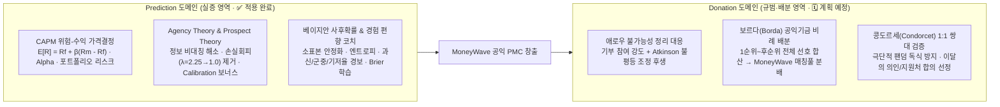

# 📊 PosMul 경제적 논거: CAPM · Agency · Behavioral 경제학 기반 예측과 사회선택(Donation 계획 예정)

> **참고 레퍼런스**: [[한순구의 노벨경제학 2부] 중환자실 의사는 왜 저축 안 할까? 내 경험이 판단을 망치는 '확률의 함정', 노벨 경제학상이 증명한 다수결의 함정 (연세대학교 경제학부 한순구 교수)](https://www.youtube.com/watch?v=XruQm-DF4GU)  
> **작성일**: 2026-11-11 (도메인 이원화 아키텍처 반영 개정)  
> **목적**: PosMul 플랫폼이 **"사후 정답이 존재하는 실증 영역(Prediction)"** 과 **"사후 정답이 없는 가치·배분 영역(Donation)"** 을 어떻게 노벨경제학상 이론과 알고리즘으로 이원화해 설계하는지 정의합니다.

---

## 1. 핵심 테제: 정답의 유무에 따른 도메인 이원화 아키텍처

한순구 교수의 강의가 짚어낸 두 가지 의사결정 실패는 **도메인의 성격(정답의 존재 여부)** 에 따라 해법이 달라집니다.

1. **실증 · 사실 추정 영역 → `Prediction` 도메인 (✅ 현재 구현 및 연동 완료)**:
   - 경제 지표(ECOS/KOSIS), 기업 공시(DART), 스포츠, 입법 결과 등 **사후 오라클을 통해 객관적 정답(Ground Truth)이 판명**됩니다.
   - 따라서 다수결 합의(타협)보다 **객관적 확률 추정의 정확도(Calibration)**, **CAPM 기반 위험-보상 가격결정**, **Agency Theory 기반 정보 비대칭 해소**, **경험 편향 교정 및 Brier 지속학습**이 본질입니다.
2. **규범 · 가치 배분 영역 → `Donation` 도메인 (🗓️ 계획 예정 / Planned)**:
   - 한정된 MoneyWave 공익 기금(PMC 풀)을 소아암 치료, 결식아동 식품, 독거어르신 쌀, 자립청년 창업 중 어디에 우선 배분할지는 **수학적 정답이 존재하지 않는 가치 판단 문제**입니다.
   - 바로 이 영역이 **애로우 불가능성 정리, 콩도르세 1:1 쌍대 비교, 보르다 카운트**가 해결해야 할 본래 목적지이며, **향후 Donation 도메인 고도화 단계에 적용할 예정(Planned)** 입니다.

---

## 2. Prediction 도메인 경제학 아키텍처 (✅ 구현 완료)

### 2.1 CAPM 위험-수익 모델 (`CAPMEngine` · `prediction-economic-model.ts`)
- **공식**:
  $$E[R_k] = R_f + \beta_k \cdot (R_m - R_f)$$
- 게임 중요도(난이도), 시장 엔트로피(불확실성), 참여 깊이, 옵션의 시장 이탈도($1 - p_k$)를 결합해 **옵션별 체계적 위험 베타($\beta_k$)** 와 **요구수익률($E[R_k]$)**, **Jensen's Alpha ($\alpha_k = R_{\text{expected},k} - E[R_k]$)** 를 실시간 산출합니다.
- **포트폴리오 위험 평가 (`assessPortfolioRisk`)**: 참여자의 보유 `PMP` 잔고 대비 참여 비중(`stake / balance`)을 실시간 계산해 `LOW (≤10%)`, `MEDIUM (≤30%)`, `HIGH (>30%)` 리스크 가이드를 제공합니다.

### 2.2 Agency Theory & Behavioral Economics (`PredictionEconomicService` · `AgencyTheoryEngine` · `BehavioralEconomicsEngine`)
- **Agency Theory (Jensen & Meckling, 1976)**: 시민(Principal)이 예측 참여를 통해 정보 비대칭 비용을 낮추면 정보 품질($\text{accuracy} \times \text{confidence}$), 집단지성 효과($\min(0.10, N/1000)$), 소수 정답자 독점 프리미엄(`exclusivityBonus`)을 보상합니다 (`PredictionSettlementService.calculateWinnerPayouts` 정산 연동).
- **Prospect Theory (Kahneman & Tversky)**: 현금 베팅의 손실 회피 계수($\lambda \approx 2.25$)를 **무위험 학습 자산 `PMP`** 로 중화($\lambda \to 1.0$)하고, 정산 시 적정 확신도 Calibration 보너스(최대 `+20%`)와 과신 페널티(`overconfidencePenalty`)를 적용합니다.

### 2.3 베이지안 업데이트와 확률적 판단 (`computeBayesianMarketPosterior` · `computeBayesianPosteriorTimeline`)
- **Dirichlet-Multinomial 켤레 사전분포** 기반으로 반감기 14일 시간 감쇠, 참여자 누적 스킬 가중치(`skillWeight`), 확신도, 로그 스테이크 강도를 순차 반영하여 **소표본 100% 폭주 방지 사후확률**, **95% 신뢰구간**, **Shannon 엔트로피**를 계산합니다.

### 2.4 경험의 편향("중환자실 의사 함정") 극복과 지속적 학습 (`evaluateExperienceBias` · Brier 폐루프)
- **참여 전**: [`BalancedDecisionBriefing.tsx`](../../apps/posmul-web/src/bounded-contexts/prediction/presentation/components/BalancedDecisionBriefing.tsx)의 중립 · 찬성 · 반대 3단 읽기(`+20 PMP`)로 가용성 편향을 차단합니다.
- **참여 시**: `evaluateExperienceBias`가 실시간으로 **과신(`overconfidenceRisk`)**, **단기 군중 쏠림(`herdingBiasRisk`)**, **기저율 이탈(`baseRateNeglectRisk`)** 을 진단합니다.
- **정산 후**: `Brier Score`, `Log Loss`, `Calibration Gap`, **Empirical Bayes Shrinkage($\frac{n}{n+4}$) 적용 EMA Skill Weight** 를 산출해 다음 마켓 예측의 정보 가중치로 환류합니다.

---

## 3. Donation 도메인 사회선택 아키텍처 (🗓️ 계획 예정 / Planned)

> **현재 상태**: 핵심 사회선택 순수 알고리즘(`analyzeSocialChoiceAggregation`)은 도메인 유틸리티로 구현·단위테스트까지 검증 완료되었으며, **Prediction UI/참여 흐름에서는 분리하고 추후 Donation 도메인 고도화 시 적용 예정**입니다.

### 3.1 왜 Donation에서 애로우 · 콩도르세 · 보르다가 결정적인가
- **단순 모금액/1인 1표의 함정**: 특정 팬덤이나 마케팅에 노출된 소수 캠페인이 1위 표를 독식하면, 다수의 시민이 반대하거나 덜 시급하다고 보는 곳에 MoneyWave 공익 기금이 쏠립니다.
- **적용 예정 메커니즘 (Donation Roadmap)**:
  1. **MoneyWave 공동 매칭 기금 보르다(Borda) 배분 라운드**: `TIED_GOODS`, `NGO_MILESTONE`, `HERO_BOUNTY`, `DREAM_LADDER` 4대 필러 프로젝트 후보들에 대해 시민이 순위/비선호를 제출하면 **보르다 정규화 점수 비율로 공익 매칭 풀을 분배**합니다.
  2. **이달의 의인(`HERO_BOUNTY`) / 지원처 선정 콩도르세(Condorcet) 1:1 쌍대 검증**: 모든 후보 간 1:1 승률 매트릭스와 순환 역설($A \succ B \succ C \succ A$) 여부를 공개해 범국민적 합의 승자를 선정합니다.
  3. **애로우 대응 사회후생 보정**: 기존 `UtilityFunctionEstimationService`의 **Atkinson 불평등 조정** 및 **Rawls 최소수혜자 우선 원칙**을 결합해 소외된 공익 프로젝트가 탈락하지 않도록 보정합니다.

---

## 4. 코드베이스 구현 및 로드맵 매핑 표

| 원리 / 모델 | 대상 도메인 | 상태 | 실제 구현 모듈 및 위치 |
| :--- | :---: | :---: | :--- |
| **CAPM · Agency · Prospect 통합 경제 모델** | `Prediction` | ✅ **구현·적용** | [`prediction-economic-model.ts`](../../apps/posmul-web/src/bounded-contexts/prediction/domain/services/prediction-economic-model.ts), [`prediction-economic.service.ts`](../../apps/posmul-web/src/bounded-contexts/prediction/domain/services/prediction-economic.service.ts), [`prediction-settlement.service.ts`](../../apps/posmul-web/src/bounded-contexts/prediction/application/services/prediction-settlement.service.ts) 상세 UI: [`prediction-detail-by-slug.tsx`](../../apps/posmul-web/src/app/prediction/components/prediction-detail-by-slug.tsx), [`client.tsx`](../../apps/posmul-web/src/app/prediction/[slug]/client.tsx) |
| **순차 베이지안 · 경험 편향 코치 · Brier 학습** | `Prediction` | ✅ **구현·적용** | [`collective-intelligence-engine.ts`](../../apps/posmul-web/src/bounded-contexts/prediction/domain/services/collective-intelligence-engine.ts), [`get-game-history.ts`](../../apps/posmul-web/src/bounded-contexts/prediction/infrastructure/repositories/get-game-history.ts), [`BalancedDecisionBriefing.tsx`](../../apps/posmul-web/src/bounded-contexts/prediction/presentation/components/BalancedDecisionBriefing.tsx) |
| **애로우 · 콩도르세 · 보르다 사회선택 배분 엔진** | `Donation` | 🗓️ **계획 예정** (엔진/테스트 준비 완료, 서비스 연동 예정) | 준비된 순수 알고리즘: [`collective-intelligence-engine.ts`](../../apps/posmul-web/src/bounded-contexts/prediction/domain/services/collective-intelligence-engine.ts) (`analyzeSocialChoiceAggregation`) 향후 연동 대상: [`DonationPillarsView.tsx`](../../apps/posmul-web/src/app/donation/components/DonationPillarsView.tsx), [`donation-v2.actions.ts`](../../apps/posmul-web/src/app/donation/actions/donation-v2.actions.ts) |
| **경제학 · 집단지성 단위 테스트** | `Prediction` · `Shared` | ✅ **통과** | [`prediction-economic-model.test.ts`](../../apps/posmul-web/src/bounded-contexts/prediction/domain/services/__tests__/prediction-economic-model.test.ts), [`collective-intelligence-engine.test.ts`](../../apps/posmul-web/src/bounded-contexts/prediction/domain/services/__tests__/collective-intelligence-engine.test.ts) |
