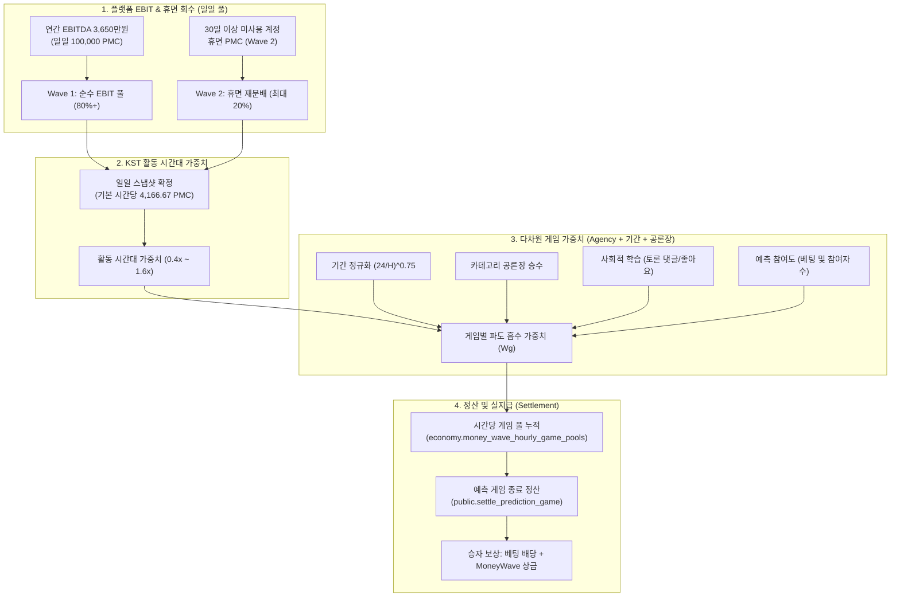

# MoneyWave v3 시스템 기술 명세서 및 경제학적 배분 엔진

> **문서 상태**: 운영 프로덕션 반영 완료 (`v3_social_learning_time_weighted`)  
> **기준 일자**: 2026-11-05  
> **관련 도메인**: Economy, Prediction, Forum  

---

## 1. 개요 및 설계 철학

PosMul의 **MoneyWave**는 플랫폼의 경제적 성과(EBIT)와 시민들의 공론장 참여를 결합하여, 집단지성 예측 시장에 지속 가능한 유동성과 동기를 공급하는 **3단계 통화 발행 및 재분배 엔진**입니다.

초기 모델의 한계(단순 균등 분배, 장기 게임의 상금 독식, 화면 연출과 실제 정산 사이의 괴리)를 극복하기 위해 **v3 알고리즘**(`v3_social_learning_time_weighted`)으로 전면 고도화되었습니다.

---

## 2. 경제학 이론적 배경

### 2.1 Jensen & Meckling 대리인 이론 (Agency Theory, 1976)
- **문제 인식**: 시민(주주/원칙자, Principal)과 정책결정자(대리인, Agent) 사이의 **정보 비대칭성**은 사회적 비용을 유발합니다.
- **해결책**: 집단지성을 모으는 예측 시장과 토론 공론장에 보상을 집중시켜 정보 비대칭을 완화합니다.
- **Agency Score 지표 구성**:
  $$\text{Agency Score} = 0.40 \times \text{기본 투명성} + 0.30 \times \text{예측 참여도} + 0.30 \times \text{사회적 학습}$$

### 2.2 행동경제학 손실회피 (Kahneman & Tversky Prospect Theory, 1979)
- **Wave 2 재분배 메커니즘**: PMC는 환금성 암호화폐가 아닌 '기부 및 사회적 환원 수단'입니다. 30일 이상 사용하지 않고 방치된 휴면 계정의 PMC는 유통속도를 높이기 위해 손실회피 경고 후 점진적으로 활성 시민 풀로 재분배됩니다.

### 2.3 네트워크 경제학 & 사회적 학습 (Social Learning, Bikhchandani et al.)
- 단순한 다수결 투표가 아닌, **"왜 그렇게 예측하는가?"에 대한 근거 제시와 토론(Forum Comments & Likes)**이 활발한 게임에 더 높은 상금을 배분하여 정보 생산을 유도합니다.

---

## 3. 핵심 수식 체계

### 3.1 일일 총 발행량 및 일일 스냅샷
- **일일 총 발행 예산**: **$100,000\text{ PMC}$ (하루 10만 원 상당)**
- **연간 설정**: $\text{annual\_ebitda} = 36,500,000$ (세율 및 이자율 0% 기준)
- **일일 풀 분배**:
  $$\text{Daily Total} = \frac{\text{annual\_ebitda}}{365} = 100,000\text{ PMC}$$
  $$\text{Wave 2 (휴면 재분배)} = \min\left(\text{Daily Total} \times 0.20,\; \text{Dormant PMC} \times 0.01\right)$$
  $$\text{Wave 1 (순수 EBIT)} = \text{Daily Total} - \text{Wave 2}$$
  $$\text{Base Hourly Total} = \frac{\text{Daily Total}}{24} = 4,166.67\text{ PMC}$$

### 3.2 KST 활동 시간대별 가중치 ($M_{\text{time}}$)
시민들의 생활 패턴에 맞춰 24시간 동안 유동적으로 파도의 크기를 조절하며, 24시간 합계는 정확히 $24.0$으로 수렴하여 일일 $100,000\text{ PMC}$를 보존합니다.

| 시간대 (KST) | 가중치 ($M_{\text{time}}$) | 시간당 배정 예산 | 경제학적 의미 |
| :--- | :---: | :---: | :--- |
| **새벽 (00:00 ~ 05:59, 6시간)** | **$0.4\times$** | **$1,666.67\text{ PMC}$** | 심야 비활동 시간 유동성 낭비 방지 |
| **주간 (06:00 ~ 17:59, 12시간)** | **$1.0\times$** | **$4,166.67\text{ PMC}$** | 일상적 참여 및 정보 탐색 시간 |
| **피크 (18:00 ~ 23:59, 6시간)** | **$1.6\times$** | **$6,666.67\text{ PMC}$** | 퇴근 후 활발한 토론과 베팅이 일어나는 골든타임 |

$$\text{Effective Hourly Pool} = \text{Base Hourly Total} \times M_{\text{time}}$$

---

### 3.3 게임별 파도 흡수 가중치 ($W_g$)

#### (1) 게임 기간 정규화 (Duration Normalization)
장기 게임(수개월 분기 실적 등)이 아무런 활동 없이도 장시간 방치되어 상금을 독식하는 현상을 원천 방지합니다.
$$\text{DurationFactor}_g = \left(\frac{24}{\text{duration\_hours}_g}\right)^{0.75}$$
- **단기 게임 (1~3일)**: 시간당 높은 비중으로 상금 흡수 (빠른 순환)
- **초장기 게임 (1~3개월)**: 활동이 없을 때 시간당 매우 낮은 비중으로 시작
- **단일 게임 최대 누적 한도**: $20,000\text{ PMC}$ 상한(Cap) 도달 시 기본 유지 가중치($0.05$)로 축소

#### (2) 마감 임박 부스트 (Urgency Boost)
결과 판정이 가까워질수록 시민들의 주목도가 높아지므로 가중치를 강화합니다.
$$\text{UrgencyBoost}_g = \begin{cases} 1.35 & (\text{남은 시간} \le 6\text{시간}) \\ 1.15 & (\text{남은 시간} \le 24\text{시간}) \\ 1.00 & (\text{기타}) \end{cases}$$

#### (3) 카테고리 공론장 승수 ($C_c$)
사회적 중요도와 공공성이 높은 카테고리에 인센티브를 부여합니다.
- `POLITICS` (법안/정책): **$1.30\times$**
- `ECONOMY` (거시경제/물가/금리): **$1.20\times$**
- `USER_PROPOSED` (시민 직접 제안): **$1.20\times$**
- `INVEST` (기업 실적/산업): **$1.10\times$**
- `SPORTS` / `ENTERTAINMENT` (스포츠/문화): **$1.00\times$**

#### (4) 예측 참여 & 사회적 학습 종합 점수
$$W_g = C_c \times \text{DurationFactor}_g \times \text{UrgencyBoost}_g \times \Big( 0.40 + 0.30 \times P_g + 0.30 \times S_g \Big)$$
- **예측 참여 점수 ($P_g$)**:
  $$P_g = 1.0 + 0.6 \ln(1 + \text{참여자 수}) + 1.2 \ln(1 + \text{최근 6시간 신규 베팅 수})$$
- **사회적 학습 점수 ($S_g$, Forum 토론 연계)**:
  $$S_g = 1.0 + 0.8 \ln(1 + \text{댓글 수}) + 0.4 \ln(1 + \text{좋아요 수}) + 1.5 \ln(1 + \text{최근 6시간 신규 댓글 수})$$

---

### 3.4 승자 정산 및 보상 지급 공식

실제 예측이 종료되어 정산(`public.settle_prediction_game`)될 때, 정답을 맞힌 승자에게 베팅 원금/배당과 함께 누적된 MoneyWave 상금이 지급됩니다.

$$\text{Total Reward} = \text{Base Reward} + \text{MoneyWave Bonus}$$

#### (1) 기본 베팅 풀 배당
$$\text{Base Reward} = \left(\frac{\text{User Bet}}{\text{Winning Pool}}\right) \times \text{Total Bet Pool}$$

#### (2) MoneyWave 사회적 학습 상금 보너스
$$\text{MoneyWave Bonus} = \min\left( \text{User Bet} \times 2.0,\; \frac{\text{User Bet}}{\text{Winning Pool}} \times (M_{\text{누적}} \times \alpha) \right)$$
- **사회적 학습 개방률 ($\alpha$)**:
  $$\alpha = \min\left(1.0,\; 0.20 + 0.10 \times \text{참여자 수} + 0.08 \times \text{댓글 수}\right)$$
  - 참여자 5명과 토론 댓글 5개만 확보되어도 누적 상금 풀의 $100\%$가 개방됩니다.
- **소액 1인 독식(어뷰징) 방지 상한 ($\text{User Bet} \times 2.0$)**:
  - 참가자가 적은 게임에 1명이 100 PMP만 걸고 누적 상금 수만 PMC를 싹쓸이하는 취약점을 방지합니다.
  - 혼자 맞춰도 원금 대비 최대 $+200\%$의 확정 수익을 보장하면서, 미지급된 잔여 풀은 다음 사이클로 이월 보존됩니다.

---

## 4. 데이터베이스 및 스케줄러 아키텍처

### 4.1 핵심 테이블 구성

| 테이블명 | 스키마 | 주요 역할 |
| :--- | :---: | :--- |
| `pmp_pmc_accounts` | `economy` | 사용자 계좌 잔액 단일 소스 (SSOT: `pmp_balance`, `pmc_balance`) |
| `pmp_pmc_transactions` | `economy` | 모든 PMP/PMC 입출금 및 소각 원장 기록 (`PMP_EARN`, `PMP_SPEND`, `PMC_EARN`, `PMP_BURN`) |
| `money_wave_config` | `economy` | 연간 EBITDA(3,650만원), 목표 타임존(Asia/Seoul), 알고리즘 버전 관리 |
| `money_wave_daily_snapshots` | `economy` | 매일 자정 생성되는 일일 총 풀(100,000 PMC) 및 Wave 1/2 분배 기준 스냅샷 |
| `money_wave_hourly_category_allocations` | `economy` | 매 정각 카테고리별로 확정되는 시간당 풀 |
| `money_wave_hourly_game_pools` | `economy` | 매 정각 각 게임에 확정 배정되는 시간당 상금 (Depth 5 Truth) |
| `money_wave_history` | `economy` | 정산 완료 시 실제 지급된 MoneyWave PMC 총액 및 통계 감사 기록 |

### 4.2 스케줄러 (`cron.job`)

1. **`moneywave_daily_snapshot_refresh` (`0 15 * * *` UTC = 00:00 KST)**:
   - 매일 자정 `economy.refresh_daily_money_wave_snapshot()`을 실행하여 당일의 100,000 PMC 스냅샷을 갱신합니다.
2. **`moneywave_hourly_alloc_prediction_game_pools` (`0 * * * *`)**:
   - 매 정각 `economy.compute_prediction_hourly_game_pools()`를 실행하여 KST 활동 가중치와 사회적 학습 지표를 반영한 게임별 상금을 확정 기록합니다.
3. **`auto-settle-expired-games` (`*/5 * * * *`)**:
   - 베팅 마감 시간이 도래한 게임을 `ACTIVE` $\to$ `CLOSED`로 안전하게 상태 전이하고, 마감 후 7일이 경과한 미정산 게임을 자동 무효화(`void`) 환불합니다.
4. **`cron-prediction-settle` (`30 * * * *`)**:
   - 국회 의안 결과 및 외부 오라클(DART, KOSIS 등) 결과를 조회하여 승자를 확정하고 상금을 정산합니다.

---

## 5. UI/UX 연동 원칙 (Truth & Reveal)

프론트엔드([useWaveCalculation.ts](file:///c:/G/posmul/apps/posmul-web/src/shared/ui/components/layout/MoneyWave/useWaveCalculation.ts))는 서버가 매 정각 확정한 **Truth Pool**을 기준으로 동작하며, 다음과 같은 원칙을 따릅니다:

1. **클라이언트 Reveal 연출**:
   - 정각 직후에는 확정 풀의 $50\%$부터 시작하여, 1시간 동안 시간이 흐름에 따라 $100\%$로 단조 증가하며 숫자가 차오르는 슬롯머신 애니메이션을 제공합니다.
2. **개별 게임 누적 표시**:
   - 개별 예측 게임 카드에서는 **이전 시간까지 누적된 확정 적립금 + 현재 시간의 Reveal 배정액**이 합산되어 표시됩니다.
3. **네트워크 성능 최적화**:
   - 브라우저의 10~15초 폴링 시 전체 데이터를 스캔하지 않고 `head: true` 카운트 쿼리를 사용하여 DB 부하를 최소화했습니다.

---

## 6. 개발자 참조 및 관련 코드 파일

- **DB RPC 및 트리거 정의**:
  - `economy.refresh_daily_money_wave_snapshot()`: 일일 스냅샷 산출
  - `economy.compute_prediction_hourly_game_pools()`: 시간대/사회적 학습 가중치 배분
  - `public.calculate_reward_amount()`: 정산 보상 및 보너스 산출
  - `public.settle_prediction_game()`: 게임 종료 및 원장 기록
  - `economy.grant_pmp()`, `economy.grant_pmc()`: 활동 리워드 및 보상 지급
- **애플리케이션 레이어**:
  - [useWaveCalculation.ts](file:///c:/G/posmul/apps/posmul-web/src/shared/ui/components/layout/MoneyWave/useWaveCalculation.ts): 프론트엔드 누적 계산 훅
  - [wave-math.ts](file:///c:/G/posmul/apps/posmul-web/src/shared/ui/components/layout/MoneyWave/wave-math.ts): 카테고리 매핑 및 Reveal 수학 함수
  - [prediction-comment.actions.ts](file:///c:/G/posmul/apps/posmul-web/src/app/prediction/components/prediction-comment.actions.ts): 공론장 댓글 작성 및 +10 PMP 지급 액션
  - [settlement-orchestrator.service.ts](file:///c:/G/posmul/apps/posmul-web/src/bounded-contexts/prediction/application/services/settlement-orchestrator.service.ts): 오라클 자동 정산 오케스트레이터
  - [settle-prediction-game.use-case.ts](file:///c:/G/posmul/apps/posmul-web/src/bounded-contexts/prediction/application/use-cases/settle-prediction-game.use-case.ts): 정산 유스케이스 (`CLOSED`/`SETTLING` 지원)

