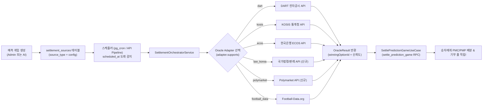

# PosMul 예측 게임별 API 매핑 명세서 (Oracle & Settlement Mapping Spec)

> **"어떤 예측 게임을 만들 때, 어떤 API를 사용하고, 어떻게 세팅(설정)하는가?"**  
> 본 문서는 PosMul 플랫폼에서 동작 중인 7대 오라클 어댑터와 신규 전문직/기후/글로벌 데이터 소스가 실제 예측 게임과 1:1로 결합되는 매핑 규격을 정의합니다.

---

## 1. 예측 게임과 API가 연결되어 작동하는 전체 원리 (How It Works)

PosMul의 예측 게임 시스템은 **"게임 생성 ➔ 정산 소스 등록 ➔ 크론 오라클 수집 ➔ 자동 정산"**의 완전 무인 파이프라인으로 설계되어 있습니다.



### 핵심 DB 구조 (`prediction.settlement_sources`)
게임을 만들 때 DB에 아래 4개 필드를 세팅함으로써 "이 게임은 이 API로 판정하라"고 지정합니다:
1. `game_id`: 대상 예측 게임 UUID
2. `source_type`: 사용할 API 식별자 (`"dart"`, `"kosis"`, `"ecos"`, `"football_data"`, `"law_korea"` 등)
3. `source_config`: 각 API가 필요로 하는 고유 파라미터 (종목코드, 경기ID, 통계표코드, 판정 기준값 등)
4. `scheduled_at`: API를 호출하여 결과를 판정할 기준 시각

---

## 2. 예측 게임 카테고리별 API 1:1 매핑 마스터 사전

| 카테고리 | 예측 게임 유형 (예시) | 매핑 API (`source_type`) | 호출 파라미터 (`source_config`) | 판정 알고리즘 |
| :--- | :--- | :--- | :--- | :--- |
| **🎓 학업·자격증 & 직무 커리어<br>(Study & Career)** | **• 주택관리사/공인중개사 판례 O/X**<br>• 직장인 필수 노동법/연차 상식<br>• Q-Net 국가기술자격 기출 모닝 10<br>• 공무원/한국사 일일 핵심 퀴즈 | **`study_career`**<br>(법제처 + Q-Net 공공데이터 + 고용노동부 + AI 오라클) | `{ track: "housing_manager" | "labor_law" | "qnet_license", questionId: "q_2026_01", answerKey: "O", explanationSource: "law.go.kr" }` | 공식 법령/판례 요지 또는 공인 시험 정답표와 유저 선택지 일치 여부 판정 |
| **📈 거시경제 & 정책** | **• 한국은행 기준금리 결정** (인상/동결/인하)<br>• 원/달러 환율 1,400원 돌파 여부<br>• 소비자물가지수(CPI) 상승률 | **`ecos`** (한국은행)<br>**`kosis`** (통계청) | `{ statCode: "722Y001", itemCode: "0101000", cycle: "M", operator: ">=", threshold: 3.5 }` | 공식 공표된 지표 수치와 임계값(`threshold`) 수식 비교 |
| **🏢 기업 실적 & 공시** | **• 삼성전자 분기 영업이익 10조 초과?**<br>• 현대차 배당금 증액 여부<br>• 테슬라 분기 EPS 컨센서스 상회? | **`dart`** (국내 상장사)<br>**`fmp`** (해외/미국 주식) | `{ corpCode: "00126380", reportCode: "11011", fsDiv: "CFS", accountId: "ifrs-full_GrossProfit" }` | 분기보고서 공시 데이터 파싱 후 목표 수치 초과 여부 자동 판정 |
| **📊 주가 & 환율** | **• 오늘 코스피 지수 상승 마감?**<br>• 엔비디아(NVDA) 주가 150달러 돌파? | **`alpha-vantage`** | `{ symbol: "005930.KS", targetPrice: 80000, condition: "ABOVE" }` | 장 마감 직후 종가(`05. price`)와 기준가 비교 |
| **🌐 글로벌 핫이슈** | **• 미 연준 12월 금리 인하 확률**<br>• 비트코인 연내 10만 달러 돌파?<br>• 글로벌 주요 선거 결과 | **`polymarket`** (신규) | `{ marketSlug: "fed-interest-rates-december-2024", conditionId: "0x...", targetProbability: 0.5 }` | 글로벌 베팅 종결 시점의 최종 결제 오라클(UMA) 승리 토큰 확인 |
| **☀️ 기후 & 일상 생활** | **• 내일 서울 영하 10도 이하 한파?**<br>• 이번 주말 강원도 첫눈 관측? | **`kma_weather`** (기상청)<br>**`open_meteo`** (오픈소스) | `{ nx: 60, ny: 127, weatherType: "TMIN", threshold: -10, operator: "<=" }` | 익일 06:00 최저기온 실제 관측 데이터와 비교 |
| **⚽ 스포츠 (해외축구)** | **• 프리미어리그 맨유 vs 첼시 승자?**<br>• 챔피언스리그 결승전 승자 | **`football_data`** | `{ matchId: 436521, homeTeamOptionId: "opt_1", awayTeamOptionId: "opt_2", drawOptionId: "opt_3" }` | 경기 종료 후 `score.winner` 필드 (`HOME_TEAM`, `AWAY_TEAM`, `DRAW`) 매핑 |
| **🎬 엔터 & 문화** | **• 이번 주말 박스오피스 1위 영화?**<br>• 개봉 영화 첫 주말 100만 관객 돌파? | **`kobis`** (영화진흥위원회) | `{ targetDate: "20260215", metric: "audiAcc", threshold: 1000000 }` | 주말 박스오피스 일별/주말 관객 집계 순위 1위 영화 코드 대조 |

---

## 3. 코드 내 실제 오라클 어댑터 매핑 구현 상세

현재 코드베이스의 [`SettlementOrchestratorService`](file:///c:/G/posmul/apps/posmul-web/src/bounded-contexts/prediction/application/services/settlement-orchestrator.service.ts)에서 각 API를 호출하는 실제 연결 구조입니다:

```typescript
// 1. 등록된 7대 어댑터 (IOracleProvider 인터페이스 구현)
this.adapters = [
  new KosisOracleAdapter(),        // 통계청 거시지표 (실업률, 물가, GDP)
  new EcosOracleAdapter(),         // 한국은행 금융통계 (기준금리, 본원통화, 환율)
  new DartOracleAdapter(),         // 금융감독원 전자공시 (영업이익, 매출, 배당)
  new KobisOracleAdapter(),        // 영화진흥위원회 (박스오피스 순위, 관객수)
  new FootballDataOracleAdapter(), // 유럽 5대리그 경기 결과
  new AlphaVantageOracleAdapter(), // 실시간 주가, 외환
  new FmpOracleAdapter(),          // 미국 기업 실적 캘린더 & 재무제표
  // ➔ 여기에 LawKoreaOracleAdapter, PolymarketOracleAdapter 추가 예정!
];

// 2. 소스 타입에 따라 담당 어댑터를 찾아 자동 실행
async fetchGameResult(source: SettlementSource): Promise<GameResult | null> {
  const adapter = this.adapters.find((a) => a.supports(source.sourceType));
  if (!adapter) return null;
  return await adapter.fetchResult(source);
}
```

---

## 4. 구체적 설정 예시 (JSON Config Examples)

### 예시 ① [학업·직무 커리어] 주택관리사·직장인 노동법 모닝 10
```json
{
  "game_id": "9b1deb4d-3b7d-4bad-9bdd-2b0d7b3dcb6d",
  "source_type": "study_career",
  "scheduled_at": "2026-11-07T07:00:00Z",
  "source_config": {
    "track": "housing_manager", // 또는 "labor_law", "qnet_license", "korean_history"
    "sub_category": "공동주택관리법 및 판례",
    "case_number": "대법원 2021도14813",
    "question": "입주자대표회의 회장의 어린이집 임대보증금 변호사 선임료 지출은 횡령죄에 해당할까?",
    "winning_condition": {
      "target_verdict": "유죄 (상고기각)",
      "options_map": {
        "O (횡령죄 성립)": "opt_true_id",
        "X (무죄)": "opt_false_id"
      }
    },
    "learning_tip": "공동주택관리법 제90조에 따른 목적 외 사용 금지 원칙 준수 필수"
  }
}
```

### 예시 ② [기업실적/DART] 삼성전자 분기 영업이익 초과 예측
```json
{
  "game_id": "1a2b3c4d-5e6f-7a8b-9c0d-1e2f3a4b5c6d",
  "source_type": "dart",
  "scheduled_at": "2026-04-15T18:00:00Z",
  "source_config": {
    "corp_code": "00126380",
    "report_code": "11013",
    "fs_div": "CFS",
    "account_id": "dart_OperatingProfitLoss",
    "threshold_amount": 10000000000000,
    "options_map": {
      "OVER_10_TRILLION": "opt_above_id",
      "UNDER_10_TRILLION": "opt_below_id"
    }
  }
}
```

### 예시 ③ [스포츠/축구] 프리미어리그 맨시티 vs 아스날
```json
{
  "game_id": "2b3c4d5e-6f7a-8b9c-0d1e-2f3a4b5c6d7e",
  "source_type": "football_data",
  "scheduled_at": "2026-03-20T23:00:00Z",
  "source_config": {
    "match_id": 498124,
    "options_map": {
      "HOME_TEAM": "opt_mancity_win",
      "AWAY_TEAM": "opt_arsenal_win",
      "DRAW": "opt_draw"
    }
  }
}
```

---

## 5. 새로운 예측 게임을 만들 때의 개발 워크플로우 (3단계)

1. **게임 템플릿 기획**:
   * 어떤 사건을 예측할지 정하고(예: 한국은행 금리 or 주택관리사 판례), 카테고리에 맞는 `source_type`을 결정합니다.
2. **`prediction.settlement_sources`에 파라미터 등록**:
   * 게임 생성 시 해당 API가 필요로 하는 식별자(코드, ID, 임계치)를 `source_config` JSON으로 함께 DB에 넣습니다.
3. **무인 자동 정산 (0인 운영)**:
   * 마감 시간이 지나면 `SettlementOrchestratorService`가 해당 API를 호출하여 데이터를 가져오고, 수식에 맞춰 승리 옵션을 자동 확정하고 참가자들에게 포인트를 즉시 분배합니다.

