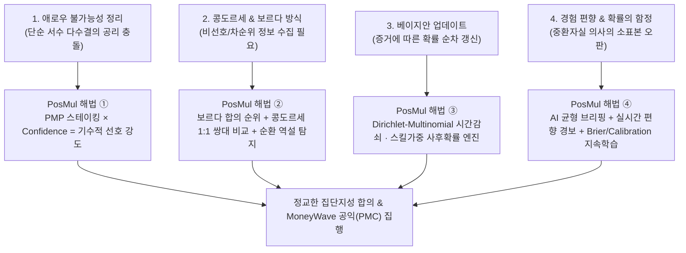

# 📊 PosMul 경제적 논거: 사회선택이론 · 베이지안 확률 판단 · 경험 편향 교정 아키텍처

> **참고 레퍼런스**: [[한순구의 노벨경제학 2부] 중환자실 의사는 왜 저축 안 할까? 내 경험이 판단을 망치는 '확률의 함정', 노벨 경제학상이 증명한 다수결의 함정 (연세대학교 경제학부 한순구 교수)](https://www.youtube.com/watch?v=XruQm-DF4GU)  
> **작성일**: 2026-11-11  
> **목적**: 대의제·단순 다수결 투표와 편향된 개인 경험이 낳는 사회적 의사결정의 실패를 경제학적으로 규명하고, **PosMul(Positive Multiplier)** 이 이를 코드와 알고리즘으로 어떻게 해결하는지 정의합니다.

---

## 1. 핵심 테제: 왜 PosMul은 '투표 사이트'가 아니라 '경제학 기반 집단지성 학습 시장'인가

한순구 교수의 노벨경제학상 강의가 던지는 핵심 통찰은 두 갈래로 수렴합니다.

1. **집단 차원의 한계 (사회선택의 불가능성)**: 단순 다수결(1인 1표 · 1순위만 기표)은 유권자의 **선호 강도(Intensity)** 와 **비선호(싫어하는 대안)** 정보를 버리기 때문에, 다수가 싫어하는 극단적 대안이 당선되거나 선호 순환이 발생하는 등 민의를 왜곡합니다.
2. **개인 차원의 한계 (확률적 판단과 경험의 편향)**: 인간은 새로운 사건을 접하며 **베이지안 업데이트(Bayesian Updating)** 로 세상을 판단하지만, 자신이 속한 환경의 편향된 표본(예: 매일 사고 환자만 보는 중환자실 의사 vs 건강한 사람만 보는 일반인)에 갇히면 업데이트를 거듭할수록 진실과 멀어지는 **확률의 함정**에 빠집니다.

**PosMul**의 존재 이유는 이 두 가지 구조적 결함을 **노벨경제학상 수상 이론(Arrow, Buchanan, Kahneman-Tversky, Markowitz-Sharpe)과 실시간 알고리즘**으로 동시에 교정하는 데 있습니다.

---

## 2. 4대 경제학 논거와 PosMul 알고리즘 설계

### 2.1 애로우의 불가능성 정리 (Arrow's Impossibility Theorem)

#### ① 경제학적 문제 제기
케네스 애로우(1972 노벨경제학상)는 3개 이상의 대안이 있을 때, 다음의 지극히 상식적인 조건을 **동시에 모두 만족하는 순위 기반(서수적) 투표 제도는 수학적으로 존재하지 않는다**고 증명했습니다.
- **완비성 & 이행성 (Rationality)**: $A \succ B$ 이고 $B \succ C$ 이면 $A \succ C$ 여야 함
- **파레토 효율성 (Pareto)**: 모두가 $A \succ B$ 라면 사회도 $A \succ B$ 를 선택
- **무관한 대안으로부터의 독립 (IIA)**: 제3의 후보 $C$ 가 출마/사퇴해도 $A$ 와 $B$ 의 우위가 뒤집히지 않아야 함
- **비독재성 (Non-dictatorship)**: 단 한 명의 의견이 전체 결정을 독점하지 않음

기존 인터넷 여론조사나 단순 다수결 투표는 **"가장 좋은 1개"라는 서수 정보만 수집할 뿐, "얼마나 확신하고 얼마나 절실히 원하는지(선호 강도)"를 측정하지 못하기 때문에** 사표, 전략적 투표, 제3후보에 의한 역전(Spoiler Effect)에 취약합니다.

#### ② PosMul의 경제학적 · 알고리즘적 해법
PosMul은 애로우의 정리의 전제 조건(서수 선호만 사용)을 벗어나, **경제적 비용(무위험 시드 `PMP`)과 확률적 확신도(`confidence`)를 결합한 기수적(Cardinal) 선호 강도**를 입력받습니다.

- **무위험 참여 자산(`PMP`) 설계**: 현금을 걸어야 하는 도박성 예측 시장(Polymarket 등)에서는 전망이론(Prospect Theory)의 손실 회피 때문에 일반 시민이 이탈해 자본 권력자의 독재(비독재성 훼손)가 발생합니다. PosMul은 포럼 학습·광고 시청으로 누구나 얻는 **무위험 자산 `PMP`** 로 참여 장벽을 제거하면서, 제한된 `PMP` 예산을 배분하는 기회비용을 통해 선호 강도를 정확히 추출합니다.
- **신호 강도 수식 (`collective-intelligence-engine.ts`)**:
  $$I_j = (0.5 + c_j) \cdot \ln\left(1 + \frac{\text{stake}_j}{250}\right) \cdot w_{\text{skill}, j}$$
  - $c_j \in [0.1, 0.99]$: 참여자가 명시한 확신도
  - $\ln(1 + \text{stake}_j / 250)$: 로그 스케일 스테이킹 강도 (고래 독점을 막고 소액 다수의 선호 강도를 보존)
  - $w_{\text{skill}, j} \in [0.65, 1.75]$: 과거 예측 정확도에서 학습된 예측자 가중치
- **사회후생함수 및 공공선택 연계**:
  - `UtilityFunctionEstimationService` (`economy`): Cobb-Douglas 효용함수와 **Atkinson 불평등 조정 사회후생함수($W = \sum U_i(x)(1 - \lambda \cdot \text{Gini})$)**, Rawls 차이 원칙, Sen 역량 접근을 통해 집계 효율성과 분배 형평성을 동시에 관리합니다.
  - `PublicChoiceEngine` (`economy`): 철의 삼각(Iron Triangle) 카르텔 및 지대추구(Rent-Seeking)를 탐지하고 중간 유권자 합의를 분석합니다.

---

### 2.2 콩도르세(Condorcet)와 보르다(Borda) 투표 방식

#### ① 경제학적 문제 제기
한순구 교수가 강조하듯, **"누가 1등으로 제일 인기가 많으냐"만 묻는 단순 다수결**은 유권자의 과반(예: 60%)이 극도로 싫어하는 후보가 나머지 표 분산 덕에 당선되는 치명적 왜곡을 일으킵니다. 이를 교정하는 대표적 메커니즘이 **콩도르세 방식**과 **보르다 카운트**입니다.

- **콩도르세 방식 (Condorcet Method)**: 모든 후보를 1대1로 맞붙여(쌍대 비교, Pairwise Comparison) 모든 가상 대결에서 과반으로 승리하는 **콩도르세 승자(Condorcet Winner)** 를 찾습니다. 단, $A \succ B \succ C \succ A$ 같은 **콩도르세 순환 역설(Condorcet Paradox)** 이 발생할 수 있습니다.
- **보르다 카운트 (Borda Count)**: 1순위부터 최하위 순위까지 전 구간(또는 **가장 싫어하는 비선호 옵션**까지) 점수를 부여해 총합을 계산합니다. "내가 싫어하는 후보"에 대한 정보가 포함되므로 사회적 갈등 비용을 최소화하는 **합의적 대안**을 찾아내는 데 탁월합니다.

#### ② PosMul의 알고리즘 구현 (`analyzeSocialChoiceAggregation`)
3지선다(`WIN_DRAW_LOSE`)와 다자 순위(`RANKING`) 예측에서 PosMul은 단순 볼륨 1위뿐 아니라 **보르다 합의 순위**와 **콩도르세 쌍대 비교 매트릭스**를 병렬 산출합니다.

1. **비선호(`avoidOptionId`) 및 선호 순위(`rankedOptionIds`) 수집**:
   - 참여 패널에서 기본 1순위 선택 외에 **선택적으로 "가장 피하고 싶은 최하위(비선호) 옵션"** 을 함께 기록할 수 있으며(`prediction_data` JSONB 저장), 기존 1순위만 선택한 경우에도 대안 수 $M$에 맞춘 중립 기대 점수를 공정 배분합니다.
2. **보르다 점수 합산**:
   - 1순위 $(M - 1)$점, 비선호 최하위 $0$점, 중간 미지정 대안은 잔여 평균 점수를 부여한 뒤 각 참여자의 기수적 강도 $I_j$를 곱해 $0 \sim 100$ 정규화 보르다 지수를 산출합니다.
3. **콩도르세 1:1 쌍대 비교 매트릭스 & 순환 역설 탐지**:
   - 모든 옵션 쌍 $(A, B)$에 대해 $A$가 $B$보다 앞선 가중치 비율 `aWinRate`을 계산합니다.
   - 모든 $(M - 1)$개 상대와 1:1 대결에서 승리한 옵션을 `condorcetWinnerId`로 지정하며, 승자가 없고 3중 순환($A \succ B \succ C \succ A$)이 존재할 경우 **`hasCondorcetCycle = true` 및 `arrowDivergenceAlert` 경보를 UI에 자동 표출**합니다.
   - 또한 **단순 볼륨 다수결 1위(`pluralityWinnerId`)** 와 **보르다·콩도르세 1위(`bordaWinnerId` / `condorcetWinnerId`)** 가 엇갈릴 때 사용자에게 다수결 왜곡 가능성을 즉시 경고합니다.

---

### 2.3 베이지안 업데이트(Bayesian Updating)와 확률적 판단

#### ① 경제학적 문제 제기
세상의 불확실성을 다룰 때 합리적 주체는 단편적 인상에 매몰되지 않고, **사전 확률(Prior) $P(H)$** 에 새로운 관측 증거 $E$의 우도를 반영해 **사후 확률(Posterior) $P(H \mid E)$** 을 순차적으로 갱신합니다.
$$P(H \mid E) = \frac{P(E \mid H) \cdot P(H)}{P(E)}$$

반면 기존 단순 집계(`해당 옵션 금액 / 전체 베팅 금액`)는 참여자가 1명뿐일 때 확률이 **100% : 0%** 으로 폭주하고, 한 달 전 낡은 판단과 방금 뉴스 보고 들어온 최신 판단을 동일하게 취급하며, 검증된 예측자와 초심자를 구분하지 못하는 치명적 약점을 가집니다.

#### ② PosMul의 순차 베이지안 엔진 (`computeBayesianMarketPosterior` & `computeBayesianPosteriorTimeline`)
PosMul은 **Dirichlet-Multinomial 켤레 사전분포(Conjugate Prior)** 를 채택해 시장 확률과 시계열 차트를 실시간 업데이트합니다.

$$\alpha_k^{(t)} = \alpha_k^{(0)} + \sum_{j \le t} \underbrace{\exp\!\left(-\frac{\ln 2 \cdot \Delta t_j}{T_{1/2}}\right)}_{\text{시간 감쇠 (반감기 14일)}} \cdot \underbrace{w_{\text{skill}, j}}_{\text{학습 숙련도}} \cdot \underbrace{(0.4 + 1.3 c_j)}_{\text{확신도}} \cdot \underbrace{\ln\!\left(1 + \frac{\text{stake}_j}{500}\right)}_{\text{로그 선호강도}} \cdot e_{j,k}$$

$$P_{\text{bayes}}(k \mid E_t) = \frac{\alpha_k^{(t)}}{\sum_{i=1}^{M} \alpha_i^{(t)}}$$

- **소표본 안정화**: 초기 사전 강도 $\alpha_0 = \sum \alpha_k^{(0)}$ (기본 `max(8, M × 4.5)`) 덕분에 첫 참여 1~2건으로 확률이 100%로 튀지 않으며, 증거가 축적될수록 자연스럽게 시장 컨센서스로 수렴합니다.
- **95% 신뢰구간 & Shannon 엔트로피**: Dirichlet 주변 분포 분산으로부터 각 옵션의 `credibleInterval` `[lower, upper]`을 계산하고, 정규화된 **Shannon Entropy** (`0` = 완전 합의, `1` = 완전 불확실)를 통해 현재 시장이 얼마나 충분한 합의에 도달했는지 시각화합니다.
- **비선호 신호 반영**: $M \ge 3$ 마켓에서 참여자가 `avoidOptionId`를 지정하면 증거의 15%를 비선호 대안을 제외한 나머지 옵션들에 재분배하여 사후확률에 '비토(Veto) 정보'를 통합합니다.
- **시계열 추이 차트 연동**: `getGameHistoryFallback` (`get-game-history.ts`) 에서도 스냅샷 미생성 구간을 단순 비율이 아닌 **순차 베이지안 사후확률 타임라인**으로 렌더링합니다.

---

### 2.4 경험의 편향(Experience Bias)과 지속적인 학습(Continuous Learning)

#### ① 경제학적 문제 제기 ("중환자실 의사는 왜 저축 안 할까?")
유튜브 강의 속 **중환자실 의사**는 매일 건강하던 사람이 돌연 사고나 질병으로 죽어 나가는 현장만 목격합니다. 의사는 나름대로 베이지안 업데이트를 수행했지만, **입력 표본 자체가 극단적으로 편향(가용성 편향 · 표본 선택 편향)** 되어 있기 때문에 *"내일 죽을 수도 있으니 저축은 무의미하다"* 는 왜곡된 결론에 도달합니다. 반대로 성형외과 의사나 상승장만 겪은 초보 투자자는 *"세상 모두가 젊고 부자가 된다"* 는 낙관/최근 편향에 빠집니다.

이 **경험 편향의 악순환**을 깨는 유일한 경제학적 해법은 두 가지입니다.
1. **반대 표본과 기저율(Base Rate)의 강제 노출**: 내 편향된 경험 밖의 데이터와 반대 논거를 의사결정 직전에 대면시키는 것.
2. **객관적 사후 피드백과 재교정(Calibration)**: 예측 결과(정답)가 판명된 뒤, 내가 "90% 확신했던 것들이 실제로는 60%만 맞았다"는 점을 수치(**Brier Score / Calibration Error**)로 확인하고 확률 판단 가중치를 교정하는 것.

#### ② PosMul의 3중 디바이어싱 & 폐루프 지속학습 아키텍처
1. **참여 전 — 확증 편향 해체 (`BalancedDecisionBriefing.tsx`)**:
   - 중립 팩트 · 찬성(YES) 논거 · 반대(NO) 논거 3개 탭을 모두 읽어야 `+20 PMP` 학습 보상을 지급함으로써, 참여자가 자신의 편향된 경험과 반대되는 증거를 반드시 읽도록 인센티브를 설계했습니다.
2. **참여 시점 — 실시간 경험 편향 코치 (`evaluateExperienceBias`)**:
   - 사용자가 선택한 옵션과 확신도(`confidence`)를 입력하면 즉시 3가지 편향 리스크를 계산해 경보합니다:
     - **과신 편향 (`overconfidenceRisk`)**: 시장 베이지안 확률이나 과거 본인 적중률 대비 확신도가 과도하게 높을 때
     - **군중 쏠림 · 최근 편향 (`herdingBiasRisk`)**: 최근 10건 단기 참여가 특정 옵션에 급격히 몰릴 때
     - **기저율 무시 · 소표본 경험 편향 (`baseRateNeglectRisk`)**: 전체 표본이 적은 상태에서 초기 기저율(`priorProbability`)과 크게 괴리된 극단 확신을 가질 때
3. **정산 후 — Brier Score · Calibration · Skill Weight 폐루프 학습 (`computeBrierLearningUpdate`, `summarizeUserLearningProfile`, `PredictionSettlementService.evaluateSettlementLearningMetrics`)**:
   - 공인 오라클(ECOS, KOSIS, KRX, DART, KOBIS 등)이 정답을 확정해 정산할 때, 멀티클래스 정규화 **Brier Score** ($\in [0, 1]$, 0이 완벽)와 **Log Loss**, **Calibration Gap** (`평균 확신도 - 실제 적중률`)을 산출합니다.
   - 초기 1~2회 우연한 적중으로 가중치가 급등하는 소표본 편향을 막기 위해 **경험적 베이즈 수축(Empirical Bayes Shrinkage: $\frac{n}{n+4}$)** 을 적용한 **EMA Skill Weight** (`0.65 ~ 1.75`)를 산출합니다.
   - 잘 교정되고 정확한 시민의 예측에는 다음 마켓의 베이지안 업데이트에서 더 높은 정보 신뢰도 가중치(`skillWeight`)가 부여되며, 과신 경향이 큰 경우 가중치 감쇠 및 UI 편향 경고가 작동해 **지속적인 자기 교정 학습**을 이끕니다.

---

## 3. PosMul 코드베이스 구현 매핑 표 (Implementation Audit & Mapping)

| 경제학 / 의사결정 원리 | 구현 상태 | 실제 구현 모듈 및 위치 | 핵심 역할 |
| :--- | :---: | :--- | :--- |
| **기수적 선호 강도 & 사회후생함수 (Arrow 대응)** | ✅ 구현 및 연동 | [`collective-intelligence-engine.ts`](../../apps/posmul-web/src/bounded-contexts/prediction/domain/services/collective-intelligence-engine.ts) [`utility-function-estimation.service.ts`](../../apps/posmul-web/src/bounded-contexts/economy/domain/services/utility-function-estimation.service.ts) [`public-choice-engine.service.ts`](../../apps/posmul-web/src/bounded-contexts/economy/domain/services/public-choice-engine.service.ts) | `PMP` 로그 스테이킹 × `confidence` 선호 강도 집적, Atkinson 불평등 조정 후생, 철의 삼각/지대추구 억제 |
| **콩도르세 쌍대 비교 & 보르다 카운트 (비선호 반영)** | ✅ 신규 구현·연동 | [`collective-intelligence-engine.ts`](../../apps/posmul-web/src/bounded-contexts/prediction/domain/services/collective-intelligence-engine.ts) (`analyzeSocialChoiceAggregation`) [`prediction.entity.ts`](../../apps/posmul-web/src/bounded-contexts/prediction/domain/entities/prediction.entity.ts), [`actions.ts`](../../apps/posmul-web/src/app/prediction/sports/soccer/[slug]/actions.ts), [`client.tsx`](../../apps/posmul-web/src/app/prediction/[slug]/client.tsx) | `avoidOptionId` / `rankedOptionIds` 저장, 보르다 합의 점수, 콩도르세 1:1 승률 매트릭스, 순환 역설·다수결 왜곡 경보 |
| **순차 베이지안 업데이트 & 엔트로피 불확실성** | ✅ 신규 구현·연동 | [`collective-intelligence-engine.ts`](../../apps/posmul-web/src/bounded-contexts/prediction/domain/services/collective-intelligence-engine.ts) (`computeBayesianMarketPosterior`, `computeBayesianPosteriorTimeline`) [`prediction-detail-by-slug.tsx`](../../apps/posmul-web/src/app/prediction/components/prediction-detail-by-slug.tsx), [`get-game-history.ts`](../../apps/posmul-web/src/bounded-contexts/prediction/infrastructure/repositories/get-game-history.ts) | Dirichlet-Multinomial 사후확률(시간감쇠+스킬+신뢰도), 95% 신뢰구간, Shannon 엔트로피, 시계열 추이 차트 폴백 |
| **경험 편향 탐지 & 지속적 Brier 학습 루프** | ✅ 신규 구현·연동 | [`BalancedDecisionBriefing.tsx`](../../apps/posmul-web/src/bounded-contexts/prediction/presentation/components/BalancedDecisionBriefing.tsx) [`collective-intelligence-engine.ts`](../../apps/posmul-web/src/bounded-contexts/prediction/domain/services/collective-intelligence-engine.ts) (`evaluateExperienceBias`, `computeBrierLearningUpdate`, `summarizeUserLearningProfile`) [`prediction-settlement.service.ts`](../../apps/posmul-web/src/bounded-contexts/prediction/application/services/prediction-settlement.service.ts) (`evaluateSettlementLearningMetrics`) | 참여 전 3단 균형 학습(+20 PMP), 참여 시 실시간 과신/군중/기저율 편향 코치, 정산 시 Brier Score · Calibration · EMA Skill Weight 환류 |
| **단위 테스트 검증** | ✅ 통과 | [`collective-intelligence-engine.test.ts`](../../apps/posmul-web/src/bounded-contexts/prediction/domain/services/__tests__/collective-intelligence-engine.test.ts) | 소표본 안정화, 시간감쇠/스킬 반영, 다수결-보르다 역전, 콩도르세 순환 역설, Brier EMA 학습 검증 |

---

## 4. 향후 발전 과제 (Roadmap Next)
1. **DB 영구 학습 테이블(`user_prediction_stats`, `behavioral_bias_profiles`) 배치 동기화**: 현재 상세페이지 진입 시 과거 정산 기록으로부터 실시간 산출하는 `UserLearningProfileSummary`를 정산 RPC 이후 백그라운드 워커로 DB 통계 테이블에도 영구 캐싱하여 리더보드(`/ranking`)에 "최고 교정 예측자(Best Calibrated)" 뱃지 노출.
2. **랭킹 다지선다 전체 드래그 순위표 UX**: 현재는 최선호(1순위) + 최하위 비선호(꼴찌)를 선택 입력받으며, 향후 다수 후보가 격돌하는 메가 의제에서 전체 순위 드래그(`rankedOptionIds`) 투표 모드 추가.
3. **아고라 포럼(`/api/forum/vote`) 보르다·콩도르세 확장**: 예산 감시 및 시민 제안 찬반을 넘어 3개 이상 대안 정책 토론에 보르다·콩도르세 합의 집계 적용.

