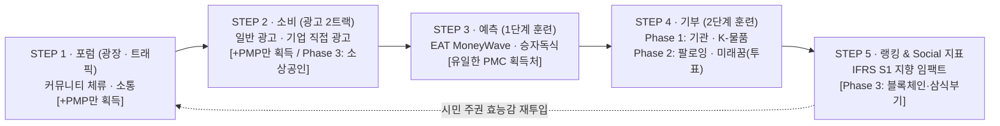

# 🌐 PosMul v2.0: AI 시대 시민 주권 & 소셜 임팩트 생태계 공식 소개서

> **"무위험 시민 참여(PMP)로 사회·경제 의제를 학습·예측하고, 적중 보상으로 획득한 공익 가치(PMC)를 시민이 직접 복지 현장과 지역 경제에 집행하는 직접민주주의 플랫폼"**
>
> 🔗 **공식 라이브 서비스**: [https://posmul.com](https://posmul.com)  
> 📅 **문서 버전**: Version 2.0 (2026. 11)
>
> ⚠️ **v3.0 정본 동기화 안내 (2026-11-12)**: 최신 기획 정본은 [POSMUL_WHITEPAPER.md](file:///c:/G/posmul/docs/POSMUL_WHITEPAPER.md) (v3.0) 및 [DOMAIN_FLOW_AND_DECISIONS.md](file:///c:/G/posmul/docs/DOMAIN_FLOW_AND_DECISIONS.md) 입니다. v3.0에서는 ① **`Consume`/`Forum` 직접 `PMC` 지급 폐기(오직 `PMP`만 지급)**, ② **`PMC`는 `Prediction` 예측 성공 시에만 유일하게 획득**, ③ **소상공인(`Minor League`)·`팔로잉 기부`·`미래꿈기부`는 Phase 2~3 순차 오픈**, ④ **`EBIT`가 아닌 세후 순이익(`EAT`) 기반 `MoneyWave`** 원칙이 확정되었습니다.

---

## 1. Executive Summary (핵심 요약)

**PosMul(Positive Multiplier, 긍정승수)**은 대의제 민주주의와 관료 중심 예산 집행이 가진 구조적 한계(**철의 삼각 카르텔**과 **대리인 비용**)를 기술과 행동경제학으로 해결하는 **AI 시대 직접민주주의 & 소셜 임팩트 플랫폼**입니다.

기존의 시민 참여 플랫폼들이 "의견만 내고 끝나는 무력감"에 머물렀고, 기존 기부 플랫폼들이 "내 기부금이 어디에 쓰였는지 모르는 불신"에 빠져 있었다면, **PosMul v2.0**은 **시민의 일상적 학습·소비·예측 활동을 실제 예산 집행권(PMC)으로 전환**하는 완벽한 5단계 선순환 플라이휠(Flywheel)을 구축했습니다.

---

## 2. 우리가 해결하는 3대 사회·경제적 문제 (The Problem)

### ① 정치·행정의 괴리와 시민 무력감 (Public Choice Failure)
- 시민은 세금을 내지만 실제 예산이 어디에 어떻게 쓰이는지 체감하기 어렵고, 관료-정치인-이익집단의 **철의 삼각(Iron Triangle)** 속에서 정책 결정으로부터 소외됩니다.
- 단순 청원이나 댓글 토론은 실질적 자원 배분 권한이 없어 지속적인 참여 동기를 부여하지 못합니다.

### ② 사회적 학습의 부재와 도박성 예측 시장의 한계 (Loss Aversion)
- 글로벌 예측 시장(Polymarket 등)은 집단지성의 정확성을 증명했지만, 참여자가 자신의 현금(위험 자산)을 직접 걸어야 하므로 **손실 회피 성향(Loss Aversion)** 때문에 일반 시민의 대중적 참여가 불가능하며 사행성 논란에 직면합니다.

### ③ 기부 생태계의 불투명성과 현금 누수 (Agency Problem)
- 기존 현금 기부는 복잡한 중간 전달 체계와 운영비 공제로 인해 실제 수혜자에게 도달하는 비율이 낮고, 기부자는 자신이 낸 돈이 어떤 물품으로 누구에게 전달되었는지 확인할 수 없습니다.

---

## 3. PosMul v2.0 핵심 솔루션: 듀얼 토큰 & 5단계 시민 플라이휠

PosMul v2.0은 노벨경제학상 수상 이론들을 결합하여 **무위험 참여 자산(`PMP`)**과 **실물 공익 가치 화폐(`PMC`)**를 분리 설계했습니다.

### 💎 듀얼 자산 아키텍처 (PMP vs PMC)

| 구분 | **PMP (PosMul Point)** | **PMC (PosMul Coin)** |
| :--- | :--- | :--- |
| **경제학적 성격** | **무위험 자산 (Risk-Free Asset, $R_f$)** | **위험·실물가치 자산 (Risky / Impact Asset)** |
| **핵심 역할** | 시민의 시간·숙의·참여를 기록하는 **예측 시드(Seed)** | 사회적 가치를 구매·기부·집행하는 **공익 실행 화폐** |
| **획득 경로** | 포럼 뉴스 학습, 예산 감시, 아고라 토론, 광고 시청 | 예측 마켓 적중 보상(`MoneyWave`), 지역 상생 소비, 펀딩 |
| **사용처** | 모든 예측 마켓(경제·스포츠·정책·문화) 베팅에 사용 | K-물품 직접기부, NGO 마일스톤 집행, 지역 상점 결제 |
| **핵심 철학** | **"원금 손실 공포 없이 누구나 사회 의제를 예측한다"** | **"정확한 집단지성이 더 큰 예산 집행권을 갖는다"** |

---

### 🔄 5단계 도메인 상세 소개 (Live on `posmul.com`)

#### STEP 1. 포럼 (`Forum · Public Agora`) — 공론과 숙의
* **경로**: [`https://posmul.com/forum`](https://posmul.com/forum)
* **핵심 기능**:
  - **공공 뉴스 & 이슈 갤러리**: 경제·재정·정책·사회 뉴스를 읽고 팩트 기반 의견을 작성하면 즉시 `+10 PMP` 지급.
  - **국가·지역 예산 감시 (`Budget`)**: 정부 및 지자체 예산안을 시민 눈높이에서 분석하고 낭비 요소를 감시.
  - **시민 아고라 (`Agora`)**: 브레인스토밍과 정책 토론을 통해 예측 마켓에 상정할 시민 의제를 발굴.

#### STEP 2. 소비 (`Consume · Value Exchange`) — 시간과 소비의 가치화
* **경로**: [`https://posmul.com/consume`](https://posmul.com/consume)
* **핵심 기능**:
  - **🎬 Major League (`TimeConsume`)**: 시민이 자신의 시선과 시간(공익·기업 캠페인 영상 시청 및 퀴즈·설문 응답)을 투입하여 무위험 자산 `PMP`를 획득. 기업의 광고비가 시민의 예측 시드와 `MoneyWave` 상금풀 재원으로 전환됩니다.
  - **🏪 Minor League (`MoneyConsume`)**: 골목상권·지역 상생 가맹점(카페, 음식점, 동네서점) 이용 시 결제액의 일부가 `PMC`로 적립되어 지역 내 부의 선순환을 창출.
  - **💡 Cloud Funding (`CloudConsume`)**: 친환경·사회적 기업·청년 스타트업 크라우드 펀딩 참여.

#### STEP 3. 예측 (`Prediction Market`) — 사회적 학습장과 집단지성
* **경로**: [`https://posmul.com/prediction`](https://posmul.com/prediction)
* **핵심 기능**:
  - 시민은 STEP 1·2에서 모은 무위험 자산 `PMP`를 걸고 미래의 사회·경제 이슈를 예측합니다. 내 지갑의 현금이 깎이지 않으므로 **전망이론(Prospect Theory)의 손실 회피 장벽이 사라져** 진지한 학습과 데이터 탐색이 일어납니다.
  - **6대 예측 도메인 및 공인 검증 데이터 연동**:
    1. **📈 경제 (`/prediction/economy`)**: 주식(`Alpha Vantage`, `KRX`), 기업 분기 실적(`DART`, `SEC`), 거시경제 지표(`KOSIS`, `FRED`), 암호화폐(`CoinGecko`).
    2. **💳 소비예측 (`/prediction/consume`)**: `TimeConsume` 캠페인, `MoneyConsume` 지역소비, `CloudConsume` 펀딩 달성률 예측.
    3. **⚽ 스포츠 (`/prediction/sports`)**: 축구(K리그, EPL, 챔스), 야구(KBO, MLB), 농구, e스포츠 공식 매치 결과 예측.
    4. **🎬 엔터테인먼트 (`/prediction/entertainment`)**: 영화 박스오피스(`KOBIS`), 드라마·예능 시청률(`닐슨코리아`), 음원 차트(`써클차트·빌보드`), 시상식 예측.
    5. **🗳️ 정치/선거 (`/prediction/politics`)**: 국가·지역 선거(`중앙선관위`) 및 국회 본회의 법안 통과(`국회 의안정보시스템`) 예측.
    6. **💡 시민 제안 (`/prediction/user-suggestions`)**: 시민 직접 발의, AI 공공뉴스 큐레이션, 오피니언 리더 제안 마켓.
  - **🌊 MoneyWave 3단 상금풀 엔진**:
    - 플랫폼에 축적된 기업 후원금·광고 재원·미소진 재원이 매시간(`Hourly Wave`) 각 예측 게임의 중요도와 참여 열기에 비례하여 자동 배분되며, 예측 적중 시 `PMP`가 실제 가치를 지닌 `PMC`로 전환됩니다.

#### STEP 4. 기부 (`Donation`) — 시민 직접 예산 집행 & K-물품 승수 모델
* **경로**: [`https://posmul.com/donation`](https://posmul.com/donation)
* **핵심 기능 (4대 임팩트 필러)**:
  1. **📦 K-물품 직접기부 & K-위시리스트 (`/donation/direct`, `/donation/direct/wishlist`)**:
     - 현금을 건네는 대신 **LG 휘센 고효율 에어컨, 삼성 건조기·세탁기, 부산 수제 아동 운동화, 한국산 간편식** 등 대한민국 기업의 우수 실물 제품을 직접 구매하여 보육원·독거어르신 쉼터·지역아동센터에 직배송합니다.
     - **영국식 Tied Aid & 수출 승수 효과**: 현금 유용(횡령·중간 수수료 누수)을 0%로 원천 차단할 뿐 아니라, 기부금이 곧바로 **국내 제조사의 매출과 고용으로 직결되는 경제 승수(Multiplier) 효과**를 만듭니다.
     - **수혜기관 직접 선택 & 인라인 스토리 검증**: 기부자가 물품을 고른 뒤 실제 물품을 기다리는 전국 복지시설의 사연·인가증·현장 사진을 페이지 이탈 없이 확인하고, **내가 원하는 시설을 콕 집어 소액(1,000 PMC~)부터 크라우드펀딩**할 수 있습니다.
  2. **🏛️ 마일스톤 검증 NGO (`/donation/institute`)**:
     - 기부금을 일시불로 주지 않고 **3단계(30% ➔ 40% ➔ 30%) 스마트 에스크로**로 분할하여, NGO가 현장 영수증과 사진을 증빙하고 시민이 투표로 승인해야 다음 단계 자금이 집행됩니다.
  3. **🌟 의인 포상 & 꿈의 사다리 (`/donation/opinion-leader`)**:
     - 우리 사회의 숨은 의인에게 소득세법 제18조 기반 비과세 공익 포상금을 수여하고, 자립준비청년에게 무이자 꿈 펀딩(성공 후 후배에게 되갚는 Pay-it-Forward)을 지원합니다.

#### STEP 5. 랭킹 & 투명회계 (`Ranking & Other`) — 풀뿌리 주권 위상 증명
* **경로**: [`https://posmul.com/ranking`](https://posmul.com/ranking) / [`https://posmul.com/other`](https://posmul.com/other)
* **핵심 기능**:
  - **예측 명사수 & 나눔 리더 전당**: 전국 ➔ 시도(서울, 경기, 부산 등) ➔ 시군구 ➔ 읍면동 단위로 시민의 예측 정확도와 공익 기여도를 증명합니다.
  - **영국식 Gift Aid & 투명 세무·회계**: 기부 내역에 대한 영수증 발급 및 세액공제 시뮬레이터를 제공하며 모든 `MoneyWave` 자금 흐름을 투명하게 공개합니다.

---

## 4. 학술적·경제학적 설계 기반 (Theoretical Backbone)

| 적용 이론 | 창시자 / 배경 | PosMul v2.0 구현 방식 |
| :--- | :--- | :--- |
| **자본자산가격결정모형 (CAPM)** | H. Markowitz, W. Sharpe (1990 노벨경제학상) | 무위험 수익률($R_f$) 자산인 `PMP`와 시장 위험 프리미엄 자산인 `PMC`를 분리하여 시민의 포트폴리오 전환 설계 |
| **전망 이론 (Prospect Theory)** | D. Kahneman, A. Tversky (2002 노벨경제학상) | 예측 실패 시에도 내 현금이 손실되지 않는 `PMP` 구조를 통해 시민의 손실 회피(Loss Aversion) 심리 장벽 완벽 제거 |
| **공공선택이론 (Public Choice)** | James M. Buchanan (1986 노벨경제학상) | 관료제의 예산 극대화 비효율을 막고, 예측으로 검증된 시민이 직접 기부·예산처(`K-위시리스트`)를 선택해 자원 배분 |
| **주인-대리인 이론 (Agency Theory)** | M. Jensen, W. Meckling | 현금 기부 대신 **K-물품 직배송** 및 **3단계 마일스톤 에스크로 투표**를 도입하여 대리인 비용(도덕적 해이)을 제로화 |
| **케인즈 승수 & 조건부 원조 (Tied Aid)** | J. M. Keynes / 영국 ODA 모델 | 복지 지원금이 해외 유출이나 중간 관리비로 새지 않고 100% 국내 제조업·소상공인 매출로 전환되는 긍정승수(Positive Multiplier) 실현 |

---

## 5. 비즈니스 모델 및 지속가능성 (Sustainability & Revenue Model)

PosMul은 정부 보조금에만 의존하지 않고 **민간 광고·ESG 기금·지역 상생 수수료가 결합된 자생적 수익 구조**를 가집니다.

1. **기업 ESG & 임팩트 스폰서십 (B2B)**:
   - 대기업 및 중견기업이 `Major League`에 브랜드·ESG 캠페인 영상을 집행하고, 해당 예산이 `MoneyWave` 상금풀로 유입됩니다. 기업은 단순 광고 노출을 넘어 **"우리 기업의 캠페인이 아동센터 에어컨 100대 지원으로 직결되었다"**는 검증된 ESG 임팩트 리포트를 확보합니다.
2. **K-제조사 B2B 공익 특판 파트너십 (Manufacturing Alliance)**:
   - 가전·식품·제화·생필품 등 국내 제조사가 PosMul `K-물품 카탈로그`에 공익 특판가로 입점하여 대량 판로를 확보하고, 절감된 유통 마진 일부가 플랫폼 운영 및 추가 기부 풀로 환원됩니다.
3. **지자체 시민참여예산 & 고향사랑기부제 SaaS (B2G)**:
   - 지자체가 주민참여예산 선정 및 지역 현안 여론 수렴을 위해 PosMul의 `Forum - Prediction - Donation` 모듈을 화이트라벨/SaaS 형태로 도입합니다.

---

## 6. 기술적 차별점 요약 (Technology Highlights v2.0)

* **AI 뉴스 기반 자동 예측 생성 & 공인 데이터 자동 정산**:
  - AI 파이프라인이 실시간 공공 뉴스·공시 데이터를 분석하여 예측 마켓을 자동 생성하고, `DART`, `KOSIS`, `Alpha Vantage`, `KOBIS` 등 공인 데이터 소스와 연동해 투명하게 정산합니다.
* **Domain-Driven Design (DDD) 멀티 스키마 아키텍처**:
  - `economy`, `prediction`, `donation`, `forum`, `consume`, `ranking` 등 9개 도메인이 코드 레벨뿐 아니라 PostgreSQL 데이터베이스 스키마 레벨에서도 완벽히 격리(Schema-per-Context)되어 금융급 데이터 정합성을 보장합니다.
* **3-Row Tone-on-Tone 시민 여정 UI**:
  - 상단 고정 3단 네비게이션이 시민의 5단계 여정(공론 ➔ 소비 ➔ 예측 ➔ 기부 ➔ 랭킹)과 도메인별 고유 컬러 톤을 일관되게 안내하여 복잡한 생태계를 직관적으로 탐색할 수 있습니다.

